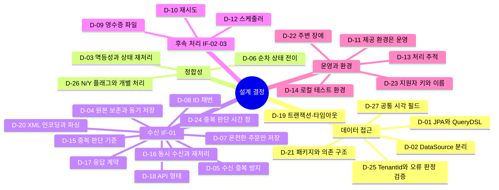
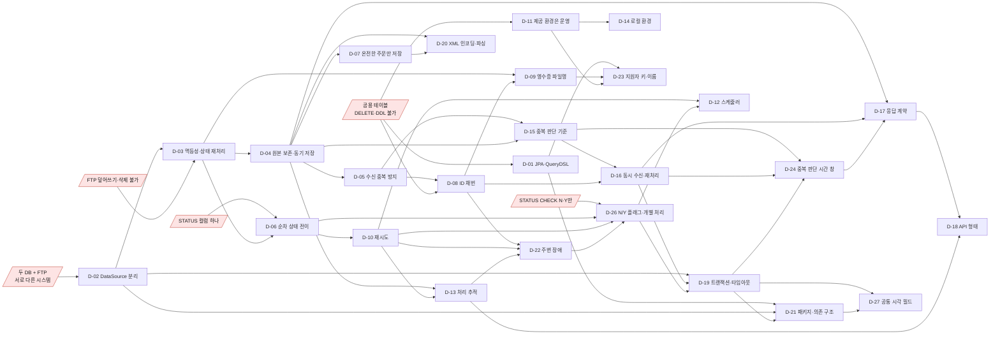
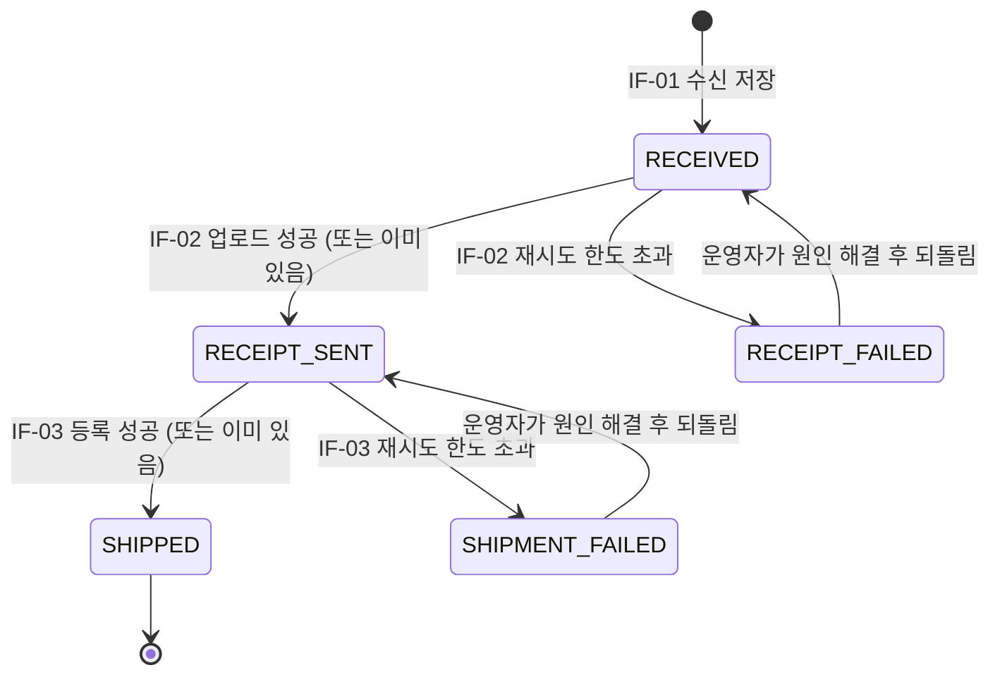

# 설계 결정 기록

요구사항은 [requirements.md](requirements.md), 현재 설계의 모습은 [design.md](design.md)를 참고한다. 이 문서는 설계 결정과 그 근거, 고르지 않은 대안을 결정한 순서대로 남긴다. 결정이 바뀌면 기존 기록을 지우지 않고 새 결정을 추가해 이유를 남긴다.

**근거 원칙:** 결정의 근거는 실무에서 일어날 수 있는 상황으로 설명한다. 시연 편의는 근거로 쓰지 않는다. 과제 환경의 제약(공용 계정, DELETE·DDL 권한 없음, FTP 권한)은 실제 고객사 환경에서도 흔한 제약으로 보고 따른다.

## 결정 요약 (발표용)

괄호 안 `D-xx 변경`·`D-xx 보완`은 이 결정이 앞 결정을 바꿨다는 뜻이고, `→ D-xx`는 뒤 결정이 이 결정을 바꾸거나 보완했다는 뜻이다. 자세한 내용은 각 결정의 상태 줄에 있다.

| # | 결정 | 한 줄 근거 | 고르지 않은 것 |
|---|---|---|---|
| D-01 | DB 접근은 JPA + QueryDSL | 공용 테이블에서 `APPLICANT_KEY` 조건 누락을 구조로 막는다 | Criteria API, Jakarta Data |
| D-02 | 쇼핑몰 DB와 운송회사 DB를 DataSource 둘로 분리 | 서로 다른 시스템을 연계한다는 EAI 구조를 코드에 드러낸다 | DataSource 하나 |
| D-03 | 정합성은 멱등성 + 상태 기반 재처리. 배송 번호는 미리 배정해 재시도에 재사용 (→ 2026-11-01 보완, D-26 변경) | 두 DB와 FTP는 한 트랜잭션으로 묶을 수 없다. 다시 해도 결과가 같게 만든다. 결과를 모르면 같은 식별자로 다시 시도한다 | 분산 트랜잭션(XA), 보상 트랜잭션 |
| D-04 | 수신은 원본 H2 보존 + 쇼핑몰 DB 동기 저장 (→ D-17 변경, D-20 보완, D-26 변경) | 작업 큐는 `ORDER_TB.STATUS` 한 곳, H2는 이력. 재시도는 송신자 몫 | Store-and-Forward |
| D-05 | 수신 중복은 메시지 ID + `ORDER_ID` 선채번으로 방지 (→ D-15·D-16 변경) | 재전송이 와도 같은 `ORDER_ID`를 써서 PK가 중복을 막는다 | 메시지 ID 헤더 필수 |
| D-06 | 영수증 → 배송 순차, 상태 5개 (→ D-22 보완, D-26 변경) | `STATUS` 컬럼이 하나라 독립 처리는 상태 9개와 동시 갱신 문제가 생긴다 | 독립 처리 |
| D-07 | 온전한 주문만 저장, 나머지는 사유와 함께 거부 | 잘못된 데이터는 입구에서 막는다. 고객 DB에 들어가면 지울 수 없다 | 메시지 전체 거부, 빈 값 저장 |
| D-08 | ID 채번은 H2 시퀀스, 시작 시 Oracle과 동기화 (→ D-17·D-22 보완) | 예약 번호까지 포함해 같은 번호를 두 번 주지 않는다. 단일 인스턴스 범위 | `ORDER_TB` 최댓값 + 1, TSID |
| D-09 | 영수증은 주문당 CSV 1개, 파일명 `영수증_{지원자명}_{ORDER_ID}.csv` (→ D-23 보완, D-26 변경) | 덮어쓰기·삭제가 안 되는 FTP에서 재시도해도 같은 이름이 나와야 "이미 올렸나"를 판단할 수 있다 | 파일명에 업로드 시각, TXT 영수증 |
| D-10 | 재시도는 연결 실패·건별 실패를 나누고, 건별 실패만 지수 백오프로 5회 (→ D-22 보완, 용어 변경, D-26 변경) | 상대 시스템 점검 때문에 멀쩡한 주문이 한꺼번에 실패 처리되지 않게 한다 | 고정 간격 재시도, 재처리 API |
| D-11 | 제공 Oracle·FTP는 운영 환경으로 취급. 시행착오는 로컬, 공용 환경에는 의도한 실행만 | DELETE·덮어쓰기가 안 되어 남긴 것이 그대로 평가 대상이 된다 | 제공 환경에서 개발·테스트 |
| D-12 | 스케줄러는 `fixedDelay` 30초, 주기당 100건, 오래된 순 (→ D-19 보완, D-26 변경) | 단일 인스턴스에서는 `fixedDelay`만으로 겹침이 없다. 주기는 가장 짧은 재시도 간격보다 짧게 | ShedLock, Quartz 클러스터, `SKIP LOCKED` |
| D-13 | 처리 추적은 H2 이력 3종(메시지, 주문 단계, 이벤트) + 읽기 전용 조회 API (→ D-15 변경, D-18·D-22 보완, D-26 변경, 2026-11-04 보완: 주문 목록은 `N`만) | 임베디드 H2는 앱 실행 중 외부에서 열 수 없다. 현재 상태는 Oracle `STATUS`가 기준 | 로그만, H2 웹 콘솔, 관리자 화면 |
| D-14 | 로컬은 Oracle Free·FTP 서버 컨테이너, 운영과 같은 권한으로 (→ D-26 보완) | 제공 환경에서는 실수를 지울 수 없으므로 차이를 로컬에서 먼저 드러낸다 | H2 Oracle 호환 모드 |
| D-15 | 수신 중복은 본문 해시만으로 판단(묶음 단위, 첫 수신부터 10분), 중복이면 200에 "이전 결과" 표시 (D-05 변경, → D-24 변경) | 송신자를 바꿀 수 없다는 전제에서 헤더 경로는 쓰는 곳이 없다. 표시는 송신자에게 아무것도 요구하지 않으면서 정상 재주문 유실을 드러낸다 | `Idempotency-Key` 헤더, 주문 단위 판단, "10분 뒤 재시도" 오류 응답 |
| D-16 | 수신은 메시지 키로 나눈 잠금 안에서 처리, 재처리는 미리 배정한 주문번호로 먼저 조회 (D-05 일부 변경) (→ D-19 보완, D-24 변경) | 메시지 키는 10분 뒤 같은 값이 다시 와서 유니크 제약을 걸 수 없다. 같은 키는 순서대로, 다른 키는 동시에 처리한다 | 메모리 처리 중 표시 + `409`, H2 보조 테이블, Redis, 운영자 확인만 |
| D-17 | 수신 응답 계약: `400` 고쳐서 보냄, `500` 문의, `503` 재전송, 응답 없음은 10분 안에 재전송. 오류 본문은 Problem Details. Oracle 오류는 연결·자원 계열만 `503`, 거절은 `500`. 본문이 상한을 넘으면 `413` (D-04 변경) (→ D-18 보완, D-24 변경, 2026-11-01 보완, 2026-11-04 보완(D-19), 2026-11-04 보완: DB 예외가 아닌 오류는 `INTERNAL_ERROR`) | 재전송으로 풀리는 오류만 재전송하게 한다. 송신자가 계약을 어겨도 서버 멱등성이 안전을 지킨다 | "그 외 = 재전송", 채번 소진 `503`, 자체 오류 형식 |
| D-18 | API 형태: `POST /orders`, `GET /tracking/...`. 성공은 `{ traceId, data, page }`, 오류는 Problem Details. 공통 필드는 팩토리와 예외 처리기에서만 채움 (→ D-26 보완: 재처리 API) | 공통 요소는 바깥, 엔드포인트별 필드는 `data`에 두어 재사용하고 실수를 막는다. 성공·실패는 HTTP 상태 코드로만 말한다 | 래핑 없음, `success`·`code`를 담는 래핑, 목록 두 겹 래핑, 쪽 번호 페이징, URL 버전 |
| D-19 | 트랜잭션 매니저 3개(`@Primary` 없음), H2 `WRITE_DELAY=0`, 기본값이 무한 대기인 곳에만 타임아웃. 재처리 PK 충돌은 다시 조회해 비교. 공용 계정이라 커넥션 풀은 작게(쇼핑몰 5 → 7(D-26), 운송 2), 풀 연결 대기 5초. 수신 본문 상한 1MB, 넘으면 저장 전에 `413` (D-16 보완, → D-21 일부 변경, → 2026-11-01 보완, → D-26 변경, D-27 보완, → 2026-11-04 보완) | 기본값 그대로면 이 앱에서 실제로 문제가 생기는 것만 정한다. 고장 나면 "느린" 게 아니라 "끝없이" 멈춘다 | 기본 매니저 지정, `ddl-auto=update`, Flyway, 커넥션 keepalive, ~~본문 크기 제한~~(→ 2026-11-04 보완에서 채택) |
| D-20 | 인코딩은 BOM → `Content-Type` charset → XML 선언 → 기본 EUC-KR. EUC-KR 계열은 MS949로 엄격 디코딩, 실패는 `400`. 맨 앞 선언만 지우고 감싸서 DOM으로, DOCTYPE 금지 (D-04 보완) | 송신자가 인코딩을 밝히지 않고 EUC-KR로 보낸다. 깨진 글자를 저장하면 지울 수 없으니 읽지 못하면 입구에서 거부한다 | UTF-8 먼저 시도하는 자동 감지, 대체 문자로 바꿔 저장, 모든 문자셋 허용, 깊이 무관 검색 |
| D-21 | 도메인별 패키지 + 포트와 어댑터(헥사고날). 앱 안에서는 정규 모델 `Order`만 다루고, 바깥 형식은 어댑터가 변환. 의존 규칙은 ArchUnit으로 강제 (D-19 일부 변경, → 2026-11-01 보완, D-26 보완, → 2026-11-04 보완: `retry` → `stage`, 주기 도구는 `cycle`, 흐름은 `…Facade`·DB 하나의 트랜잭션은 `…Service`) | 연계 앱에서 가장 자주 바뀌는 것은 업무 규칙이 아니라 연계 대상과 방식이다. 바뀌면 어댑터 하나만 고친다 | 계층 단위 패키지, 기능 패키지 안에 엔티티, DB별 `store` 패키지, 모든 서비스에 인터페이스 |
| D-22 | 주변 장애는 기존 경로로: 시작 동기화 실패는 기동 실패, H2 기록 없는 주문은 바로 `*_FAILED`, 우리 쪽 저장소 장애는 횟수 없이 주기 종료, 연결 실패 이벤트는 상태가 바뀔 때만. "주문 실패"는 "건별 실패"로 (D-08·D-10·D-13 보완) (→ D-26 변경) | 빈틈마다 새 장치를 만들지 않는다. 모르는 값은 지어내지 않고 사람에게 넘긴다 | 처음 채번할 때 동기화, 빈 수신일시로 영수증, 매 주기 이벤트 |
| D-23 | `APPLICANT_KEY`와 지원자 실명은 `config/`(Git 제외)에서 그대로 읽는다. 없으면 기동 실패. 다른 PC에는 `config/`를 복사 | 키는 접속 정보와 한 묶음인 환경 설정이고, 실명은 개인정보다. 과제 API 재호출 시 같은 응답임을 확인했다 | `application.yml`에 직접, 환경 변수 |
| D-24 | 중복 판단 시간 창은 완료된 메시지에만, 완료 후 1분. 실패(`400` 제외)·처리 중 메시지는 시간과 관계없이 이어서 처리 (D-15·D-16·D-17 변경) | 재전송과 새 주문의 처리가 갈리는 것은 완료된 메시지뿐이다. 실패한 메시지는 어느 쪽이든 "한 번 저장"이 맞다 | 모든 상태에 1분, 10분 유지, 첫 수신부터 세기 |
| D-25 | 로컬 검증 결과 반영: `APPLICANT_KEY`는 `@TenantId`로 강제(네이티브 SQL 금지), Oracle 오류는 원인 사슬 전체로 연결·자원 계열을 판정 (D-01·D-17 보완) | 실제 동작을 확인한 방법만 쓴다. 연결이 끊기면 롤백 예외가 원래 예외를 덮어써 예외 타입 하나로는 나눌 수 없다 | QueryDSL 공통 조건, Spring 예외 계층만으로 판정 |
| D-26 | `STATUS`는 연계 완료 플래그(`N` 진행 중, `Y` 영수증·배송 모두 완료). 영수증·배송은 따로 처리하고 단계별 진행은 H2에, `Y`는 마감 스케줄러가 씀. 스케줄러 스레드 3개, 운영자 재처리는 H2만 바꾸는 API (D-03·D-04·D-06·D-09·D-10·D-12·D-13·D-19·D-22 변경, D-14·D-18·D-21 보완) | 제공 DB의 CHECK 제약이 `N`·`Y`만 받는다. 상태 칸 하나라는 순차의 이유가 사라졌고, FTP 장애가 출고를 막지 않게 한다. `Y`는 지울 수 없는 Oracle에 남아 H2를 잃어도 끝난 주문을 다시 보지 않는다 | 순차 유지, `Y` = 배송 완료, 두 스케줄러가 서로 확인, H2만 사용, 스레드 1개, 주문별 잠금 |
| D-27 | H2 엔티티 모두에 공통 시각 필드 `CREATED_AT`·`UPDATED_AT`, 공통 클래스의 JPA 표준 콜백(`@PrePersist`·`@PreUpdate`)으로 채움. Oracle 엔티티는 제외 (D-19 보완) | "행이 언제 생기고 바뀌었나"를 모든 테이블에서 같은 이름으로 본다. 설정 없이 엔티티 매니저 3개에서 동작하고 이전 프로젝트와 같은 방식이다. 업무 시각과는 섞지 않는다 | Spring Data JPA Auditing, Hibernate `@CreationTimestamp`, Oracle 생성 시각 매핑 |

### 결정 지도

영역별로 묶으면 다음과 같다.



### 결정 사이의 연결

화살표는 "앞 결정 때문에 뒤 결정이 필요해졌다"는 뜻이다. 맨 왼쪽은 과제 환경의 제약이다.



## 결정 기록

### D-01. DB 접근: Spring Data JPA + QueryDSL (OpenFeign 포크)

- **상태:** 결정 (2026-10-30). **2026-11-01 D-25로 보완:** `@TenantId`가 복합 PK 구성 컬럼에서 동작함을 확인했다. `APPLICANT_KEY`는 `@TenantId`로 강제한다.
- **의존성:** `spring-boot-starter-data-jpa`, `io.github.openfeign.querydsl` (jpa 모듈 + annotation processor). 기존 `spring-boot-starter-jdbc`를 대체한다.

**배경.** 과제 DB는 지원자 공용 계정으로 보인다 (requirements §4.1). 모든 조회·수정에 `APPLICANT_KEY = 내 키` 조건이 들어가야 하는데, DELETE 권한이 없어서 실수로 남의 행을 건드리면 되돌릴 수 없다.
PPT는 "필요한 라이브러리만 이용"하라고 하므로, 라이브러리를 추가하는 이유를 여기 남긴다.

**근거.**

1. **`APPLICANT_KEY` 누락 방지 (가장 큰 이유).** 이 조건을 쿼리마다 손으로 넣지 않고 공통 조건이나 Repository 구조로 강제한다.
2. **타입 안정성.** QueryDSL이 생성한 Q클래스로 쿼리를 Java 코드로 쓴다. 컬럼명·타입 실수가 컴파일 오류로 드러난다.
3. **실무 표준.** 가장 흔한 조합이라 선택 이유를 설명하기 쉽다.
4. **포크를 쓰는 이유.** 원래 QueryDSL(`com.querydsl`)은 유지보수가 사실상 멈췄다. Spring Boot 4.1 / Hibernate 7 / Jakarta / Java 25에는 OpenFeign 포크가 맞는다.

**검토했지만 고르지 않은 것.**

| 후보 | 고르지 않은 이유 |
|---|---|
| JPA Criteria API + 정적 메타모델 | 표준이지만 코드가 길고 읽기 어렵다 |
| Hibernate 7 / Jakarta Data (`@Find`, `@HQL`) | 컴파일 시점 검증은 되지만 레퍼런스가 적다 |
| Spring Data 메서드 이름 쿼리 | 컴파일 시점 검증이 아니다. 단순 조회에는 함께 써도 된다 |

**지켜야 할 것.**

- `spring.jpa.hibernate.ddl-auto=none`. DDL 권한이 없고, Hibernate가 고객 테이블을 만들거나 바꾸면 안 된다.
- 복합 PK `ORDER_TB(ORDER_ID, APPLICANT_KEY)`, `SHIPMENT_TB(SHIPMENT_ID, APPLICANT_KEY)`는 `@IdClass` 또는 `@EmbeddedId`로 매핑한다.
- `APPLICANT_KEY` 자동 적용 후보: Hibernate `@TenantId`(discriminator 멀티테넌시) 또는 `@Filter`.
  `@TenantId`가 복합 PK 구성 컬럼에서 동작하는지는 **미검증**. 안 되면 QueryDSL 공통 조건으로 강제한다.

### D-02. DataSource 분리: 쇼핑몰 DB / 운송회사 DB

- **상태:** 결정 (2026-10-30). 구현 세션에는 아직 전달하지 않음.
- 접속 정보가 `ORDER_TB_CONN`과 `SHIPMENT_TB_CONN`으로 따로 주어진다. 지금은 같은 Oracle 인스턴스, 같은 계정이지만 시나리오상 서로 다른 시스템(쇼핑몰, 운송회사)이다.
- EAI는 서로 다른 시스템을 연계하는 것이 본업이므로, DataSource를 둘로 나눠 이 구조를 코드에 드러낸다.
- **결과:** 두 DB에 걸친 작업(IF-03 배송 연계)은 하나의 트랜잭션으로 묶이지 않는다 → 단계별 커밋, 멱등 처리, 상태 기반 재처리로 정합성을 맞춘다 (Q-06).

### D-03. 정합성 전략: 멱등성 + 상태 기반 재처리

- **상태:** 결정 (2026-10-30). **2026-11-01 보완:** 배송의 `SHIPMENT_ID`를 INSERT 전에 H2에 미리 배정하고 재시도에 재사용한다. 커밋 결과를 모를 때 중복 배송이 생기는 빈틈을 막는다. **2026-11-01 D-26으로 변경:** 단계를 마치면 `STATUS`가 아니라 H2에 그 단계의 완료를 적는다. 아래 "`STATUS` 갱신"·`STATUS=SHIPPED`·`SHIPMENT_FAILED`는 각각 "H2 완료 기록"·배송 완료·배송 `FAILED`로 읽는다. 대상은 `STATUS=N` 폴링 그대로다.
- 각 단계는 자기 DB에서 따로 커밋한다. 다시 실행해도 결과가 같도록(멱등) 만들고, 실패하면 `STATUS`를 보고 다시 처리한다.
  - 배송 등록: INSERT 전에 `SHIPMENT_TB`에 같은 `ORDER_ID`가 있는지 조회한다.
  - 영수증 업로드: 업로드 전에 FTP 목록에서 같은 파일이 있는지 확인한다 (파일명을 주문 단위로 결정적으로 만든다).
- **장애 시나리오: 배송 INSERT 커밋 후, `STATUS` 갱신 직전에 중단.** 다음 실행이 같은 주문을 다시 고른다 → `SHIPMENT_TB`에서 `APPLICANT_KEY` + `ORDER_ID`로 조회하면 이미 있음 → INSERT를 건너뛰고 `STATUS`만 갱신. 결과는 중단이 없었을 때와 같다.
  - `SHIPMENT_TB`에는 `ORDER_ID` 유일 제약이 없으므로 중복 방지는 이 조회가 책임진다. 같은 주문을 동시에 두 실행이 처리하지 않도록 스케줄러는 겹치지 않게 돈다.
  - FTP는 업로드 도중 끊기면 불완전한 파일이 남고, 삭제·덮어쓰기가 불가능하다. 목록의 파일 크기로 완전성을 확인하고, 불완전하면 새 이름(재시도 번호)으로 다시 올린다 → 파일명 규칙은 D-09.
- **보상 트랜잭션은 쓰지 않는다.** 이 흐름은 되돌리기가 아니라 앞으로 나아가는 재시도로 끝난다(영수증이 실패해도 주문을 취소하지 않는다). 게다가 DELETE 권한이 없고 `SHIPMENT_TB`에는 상태 컬럼이 없어서 되돌릴 수단도 없다.
- **후속 처리는 `ORDER_TB.STATUS` 폴링으로 이어간다 (Polling Consumer).** `STATUS`가 "아직 처리하지 않은 주문"을 가리키고, 스케줄러가 이를 조회해 처리한다.
  - 엄밀한 Transactional Outbox는 아니다. Outbox는 업무 데이터와 같은 DB, 같은 트랜잭션에 별도 메시지를 쓰는 패턴인데, 여기서는 업무 행 자체의 상태를 폴링한다.
  - Outbox 테이블을 이력 DB(H2)에 두면 `ORDER_TB` INSERT와 다른 DB가 되어 dual write 문제가 그대로 남는다.
  - FTP 업로드(IF-02)도 API 요청 안에서 바로 하지 않고 `STATUS` 폴링으로 처리한다 (D-09).

**2026-11-01 보완: 배송 번호를 미리 배정해 재시도에 재사용한다 (설계 검토 반영).**

- **문제:** 배송은 "`ORDER_ID`로 조회 → 없으면 새 `SHIPMENT_ID` 채번 → INSERT"였다. 커밋 중 응답 읽기 타임아웃(D-19)이 나면 우리는 포기하지만 Oracle 서버의 커밋은 멈추지 않는다.

| 시각 | 배송 스케줄러 | 운송 Oracle |
|---|---|---|
| 0초 | A017 조회 → 없음 → `B001` 채번 → INSERT → 커밋 요청 | 커밋 처리 중 (예: 아카이브 공간이 차서 멈춤) |
| 10초 | 응답 읽기 타임아웃 → 연결 실패로 주기 종료 (D-22) | 아직 커밋 전이라 행이 보이지 않음 |
| 30초 뒤 | 다음 주기: A017 조회 → 없음 → `B002` 채번 → INSERT | |
| 나중에 | | 공간을 비우면 `B001`, `B002` 둘 다 커밋 |

  - 번호가 달라 PK 충돌이 없고, `ORDER_ID` 유일 제약도 없어 DB가 막지 못한다. 같은 주문의 물건이 두 번 나간다. DELETE 권한이 없어 되돌릴 수 없다.
  - 위의 "조회로 중복을 막는다"는 앞 커밋이 끝났거나 실패했을 때만 성립한다. 커밋이 진행 중이면 조회에 보이지 않는다.
  - 수신은 주문번호를 미리 배정해 재사용하므로(D-05, D-16) 같은 상황에서 PK 충돌이 나고, 다시 조회해 "이미 저장됨"으로 끝난다(D-19). 영수증은 주문마다 파일명이 정해져 있다(D-09). 배송에만 이 장치가 없었다.

**배송 처리 순서.**

| 단계 | 처리 |
|---|---|
| ① 번호 배정 | H2 `ORDER_STAGE`(배송 단계)의 `ARTIFACT`에 번호가 없으면 채번해 기록한다. 채번과 기록은 한 H2 트랜잭션이다 (D-08과 같은 방식) |
| ② 기존 배송 조회 | `APPLICANT_KEY` + `ORDER_ID`로 조회한다. 있으면 INSERT 없이 `STATUS=SHIPPED` (지금과 같음) |
| ③ INSERT | 없으면 ①의 번호로 INSERT한다. 재시도해도 같은 번호다 |
| ④ PK 충돌 | 롤백 후 새 트랜잭션에서 그 번호로 다시 조회해 비교한다. `ORDER_ID`·`ITEM_ID`·`ADDRESS`가 같으면 앞 시도가 늦게 커밋된 것이므로 `STATUS=SHIPPED`. 다르면 원래 생길 수 없는 상태라 재시도 없이 `SHIPMENT_FAILED`, ERROR 로그와 이벤트를 남긴다 (D-19와 같은 규칙) |

- 위 시간표에서 30초 뒤 재시도도 `B001`로 INSERT한다. 앞 커밋이 아직 진행 중이면 Oracle은 같은 PK의 INSERT를 앞 트랜잭션이 끝날 때까지 기다리게 한다. 그사이 응답 읽기 타임아웃이 나면 연결 실패로 다음 주기에 다시 한다. 앞 커밋이 끝나면 PK 충돌 → ④에서 "이미 있음"으로 끝난다. 배송은 한 건이다.
- **원칙: 결과를 모르면 같은 식별자로 다시 시도해, 대상 시스템이 중복을 알아채게 한다.** 수신(주문번호), 영수증(파일명), 배송(`SHIPMENT_ID`)이 같은 원칙을 따른다.
- ④의 "다름"은 우리 시퀀스가 `SHIPMENT_TB`에 이미 쓴 번호보다 뒤처져야 생긴다. 기동 시 동기화(D-08)가 막으므로 처리 경로를 따로 만들지 않고 사람에게 넘긴다 (D-22).
- ②에서 찾은 배송의 번호가 ①과 다르면(예: H2를 옛 백업으로 되돌림) 찾은 번호를 `ARTIFACT`에 남긴다. 조회 API는 실제 배송 번호를 보여 줘야 한다.
- 미리 배정한 번호는 ②에서 기존 배송을 찾으면 쓰이지 않고 버려진다. 번호 공백은 중복보다 안전하다 (D-08).

**고르지 않은 것.**

| 방법 | 고르지 않은 이유 |
|---|---|
| 그대로 두고 받아들인 한계로 적기 | 결과가 되돌릴 수 없는 중복 배송이다. 막는 비용은 H2 컬럼 하나(`ARTIFACT`)와 PK 충돌 처리라 수신과 같은 코드 모양이다 |
| 커밋 결과 불명이면 바로 `SHIPMENT_FAILED` | 사람이 운송 DB를 직접 확인해야 하고, 확인 전에 되돌리면 같은 문제가 다시 생긴다 |
| 결과 불명이면 다음 시도를 오래 미루기 | 얼마나 기다려야 커밋이 끝나는지 알 수 없다. 기다리는 시간으로 막는 것은 보장이 아니다 |

### D-04. 수신 방식: 원본 보존 + 쇼핑몰 DB 동기 저장 (A')

- **상태:** 결정 (2026-10-30). **2026-10-31 D-17로 일부 변경:** 응답 계약 "그 외 = 저장 안 됨, 재전송하라"를 코드별 계약으로 바꾼다. **같은 날 D-20으로 보완:** 인코딩 판단 순서와 감싸기 방법을 정한다. **2026-11-01 D-26으로 변경:** `STATUS`는 N/Y만 받아 작업 큐 겸 진행 상태를 담을 수 없다. `STATUS`는 연계 완료 플래그, 단계별 진행은 H2 `ORDER_STAGE`가 맡는다.
- 주문 XML을 받으면 **원본을 이력 DB(H2)에 먼저 저장**하고, 파싱·변환 후 `ORDER_TB`에 **요청 안에서 바로(동기)** 저장한다. 응답은 "주문 저장 완료"를 뜻하고 채번된 `ORDER_ID`를 돌려준다.
- **이력 DB는 H2 파일 DB로 한다** (Q-01 해소). 수신 원본, 메시지 ID ↔ `ORDER_ID` 매핑, 단계별 처리 이력, 재시도 횟수를 둔다. 업무 DB 트랜잭션과 따로 돌기 때문에 업무 처리가 롤백돼도 실패 이력은 남는다.
- **작업 큐는 `ORDER_TB.STATUS` 하나다.** H2는 이력과 수신 중복 판단에만 쓰고, 후속 처리(IF-02, IF-03)는 `ORDER_TB.STATUS`를 폴링한다. 진행 상태가 두 곳으로 갈라지지 않게 하기 위해서다. → 2026-11-01 D-26: 대상은 여전히 `STATUS=N`이지만 단계별 진행은 H2 `ORDER_STAGE`에 둔다.
- **수신 재시도는 송신자 몫이다.** 응답 계약은 "200 = 저장됨, 그 외 = 저장 안 됨, 재전송하라"이다. 수신용 재처리 스케줄러는 두지 않는다.
  - 서버가 503을 응답해 놓고 나중에 스스로 저장하면 계약을 어기게 되고, 송신자의 재전송과 겹쳐 중복 위험이 생긴다 (해시 기반 중복 판단은 시간 창이 있으므로).
  - `ORDER_TB` 커밋 이후의 실패(H2 완료 기록 실패 등)는 200으로 응답한다. 업무 데이터는 저장됐고 이력은 최선 노력이다.
  - 응답 전에 중단되어 H2에 미완료로 남은 메시지는 송신자가 재전송하면 D-05에 따라 이어서 처리된다. 재전송이 없으면 미완료 상태로 이력에 남아 사람이 확인한다.
- **고르지 않은 것: Store-and-Forward (B).** H2에 먼저 넣고 "받았음"만 응답한 뒤 비동기로 `ORDER_TB`에 전달하는 방식. 쇼핑몰 DB 장애에 강하지만, IF-03의 소스가 쇼핑몰 DB로 명시되어 있어 상태가 H2와 `ORDER_TB` 두 곳에 생기고, 임베디드 H2가 보장 전달 저장소 역할까지 맡게 된다.
- **수신은 관대하게 받는다 (Tolerant Reader).** 인터페이스 정의서가 없고, 송신 시스템이 실제로 내보내는 형태는 샘플 XML(루트 없음, EUC-KR)뿐이다. EAI는 송신 시스템을 고치지 않고 받는 쪽에서 맞춘다. 레거시 시스템의 출력 형식은 연계를 위해 바꾸기 어려운 경우가 많다.
  - 인코딩: `Content-Type`의 charset을 따르고, 없으면 EUC-KR. → D-20에서 BOM·XML 선언까지 포함해 정함
  - XML 선언·루트 요소가 없어도 처리한다 (서버가 루트로 감싼다). → 감싸는 방법은 D-20

### D-05. 수신 중복 방지: 메시지 ID + `ORDER_ID` 선채번

> [!NOTE]
> 용어: 이 결정의 "메시지 ID"(헤더 값 또는 해시, D-15 이후에는 해시만)를 설계서에서는 **메시지 키**라 부르고, H2 내부 식별자(TSID)를 **메시지 ID**라 부른다 (design.md §4.2). 메시지 키는 유일하지 않기 때문이다.

- **상태:** 결정 (2026-10-30). Q-08 해소. **2026-10-31 D-15로 일부 변경:** `Idempotency-Key` 헤더 경로를 없애고 본문 해시만 쓴다. **같은 날 D-16으로 일부 변경:** 재처리 때 미리 배정한 번호의 행이 있으면 내용까지 같을 때만 완료로 본다.
- **문제:** 송신자가 응답을 못 받고 같은 XML을 재전송하면, `ORDER_ID`를 우리가 채번하므로 주문이 중복 저장된다. 원칙은 송신자가 주는 업무 키(주문번호)로 판단하는 것이지만 샘플 XML에는 없다.
- **메시지 ID:**
  - `Idempotency-Key` 헤더가 있으면 그 값을 쓴다 (기간 제한 없음).
  - 없으면 **본문 해시**(SHA-256)를 쓴다. 단, **짧은 시간 창(기본 10분, 설정값)** 안에서만 같은 메시지로 본다.
  - 헤더를 필수로 두지 않는 이유: 송신 시스템이 보내는 형태는 샘플 XML뿐이고 멱등 키가 없다. 연계 쪽에서 송신 시스템에 헤더 추가를 강제할 수 없다 (D-04 Tolerant Reader).
  - 시간 창을 두는 이유: 메시지에 주문번호도 주문 시각도 없어서, 같은 고객이 같은 상품을 나중에 다시 주문하면 본문이 바이트 단위로 같다. 기간 없이 해시로 막으면 정상 재주문이 영구히 버려진다. 전송 재시도는 보통 수 분 안에 오므로 그 범위만 같은 메시지로 본다.
  - 받아들인 위험: 시간 창이 지난 뒤 오는 재전송은 새 주문이 되고, 시간 창 안에 들어온 똑같은 정상 재주문은 중복으로 처리된다. 근본 해결은 송신자가 주문번호나 멱등 키를 보내는 것이다.
- **`ORDER_ID` 선채번:** `ORDER_TB`에 넣기 전에 `ORDER_ID`를 미리 채번해 H2에 "메시지 ID → `ORDER_ID` 목록"으로 기록한다 (채번 방식은 D-08). 재전송이 오면 같은 `ORDER_ID`를 재사용하므로, 어느 시점에 중단됐든 `ORDER_TB`의 PK가 중복을 막는다.
- **재시도 판단은 조회로 한다:** 미완료 메시지의 재전송이면, 예약된 `ORDER_ID`가 `ORDER_TB`에 이미 있는지 먼저 조회한다. 있으면 저장을 건너뛰고 완료 처리한다. **새 메시지인데 PK 충돌이 나면 "이미 처리됨"이 아니라 채번 오류로 보고 실패 처리한다.** 그래야 채번에 문제가 생겨도 다른 메시지의 주문이 조용히 사라지지 않는다.
- **한 메시지는 한 트랜잭션:** 메시지의 주문 전체를 `ORDER_TB`에 한 트랜잭션으로 넣는다. 일부만 저장된 상태가 생기지 않는다.

### D-06. 후속 처리 순서: 영수증 → 배송 순차, `STATUS` 상태 전이

- **상태:** 결정 (2026-10-30). Q-02 해소. **2026-10-31 D-22로 보완:** H2에 수신 기록이 없는 주문도 재시도 없이 `*_FAILED`가 된다. `*_FAILED`의 뜻이 "재시도 한도 초과"에서 "자동 처리를 멈추고 사람이 확인할 주문"으로 넓어진다. **2026-11-01 D-26으로 변경:** 제공 DB의 CHECK 제약(`STATUS IN ('N', 'Y')`) 때문에 상태 5개를 저장할 수 없다. 영수증과 배송은 따로 처리하고, 둘 다 끝나면 마감 스케줄러가 `Y`를 쓴다. 아래 순차·상태 5개는 그 전 기록이다.
- **결정:** 영수증(IF-02)이 끝난 주문만 배송(IF-03)한다. 업무 흐름은 "주문 → 결제 증빙(영수증) → 출고"로 본다.

**왜 이 결정이 필요했나.** `ORDER_TB`에 처리 상태를 담을 수 있는 칸은 `STATUS` 하나뿐이고 컬럼을 추가할 권한도 없다. 후속 작업은 둘(영수증, 배송)인데, 각 스케줄러는 `STATUS`로 "내가 처리할 주문"을 찾는다. 따라서 두 작업의 관계를 먼저 정해야 `STATUS` 값을 설계할 수 있다. PPT는 두 작업의 관계를 정하지 않았다.

**고르지 않은 것: 독립 처리.**

| | 순차 (채택) | 독립 |
|---|---|---|
| 상태 수 | 5개, 한 줄로 이어짐 | 영수증 3 × 배송 3 = 9개 조합 |
| 스케줄러 조회 조건 | 상태 값 하나 | 상태 값 여러 개 |
| 동시 수정 | 두 스케줄러가 서로 다른 상태의 주문만 건드림 | 같은 주문을 동시에 갱신하면 한쪽 완료 사실이 덮어써짐(lost update) → 조건부 갱신과 재시도 필요 |
| FTP 장애 시 | 배송도 대기 | 배송은 계속 진행 |

**받아들인 트레이드오프.** (→ 2026-11-01 D-26에서 없어짐: 영수증과 배송을 따로 처리한다.) FTP 장애나 영수증 실패가 배송을 막는다. 대신 실패는 `RECEIPT_FAILED` 상태와 H2 이력으로 즉시 드러나고, 원인을 해결한 뒤 상태를 되돌리면 이어서 처리된다.

**상태 값.**

| 값 | 의미 | 다음에 처리하는 쪽 |
|---|---|---|
| `RECEIVED` | 주문 저장됨, 영수증 대기 | IF-02 영수증 스케줄러 |
| `RECEIPT_SENT` | 영수증 업로드됨, 배송 대기 | IF-03 배송 스케줄러 |
| `SHIPPED` | 배송 등록됨, 처리 완료 | — |
| `RECEIPT_FAILED` | 영수증 재시도 한도 초과 | 운영자 |
| `SHIPMENT_FAILED` | 배송 재시도 한도 초과 | 운영자 |



**상태 전이 규칙.**

| 현재 | 사건 | 다음 | 주체 |
|---|---|---|---|
| (없음) | 수신 저장 | `RECEIVED` | IF-01 |
| `RECEIVED` | 업로드 성공, 또는 같은 파일이 이미 있음 | `RECEIPT_SENT` | IF-02 |
| `RECEIVED` | 업로드 실패, 한도 미만 | `RECEIVED` 유지 (H2에 횟수 기록) | IF-02 |
| `RECEIVED` | 업로드 실패, 한도 초과 | `RECEIPT_FAILED` | IF-02 |
| `RECEIPT_SENT` | 등록 성공, 또는 같은 `ORDER_ID` 배송이 이미 있음 | `SHIPPED` | IF-03 |
| `RECEIPT_SENT` | 등록 실패, 한도 미만 | `RECEIPT_SENT` 유지 (H2에 횟수 기록) | IF-03 |
| `RECEIPT_SENT` | 등록 실패, 한도 초과 | `SHIPMENT_FAILED` | IF-03 |
| `RECEIPT_FAILED` | 운영자가 원인 해결 | `RECEIVED` | 운영자 (UPDATE 권한 있음) |
| `SHIPMENT_FAILED` | 운영자가 원인 해결 | `RECEIPT_SENT` | 운영자 |

- 상태 갱신은 항상 **조건부**로 한다: `UPDATE ... SET STATUS = 다음 WHERE APPLICANT_KEY = 내 키 AND ORDER_ID = ? AND STATUS = 현재`. 순차 구조라 동시 수정은 없지만, 예상과 다른 상태면 갱신하지 않고 이력에 남긴다.
- 재시도 한도와 간격, 운영자가 되돌릴 때 재시도 횟수를 초기화하는 방법은 D-10을 따른다.

### D-07. 수신 검증: 온전한 주문만 저장 (부분 수용)

- **상태:** 결정 (2026-10-30). Q-03 해소. **2026-11-01 확인 반영:** 길이 단위는 바이트, DB 문자셋은 `AL32UTF8`이다 (아래 검증 규칙).
- **원칙:** HEADER와 ITEM이 모두 있고 검증을 통과한 주문만 `ORDER_TB`에 저장한다. 나머지는 거부하고, 거부한 사실과 사유를 응답과 H2 이력에 남긴다. 잘못된 데이터는 입구에서 막는다.
- **판단 단위는 전송 단위(메시지)가 아니라 업무 단위(주문)다.** 주문 1건 = `ORDER_TB` 1행 = 영수증 1장 = 배송 1건이다. 수신 메시지는 **항상 주문의 묶음**으로 본다. 단일 주문은 1건짜리 묶음이다. 처리 경로는 하나다: 메시지 → 주문 목록 → 주문마다 검증·저장.
- **샘플 기준 결과:** 정상 63건 저장, HEADER 없는 ITEM 7건 거부, ITEM 없는 HEADER 4건은 저장할 주문이 없으므로 경고만 남긴다.
- **검증 규칙:**
  - `USER_ID`, `ITEM_ID` 필수
  - `USER_ID`로 연결되는 HEADER가 있어야 함 (`NAME`, `ADDRESS` 확보)
  - `PRICE`는 숫자
  - 값 길이는 바이트 기준 100 이하 (`VARCHAR2(100)`의 길이 단위는 접속 후 확인) → 2026-11-01 확인: `VARCHAR2(100 BYTE)`이고 DB 문자셋이 `AL32UTF8`이라 UTF-8 바이트로 센다. 한글은 한 글자 3바이트라 약 33자까지다 (design §11.1)
  - 같은 `USER_ID`의 HEADER가 둘 이상이면 그 사용자의 ITEM은 거부
- **응답:** 거부 건은 다시 보내도 또 거부되므로 실패 응답으로 재전송을 유도하지 않는다. `200`과 함께 저장·거부·경고 건수와 목록을 돌려준다. 이 결과는 H2에 저장해 재전송 시 그대로 돌려준다 (D-05).
- **고르지 않은 것:**

| 방법 | 고르지 않은 이유 |
|---|---|
| 메시지 전체 거부 | 불량 1건 때문에 정상 주문까지 버린다. 송신자가 같은 메시지를 다시 보내도 또 거부되므로 정상 주문이 영영 들어오지 못한다 (poison message) |
| 빈 값으로 저장 | 불량 데이터가 고객 DB에 들어가 배송 단계에서야 실패한다. DELETE 권한이 없어 지울 수도 없다 |
| HEADER가 올 때까지 보류 | 나눠 보내는 송신 규칙이 있다는 근거가 없다 |

### D-08. ID 채번: H2 시퀀스 + 시작 시 Oracle 최댓값과 동기화

- **상태:** 결정 (2026-10-30). Q-04 해소. **2026-10-31 D-17로 보완:** 채번 소진은 `500` + `ORDER_ID_EXHAUSTED`로 응답한다. **같은 날 D-22로 보완:** 시작 시 동기화가 실패하면 기동 실패. 동기화는 새로 받은 코드나 다른 PC 실행에서도 필요하다.
- **채번이란:** 새 데이터에 고유 번호를 발급하는 일. 주문 XML에 `ORDER_ID`가 없으므로 우리가 발급해야 `ORDER_TB`에 저장할 수 있다. 이 번호로 영수증 파일명, 배송 연결, 상태 갱신, 이력 추적, 수신 중복 방지가 이뤄진다.
- **제약:**
  - 형식은 PPT에 정해진 대로 대문자 1자 + 숫자 3자리 (`A001`~`Z999`, 약 2만 6천 개). 컬럼은 `VARCHAR2(100)`이지만 요구사항이므로 지킨다.
  - 유일해야 하는 범위는 내 `APPLICANT_KEY` 안이다 (복합 PK).
  - DELETE가 안 되므로 테스트로 쓴 번호도 영구 소진된다. DDL이 안 되므로 Oracle 시퀀스는 만들 수 없다.
- **핵심 요구: 같은 번호를 두 번 주지 않는다.** D-05는 `ORDER_TB`에 넣기 전에 번호를 예약하므로, `ORDER_TB` 최댓값만 보고 채번하면 아직 저장 안 된 예약 번호를 다른 메시지에 또 줄 수 있다.
- **방식:**
  - H2에 시퀀스를 두고, 번호 발급과 "메시지 ID → `ORDER_ID` 목록" 기록을 같은 H2 트랜잭션에서 한다. 예약된 번호는 다시 나가지 않는다.
  - 앱 시작 시 시작점을 `max(H2 시퀀스 값, ORDER_TB에서 내 최댓값 + 1)`로 맞춘다. H2 파일이 새로 생겨도 이미 쓴 번호를 다시 주지 않는다.
  - 형식이 고정 길이라 문자열 정렬이 곧 번호 순서다 (`A999` 다음은 `B001`). `MAX()`를 그대로 쓸 수 있다.
  - 예약 후 저장되지 않은 번호는 버려진다. 번호 공백은 중복보다 안전하다.
  - `Z999`를 넘으면 수신을 거부하고 이력에 남긴다.
  - `SHIPMENT_ID`도 같은 방식이고 시퀀스는 따로 둔다. 시작점은 `SHIPMENT_TB`와 맞춘다. 배송은 같은 `ORDER_ID` 배송이 없을 때만 새 번호를 받는다 (D-03). → 2026-11-01 D-03 보완: 배송 번호는 INSERT 전에 H2(`ORDER_STAGE.ARTIFACT`)에 미리 배정하고 재시도에 재사용한다.

**시퀀스란.** DB가 제공하는 번호 발급기다. 호출할 때마다 겹치지 않는 다음 정수를 준다.

```sql
CREATE SEQUENCE ORDER_SEQ START WITH 1;
SELECT NEXT VALUE FOR ORDER_SEQ;  -- 1, 다음 호출은 2, 3, ...
```

- 동시에 호출해도 같은 번호를 주지 않는다. DB가 원자적으로 보장한다. `MAX() + 1`은 두 요청이 같은 최댓값을 읽으면 같은 번호를 만든다.
- 한 번 나간 번호는 되돌리지 않는다. 저장이 실패해도 그 번호는 다시 나가지 않으므로 공백은 생겨도 중복은 생기지 않는다.
- 정수를 4자 형식으로 바꾼다: 앞 글자 = `'A' + (n - 1) / 999`, 숫자 = `(n - 1) % 999 + 1`. 1 → `A001`, 999 → `A999`, 1000 → `B001`, 25974 → `Z999`.

**왜 시작할 때 Oracle을 조회하는 구조가 되었나.**

번호 발급기와 번호를 실제로 쓰는 곳이 서로 다른 DB에 있기 때문이다.

| | 이상적인 구조 | 이 과제의 구조 |
|---|---|---|
| 번호 발급 | Oracle 시퀀스 | H2 시퀀스 (Oracle에는 DDL 권한이 없어 만들 수 없다) |
| 번호 사용 | Oracle `ORDER_TB` | Oracle `ORDER_TB` |
| 둘의 관계 | 같은 DB라 항상 일치 | 다른 DB라 어긋날 수 있다 |

- **어긋나는 경우:** H2는 앱에 딸린 파일 DB라 지워지거나 새로 만들어질 수 있다. 그러면 시퀀스는 1부터 다시 시작한다. 하지만 Oracle `ORDER_TB`에는 이미 쓴 번호가 그대로 남아 있다 (DELETE 불가). 그대로 두면 이미 쓴 번호를 또 준다.
- **보정:** "어떤 번호를 썼는가"의 진실은 지울 수 없는 Oracle `ORDER_TB`에 있다. H2 시퀀스는 "다음 번호"를 빠르고 안전하게 주기 위한 발급기일 뿐이다. 그래서 앱 시작 시 한 번 Oracle에서 내 최댓값을 조회해, 시퀀스가 그보다 뒤에 있으면 앞으로 당긴다.

```
ORDER_TB에서 내 최댓값 → A063 (= 63)
H2 시퀀스 현재 값     → 1 (H2가 초기화된 경우)
→ 시퀀스를 64부터 시작하도록 맞춘다
```

- 평소에는 시퀀스가 이미 앞서 있어서 아무 일도 일어나지 않는다. H2가 초기화된 경우에만 동작하는 안전장치다.
- **매번 Oracle을 조회하지 않는 이유:** 예약만 되고 아직 저장되지 않은 번호는 Oracle에 없다. 그래서 요청마다 Oracle 최댓값으로 채번하면 같은 번호를 두 번 줄 수 있다. 시작 시 보정은 "H2가 기억을 잃은 경우"만 메우고, 평소 발급은 시퀀스가 맡는다.
- `SHIPMENT_ID`도 같은 이유로 `SHIPMENT_TB` 최댓값과 맞춘다.

- **H2 내부 키**(메시지 ID, 이력 ID 등)는 형식 제약이 없으므로 TSID를 쓴다.
- **고르지 않은 것:**

| 방법 | 고르지 않은 이유 |
|---|---|
| `ORDER_TB` 최댓값 + 1 | 예약만 되고 저장 전인 번호를 못 봐서 같은 번호를 두 번 줄 수 있다 |
| Oracle 시퀀스 | DDL 권한이 없다 |
| 무작위 번호 + 충돌 확인 | 공간이 2만 6천 개뿐이라 찰수록 충돌이 잦다 |
| TSID를 `ORDER_ID`로 | 13자라 PPT의 4자 형식에 맞지 않는다 |

- **설계 범위: 단일 인스턴스.** 임베디드 H2, H2 시퀀스, 수신 중복 판단, 스케줄러가 모두 앱 하나가 도는 것을 전제한다. 쇼핑몰 한 곳의 주문을 연계하는 앱이고 처리량·가용성 요구가 주어지지 않았다. Oracle에 테이블을 만들 수 없어 이력 저장소로 임베디드 H2를 고른 시점(D-04)에 이 전제가 생겼다. 요구가 생기면 H2를 공유 DB로 바꾸는 것이 확장의 출발점이다.

### D-09. 영수증 파일(IF-02): 주문당 CSV 1개, 결정적 파일명

- **상태:** 결정 (2026-10-30). Q-05 해소. **2026-10-31 보완 (Q-15):** UTF-8에 BOM을 붙이고, 형식 세부는 설계서 §5.2에 둔다. **같은 날 D-23으로 보완:** 지원자명은 `config/bootstrap.properties`에서 읽는다. **2026-11-01 D-26으로 변경:** 대상은 `STATUS=N`이고 영수증이 끝나지 않은 주문이다. "`STATUS`만 갱신"은 "H2에 영수증 완료만 기록"으로 읽는다. **2026-11-01 확인 반영:** 한글 파일명은 UTF-8, 연결은 평문 FTP다 (아래 "미검증" 단락). **2026-11-04 보완:** `=` `+` `-` `@` 탭·CR로 시작하는 값은 앞에 `'`를 붙여 엑셀 수식 실행을 막는다 (아래 "내용" 단락).
- **시점:** `STATUS=RECEIVED` 폴링으로 올린다 (D-03, D-06). 수신 API 요청 안에서 올리지 않는다. FTP 장애가 주문 수신 실패로 번지지 않게 하기 위해서다 (D-04의 응답 계약).
- **FTP 제약:** 목록 조회와 신규 업로드만 된다. 덮어쓰기·이름 변경·삭제가 안 되므로 **한 번 올린 파일은 고칠 수 없다.** 파일명에는 지원자 이름(한글)이 들어가야 한다. 업로드 경로는 다른 지원자와 함께 쓰는 공용 폴더로 보인다.

**파일명.**

```
영수증_{지원자명}_{ORDER_ID}.csv          예) 영수증_홍길동_A001.csv
반쪽 파일 뒤 재업로드: 영수증_{지원자명}_{ORDER_ID}_r{N}.csv   예) 영수증_홍길동_A001_r1.csv
```

- **재시도해도 바뀌지 않는 값만 넣는다.** 파일명은 "이미 올렸나"를 판단하는 열쇠다 (D-03). 업로드 성공 후 `STATUS` 갱신 전에 중단되면 다음 주기에 같은 주문을 다시 처리하는데, 이때 같은 이름이 나와야 목록에서 찾아 건너뛸 수 있다.
- **유일성은 `ORDER_ID`가 보장한다.** `ORDER_ID`는 다시 발급되지 않는다: `ORDER_TB`에 DELETE 권한이 없고, H2가 초기화돼도 시작 시 Oracle 최댓값 뒤부터 발급하며, `Z999`를 넘으면 수신을 거부한다 (D-08). 지원자명은 공용 폴더에서 다른 지원자의 파일과 구분한다.
- **날짜·시각은 넣지 않는다.** 유일성에 보태는 것이 없다. 특히 업로드 시각을 넣으면 재시도 때 이름이 바뀐다 (예: 23:59에 업로드 성공 후 중단 → 00:01 재시도는 다음 날짜로 이름을 만들어 목록에서 못 찾고 한 번 더 올린다). 업로드 시각은 FTP 목록에 나오고, 수신일시는 파일 내용에 넣는다.
- 앞부분(`영수증_{지원자명}_`)이 고정이라 목록이 `ORDER_ID` 순으로 정렬되고, 재업로드 파일(`_r1`)이 원래 파일 바로 옆에 보인다.

**내용.**

- CSV, 헤더 1줄 + 데이터 1줄. 사람도 읽고 엑셀·회계 시스템도 바로 읽는다.
- 항목: `ORDER_ID`, `USER_ID`, `NAME`, `ITEM_ID`, `ITEM_NAME`, `PRICE`, 수신일시.
- **내용도 결정적으로 만든다.** `ORDER_TB`와 H2에 저장된 값만 쓰고 "파일 생성 시각" 같은 값은 넣지 않는다. 그래야 올라가 있어야 할 파일 크기를 미리 계산해 비교할 수 있다.
- 인코딩은 UTF-8을 기본으로 하고 설정으로 바꿀 수 있게 한다. 받는 쪽(회계)의 인코딩이 정해져 있지 않다.
- **2026-10-31 보완 (Q-15):** 형식 세부(헤더명, 수신일시 형식, 줄바꿈, 이스케이프)는 [설계서 §5.2](design.md)에 둔다. 판단이 들어간 것은 BOM 하나다. **UTF-8에 BOM을 붙인다.** 없으면 한국어 엑셀이 CP949로 읽어 한글이 깨진다. 나머지는 CSV 표준(RFC 4180)과 엑셀 기본 동작을 따른다.
- **2026-11-04 보완 (수식 무력화):** `USER_ID`·`NAME`·`ITEM_ID`·`ITEM_NAME`은 쇼핑몰이 보낸 외부 입력이 그대로 들어가고, 파일은 회계 담당자가 엑셀로 연다. `=HYPERLINK(...)` 같은 값이 수식으로 실행되지 않게 OWASP 권고를 따른다: `=` `+` `-` `@` 탭·CR로 시작하는 값은 앞에 `'`를 붙이고 큰따옴표로 감싼다. 거부하지 않는 것은 "-10% 할인 쿠폰" 같은 정상 값의 주문을 막지 않기 위해서다. 대가로 그런 드문 값은 파일에 `'`가 남는다. 규칙은 모든 칸에 같이 쓰고, 우리가 만드는 값(`ORDER_ID`, `PRICE`, 수신일시)은 해당하지 않는다. 보통 값은 바이트가 그대로라 예상 크기도 같다. 이 보완 전에 올렸지만 완료 기록 전인 주문에 해당 값이 있으면 크기가 달라 `_r1`로 한 번 더 올라가고, 정본 규칙에 따라 무력화된 새 파일이 정본이 된다.

**업로드와 완전성 확인.**

- 바이너리 모드로 전송한다. ASCII 모드는 줄바꿈을 바꿔 크기가 달라진다.
- FTP에는 트랜잭션이 없어서 업로드 도중 끊기면 반쪽 파일이 남고, 지울 수도 덮어쓸 수도 없다.

```
FTP 목록에서 이 주문의 파일(기본 이름과 _rN)을 찾는다
├─ 없음                          → 기본 이름으로 업로드
├─ 가장 큰 번호의 파일 크기가 맞음 → 이미 완료. 업로드하지 않고 STATUS만 갱신
└─ 가장 큰 번호의 파일 크기가 다름 → 반쪽 파일. 다음 번호(_r{N+1})로 업로드
```

- 반쪽 파일과 재업로드 이름은 H2 이력에 남긴다. 회계팀에는 "같은 주문은 재시도 번호가 가장 큰 파일이 정본"이라는 규칙으로 안내한다.
- 재업로드도 재시도 횟수에 포함한다. 한도는 D-10을 따른다.

**미검증: 한글 파일명 인코딩.** (→ 2026-11-01 확인: 쓰기 없이 판단됐다. `FEAT`에 `UTF8`이 있고 공용 폴더의 한글 파일명 64개가 모두 UTF-8로 읽혀 UTF-8로 보낸다. 평문 FTP로 접속된다. design §11.1) FTP 서버마다 파일명 인코딩(UTF-8, EUC-KR)이 다르다. 맞지 않으면 파일명이 깨진 채 올라가고 지울 수 없다. 먼저 쓰기 없이 확인한다 (D-11): 공용 폴더에 있는 다른 한글 파일명이 UTF-8로 읽히는지, `FEAT` 응답에 UTF8 지원이 있는지 본다. 그래도 판단이 안 될 때만 확인용 파일 하나를 올린다. 그 결과로 파일명 인코딩 설정(`OPTS UTF8 ON` 사용 여부 등)을 정한다. FTP와 FTPS 여부도 이때 확인한다.

**고르지 않은 것.**

| 방법 | 고르지 않은 이유 |
|---|---|
| 파일명에 업로드 시각 | 재시도 때 이름이 바뀌어 같은 주문의 영수증이 두 번 올라간다 |
| 파일명에 수신일자·수신일시 | 재시도에는 안전하지만 유일성은 `ORDER_ID`로 충분하다. 이름만 길어진다 |
| 고객별(결제 단위) 영수증 (2026-10-31 검토) | 실제 쇼핑몰에서는 자연스럽지만, 데이터에 "같은 결제"를 알려 주는 값이 없다. HEADER는 주문서 머리가 아니라 고객 정보이고 주문번호가 없다. 같은 메시지 안의 같은 `USER_ID`로 묶으면 "묶음 = 결제 단위"라는 추측에 기대게 된다. `ORDER_TB` PK가 `ORDER_ID`라 1 `ORDER_ID` = 상품 1개이고, 배송(`SHIPMENT_TB`)도 같은 단위다 |
| TXT 영수증 (사람이 읽는 양식) | 회계 시스템이 읽기 어렵다 |
| XML / JSON | 주문 1건짜리 파일에는 구조가 과하다 |
| 수신 API 요청 안에서 바로 업로드 | FTP 장애가 주문 수신 실패가 된다. 이미 `ORDER_TB`에 저장한 뒤라면 응답 계약도 꼬인다 |

### D-10. 재시도 정책 (IF-02, IF-03)

- **상태:** 결정 (2026-10-30). Q-09 해소. **2026-10-31 보완 (Q-20):** `*_FAILED` 도달 시 쓰는 순서와, 되돌림 감지·백오프 제외 순서를 정한다. **같은 날 D-22로 보완:** "주문 실패"를 "건별 실패"로 부른다(주문 취소가 아니다). 쇼핑몰 Oracle·H2 장애와 `STATUS` 갱신 실패도 횟수에 넣지 않는다. 연결 실패 판정 기준을 정한다. **2026-11-01 D-26으로 변경:** "사람이 확인" 표시는 H2에만 쓰고, 운영자는 Oracle `STATUS` 대신 H2만 바꾸는 재처리 API를 쓴다. 되돌림 감지와 Q-20의 쓰기 순서는 없어진다.

**실패를 두 종류로 나눈다.**

| 종류 | 예 | 처리 |
|---|---|---|
| 연결 실패 | FTP 접속·로그인 실패, 운송 DB 연결 실패 | 이번 주기를 통째로 건너뛴다. **주문별 횟수는 올리지 않는다.** ERROR 로그와 H2 이력만 남긴다 |
| 주문 실패 | 연결된 뒤 특정 파일 업로드가 끊김, 특정 행 INSERT 오류 | 그 주문의 횟수를 올리고 백오프 후 재시도한다 |

- **나누는 이유:** 상대 시스템이 점검으로 30분 내려가면, 구분하지 않을 경우 대기 중인 주문 전체가 매 주기 실패하며 한도를 소진하고 한꺼번에 `*_FAILED`가 된다. 주문에는 문제가 없는데 운영자가 전부 손으로 되돌려야 한다.

**한도와 간격.**

- 주문 실패는 **지수 백오프**로 재시도한다: 1분 → 2분 → 4분 → 8분. **5회째 실패하면** `RECEIPT_FAILED` / `SHIPMENT_FAILED`. 첫 실패부터 약 15분 안에 짧은 순단은 해결되고, 그보다 오래가면 사람이 볼 문제로 본다.
- 한도와 간격은 설정값이다.
- 횟수와 "다음 시도 가능 시각"은 H2에 주문별·단계별로 기록한다 (D-04). 스케줄러는 `STATUS`로 대상을 고르고, 다음 시도 시각이 안 된 주문은 건너뛴다.
- D-09의 반쪽 파일 재업로드(`_rN`)도 횟수에 포함한다.

**운영자가 되돌릴 때 횟수 초기화: 자동 감지.** (→ 2026-11-01 D-26: 재처리 API가 H2에서 직접 초기화한다. 아래 감지와 Q-20 보완은 그 전 기록이다.)

- 운영자는 Oracle에서 `STATUS`만 되돌린다 (D-06: `RECEIPT_FAILED` → `RECEIVED`, `SHIPMENT_FAILED` → `RECEIPT_SENT`).
- 스케줄러가 처리 대기 주문을 집었는데 H2에 그 단계가 "FAILED까지 갔다"로 남아 있으면, 운영자가 되돌린 것으로 보고 횟수를 0부터 다시 센다. H2 이력에 "운영자 재처리"로 남긴다.
- 작업 상태의 기준은 `ORDER_TB.STATUS` 한 곳이고 H2는 그것을 따라가는 이력이라는 원칙(D-04)을 그대로 따른다.

**2026-10-31 보완 (Q-20): 쓰는 순서와 확인 순서.**

`*_FAILED`에 도달하면 Oracle `STATUS`와 H2 "FAILED까지 갔음" 표시(`REACHED_FAILED`) 두 곳에 쓴다. 두 DB는 한 트랜잭션으로 묶을 수 없어(D-03) 둘째 쓰기가 실패하는 창이 생긴다.

| 순서 | 둘째 쓰기가 실패하면 | 결과 |
|---|---|---|
| H2 먼저 → Oracle | H2에는 표시, Oracle은 대기 상태 그대로 | 다음 주기에 **운영자 되돌림으로 오인**한다. 5회를 다시 시도하고, 하지 않은 "운영자 재처리"가 이력에 남는다 |
| **Oracle 먼저 → H2 (채택)** | Oracle은 `*_FAILED`, H2에는 표시 없음 | 운영자가 되돌려도 감지하지 못해 횟수가 이어진다. 한 번 더 실패하면 다시 `*_FAILED`가 되고, 다시 되돌리면 그때는 표시가 있어 정상 동작한다 |

- **Oracle `STATUS`를 먼저(조건부 갱신, D-06) 바꾸고, 성공한 뒤 H2에 표시를 남긴다.** 기준을 먼저 쓰고 이력을 나중에 쓰는 원칙(D-04)과 같다. 이력이 틀리는 것보다 빠지는 편이 안전하고, 실패는 사람이 보는 `*_FAILED`로 드러난다. 원격 Oracle 장애보다 로컬 H2 쓰기 실패가 드물어 창이 열릴 확률도 낮다.
- 조건부 갱신이 0건이면(그사이 `STATUS`가 바뀌었으면) H2 표시를 남기지 않는다.
- H2 기록이 실패하면 ERROR 로그를 남긴다.
- **한 주기 안에서는 되돌림 감지를 백오프 제외보다 먼저 한다.** 되돌린 주문에 예전 "다음 시도 시각"이 남아 있으면 그 시각까지 기다리게 된다. 되돌림을 감지하면 횟수 0, 표시 해제, 다음 시도 시각 비움, "운영자 재처리" 이력 기록 후 같은 주기에 바로 대상이 된다.

**받아들인 한계.**

- **FAILED 직후 H2 기록이 실패하면 되돌림 뒤 재시도가 1회로 줄 수 있다.** 위의 "Oracle 먼저" 순서에서 생기는 창이다. 운영자가 한 번 더 되돌리면 정상으로 돌아온다.
- **영구 실패도 5회 시도한다.** 권한 오류처럼 다시 해도 안 되는 실패도 약 15분 뒤에 `FAILED`가 된다. 오류 종류를 세분해 분류하면 빨라지지만, 분류가 틀리면 고칠 수 있는 주문을 바로 포기하게 된다.
- **연결 실패는 `FAILED` 상태를 만들지 않는다.** 비밀번호 변경 등으로 연결이 계속 안 되면 주문은 대기 상태로 남고 로그와 이력만 쌓인다. 이를 알리는 일(알림, 모니터링)은 범위 밖이다.

**고르지 않은 것.**

| 방법 | 고르지 않은 이유 |
|---|---|
| 고정 간격 재시도 (매 주기 즉시) | 장애 중인 상대 시스템을 계속 두드리고, 짧은 장애에도 한도를 금방 소진한다 |
| 재처리 API로 `STATUS`와 H2를 함께 변경 | Oracle과 H2를 함께 바꾸는 이중 쓰기다. 운영자가 DB를 직접 고치면 초기화가 빠진다 |
| 운영자가 H2도 직접 수정 | 임베디드 H2는 앱 밖에서 접근하기 어렵고, 두 곳을 손으로 맞춰야 한다 |

### D-11. 제공 환경 사용 원칙: 운영 환경으로 취급

- **상태:** 결정 (2026-10-31). Q-07 해소.

**Q-07 해석.** PPT 슬라이드 6의 "DBMS 접속 후 해당 데이터 조회(참여자명, 당일날짜 기준 조회)"는 **면접 당일 시점에 지원자가 저장한 데이터 전체를 본다**는 뜻으로 해석한다.

- "당일날짜 기준"은 조회 조건(`WHERE 날짜 = 오늘`)이 아니라 기준 시점(면접 당일 현재 상태)으로 읽는다. 근거는 스키마다. 테이블을 설계한 출제자가 날짜 컬럼을 두지 않았으므로 날짜 필터를 의도했다고 보기 어렵다.
- "참여자명"은 `APPLICANT_KEY`로 거른다. 키와 지원자의 매핑은 출제자 쪽에 있다.
- 따라서 시연용 조회 기능은 따로 만들지 않는다. 조회는 `SELECT ... WHERE APPLICANT_KEY = 내 키`면 된다.
- 다른 해석(오늘 만든 행만 보기, 출제자 쪽 감사 이력 등)도 검토했다. 날짜를 기존 컬럼(`STATUS` 등)에 끼워 넣는 방식은 고객 데이터를 왜곡하므로 어떤 해석에서도 쓰지 않는다. `ORA_ROWSCN`은 블록 단위라 공용 테이블에서 다른 지원자의 변경에 영향을 받으므로 근거로 쓰지 않는다.
- IF-04 처리 추적의 조회 수단은 이 해석과 별개로 IF-04 요구 자체를 위해 정한다 (D-13).

**원칙.** 면접관은 내가 남긴 모든 행과 파일을 본다. DELETE와 덮어쓰기가 안 되므로 시험 데이터, 잘못 들어간 행, 반쪽 파일도 지울 수 없고 그대로 평가 대상이 된다. 그래서 제공 Oracle과 FTP를 **운영 환경**으로 취급한다. 시행착오는 로컬에서 하고, 공용 환경에는 의도한 실행만 남긴다. 실무의 "운영 환경에서 테스트하지 않는다, 검증 후 이관하고 첫 실거래를 확인한다"와 같다.

| 단계 | 환경 | 공용 환경에 남는 것 |
|---|---|---|
| 1. 개발·테스트 | 로컬 DB, 로컬 FTP 서버 (D-14) | 없음 |
| 2. 접속 확인 (읽기 전용) | 제공 환경 | 없음 |
| 3. 최종 실행 1회 (제출 전) | 제공 환경 | 샘플 1회분의 정상 처리 결과 |
| 4. 면접 당일 시연 실행 | 제공 환경 | 시연 1회분 추가 |

- **2단계에서 확인할 것 (쓰기 없이):**
  - DB: 접속, 내 행 `SELECT`, 딕셔너리 뷰로 컬럼 길이 단위(바이트·글자)와 NOT NULL 여부.
  - FTP: 접속, 목록 조회, `FEAT` 응답. FTP/FTPS 여부. 한글 파일명 인코딩은 공용 폴더에 있는 다른 한글 파일명이 UTF-8로 읽히는지, `FEAT`에 UTF8 지원이 있는지로 판단한다 (D-09).
- **3단계 기대 결과 (샘플 기준):** 정상 63건 저장, 거부 7건, 경고 4건, 영수증 63개, 배송 63건, 63건 모두 `SHIPPED`. 이것이 면접관이 보게 될 결과물이다.
- **4단계:** 같은 샘플을 다시 보내면 해시 시간 창(D-05)이 지났으므로 새 메시지로 처리되어 새 `ORDER_ID`·영수증·배송이 추가된다. 두 실행 모두 의도한 실행이다.
- **미확인:** 이 원칙을 정하기 전에 제공 DB·FTP에 이미 쓰기가 있었는지는 확인하지 않았다 (확인된 것은 과제 API 호출뿐).

### D-12. 스케줄러 실행 정책 (IF-02, IF-03)

- **상태:** 결정 (2026-10-31). Q-11 해소. **같은 날 D-19로 보완:** 스케줄러 스레드는 1개로 설정에 명시한다 (아래 "정하지 않는다"를 바꿈). **2026-11-01 D-26으로 변경:** 스케줄러는 영수증·배송·마감 셋이고 스레드는 3개(하나씩)다.

| 항목 | 결정 | 이유 |
|---|---|---|
| 실행 방식 | `fixedDelay` | 앞 실행이 끝난 뒤 다음 실행을 예약하므로 같은 스케줄러가 자기 자신과 겹치지 않는다 (D-03의 전제) |
| 주기 | 30초, 설정값 | 가장 짧은 재시도 간격(1분, D-10)보다 짧아야 백오프가 의도대로 동작한다. 영수증 → 배송 순차라 수신부터 배송 등록까지 최대 두 주기 |
| 한 주기 처리량 | 100건, `ORDER_ID` 오름차순(먼저 들어온 순, D-08) | 장애 뒤 밀린 주문이 많아도 한 주기가 오래 붙잡지 않는다. 나머지는 다음 주기에 처리 |
| 대상 고르기 | Oracle에서 대상 `ORDER_ID`만 모두 조회 → 앱에서 H2 기준 백오프 중인 주문 제외 → 앞에서 100건 | 100건을 먼저 자르고 거르면, 그 100건이 모두 백오프 중일 때 뒤의 정상 주문이 계속 기다린다 (기아) |
| 처리 단위 | 주문별 처리·커밋 | 한 주문의 실패가 다른 주문을 막지 않는다. 연결 실패는 주기 전체를 건너뛴다 (D-10) |
| FTP 연결 | 주기당 1회, 처리할 주문이 있을 때만 | 파일마다 접속하면 느리고 상대 서버에 부담이 된다 |
| 타임아웃 | FTP·DB 접속과 전송에 필수 | 상대가 응답 없이 멈추면 스케줄러도 멈춘다. 타임아웃이 멈춤을 실패로 바꿔 D-10 재시도로 넘긴다 |

- **스레드 수는 정하지 않는다.** 기본값(1개)이면 IF-02와 IF-03이 같은 스레드에서 차례로 돈다. IF-02가 FTP에서 멈춰 IF-03을 막는 문제는 타임아웃이 상한을 정한다. 필요하면 설정으로 늘리는 구현 세부다.
- **안전장치:** 혹시 겹쳐 돌아도 상태 갱신은 조건부(`WHERE STATUS = 현재`, D-06)라 같은 주문의 상태가 두 번 바뀌지 않는다. 업로드·INSERT 중복은 D-03의 사전 확인이 막는다.

**고르지 않은 것.** 아래는 모두 인스턴스가 여러 대일 때 필요한 장치다. 범위가 단일 인스턴스(D-08)이므로 쓰지 않는다.

| 방법 | 고르지 않은 이유 |
|---|---|
| ShedLock (`@SchedulerLock`) | 공유 DB에 잠금 테이블이 필요하다. Oracle은 DDL 권한이 없고, H2는 인스턴스마다 따로라 잠금 의미가 없다 |
| Quartz 클러스터 | 전용 테이블이 필요하고 이 규모에는 과하다 |
| `SELECT ... FOR UPDATE SKIP LOCKED` | 가능하지만 FTP 업로드 동안 행 잠금을 쥐고 있게 된다 |
| `PROCESSING` 상태로 선점 | 상태가 늘고, 처리 중 중단되면 갇힌 주문을 풀어줄 장치가 따로 필요하다 |

### D-13. 처리 추적(IF-04): H2 이력 3종 + 읽기 전용 조회 API

- **상태:** 결정 (2026-10-31). Q-10 해소. **같은 날 D-15로 변경:** 메시지 ID는 TSID이고, 중복 판단은 본문 해시(메시지 키)로만 한다. 아래 표의 "메시지 ID(헤더 또는 해시)"는 그 전 기록이다. **D-18로 보완:** API 경로·응답 형태를 확정하고 메시지 목록 조회를 추가한다. **D-22로 보완:** 연결 실패 이벤트는 상태가 바뀔 때만 남긴다. **2026-11-01 D-26으로 변경:** 단계별 진행(`ORDER_STAGE`)은 H2에만 있는 현재 상태가 된다. H2만 바꾸는 재처리 API 하나를 추가한다. **2026-11-04 보완:** 주문 목록은 진행 중(`STATUS=N`) 주문만 보여 준다. 끝난 주문은 주문번호로 본다 (아래 "운영자의 조회 수단" 단락).
- **요구:** "어떤 주문이 어디까지 처리됐고, 어느 단계에서 무엇이 잘못됐는지" 확인할 수 있어야 한다 (requirements IF-04).

**H2에 남기는 것.**

| 기록(가칭) | 단위 | 내용 | 쓰는 곳 |
|---|---|---|---|
| 수신 메시지 | 메시지 1건 | 메시지 ID(헤더 또는 해시)와 종류, 수신 시각, 원본 본문, 처리 결과(저장·거부·경고 목록), 완료 여부 | D-05 중복 판단과 재전송 응답, D-07 거부 사유 |
| 주문 단계 상태 | 주문 × 단계(영수증, 배송) | 시도 횟수, 다음 시도 시각, FAILED 도달 여부, 마지막 오류, 결과물(파일명, `SHIPMENT_ID`) | D-10 백오프와 되돌림 감지, D-12 대상 고르기 |
| 처리 이벤트 | 일어난 일 1건 | 시각, 메시지 ID, `ORDER_ID`(거부 건은 없음), 단계, 결과(성공·실패·건너뜀·거부·운영자 재처리), 오류 내용 | "어디서 무엇이 잘못됐나"의 시간순 기록. 추가만 하고 고치지 않는다 |

- **현재 상태의 기준은 Oracle `STATUS`다 (D-04).** (→ 2026-11-01 D-26: 연계 완료는 Oracle `STATUS`, 단계별 진행은 H2 `ORDER_STAGE`가 기준이다. 사본을 두지 않는 원칙은 그대로다.) H2에 현재 상태를 복사해 두지 않는다. 조회할 때 `STATUS`와 H2 이력을 합쳐 보여준다. 복사본을 두면 둘이 어긋날 때 어느 쪽이 맞는지 다시 판단해야 한다.
- **거부된 데이터는 메시지 단위 기록이 유일한 흔적이다.** HEADER 없는 ITEM은 `ORDER_ID`가 없어 Oracle 어디에도 남지 않는다 (D-07).

**운영자의 조회 수단: 읽기 전용 REST API.**

| 운영자의 질문 | API (예) | 돌려주는 것 |
|---|---|---|
| 이 주문 어디까지 갔나? | `GET /tracking/orders/{orderId}` | 현재 `STATUS`(Oracle), 단계별 상태, 시간순 이벤트, 파일명, `SHIPMENT_ID` |
| 지금 막힌 주문이 있나? | `GET /tracking/orders?status=RECEIPT_FAILED` (수신일로도 거름) | 해당 주문 목록과 마지막 오류 (→ 2026-11-04 보완: 진행 중(`N`) 주문만) |
| 보낸 메시지가 어떻게 됐나? | `GET /tracking/messages/{messageId}` | 저장·거부·경고 목록과 사유 |

- **API로 하는 이유:** 임베디드 H2는 앱이 파일을 잡고 있어서 앱이 도는 동안 외부 SQL 도구로 열 수 없다(기본 설정). 앱 안에 조회 수단이 없으면 이력을 보려고 앱을 멈춰야 한다. 수신 API 때문에 웹 서버가 이미 떠 있으므로, 화면 없는 앱(PPT 조건)에 붙일 수 있는 최소한의 모니터링 창구다.
- **읽기 전용이다.** (→ 2026-11-01 D-26: H2만 바꾸는 재처리 API 하나를 추가한다.) 상태 되돌리기는 D-10대로 운영자가 Oracle `STATUS`를 직접 바꾼다. 조회 API가 쓰기까지 하면 Oracle과 H2를 함께 바꾸는 이중 쓰기가 된다.
- **로그는 개발자용으로 따로 남긴다.** 모든 로그에 `ORDER_ID`와 메시지 ID를 MDC 키로 붙여 한 주문의 흐름을 검색으로 따라갈 수 있게 한다.
- **범위 밖:** 조회 API 인증, H2 이력 보관 기간(원본 본문이 계속 쌓임), 장애 알림.
- **2026-11-04 보완 (목록 범위):** 주문 목록은 진행 중(`STATUS=N`) 주문만 보여 준다. 끝난(`Y`) 주문은 목록에 나오지 않고, 주문번호로 상세(`GET /tracking/orders/{orderId}`)를 본다. H2 기록이 없는 `Y` 주문도 상세에서는 두 단계 `DONE`이다 (D-26). 요구는 주문마다 어디까지 갔고 어디서 잘못됐는지 보는 것이고, 목록은 그중 "막힌 주문이 있나?"에 답하려고 둔 것이다. 막힌 주문은 모두 `N`이다. 전에는 단계 조건이 없거나 `DONE`이면 `Y` 주문까지 읽었는데, `Y`는 지워지지 않고 쌓이기만 해서(최대 약 2만 6천 건, D-08) 한 페이지 50건을 내려고 쌓인 주문 전부를 Oracle에서 읽고 H2와 맞춰 봐야 했다. `N` 주문은 마감 스케줄러가 계속 `Y`로 바꾸므로 적다. `DONE` 조건은 `N` 주문 중 한 단계만 끝난 것을 찾는 데 그대로 쓴다.

**고르지 않은 것.**

| 방법 | 고르지 않은 이유 |
|---|---|
| 로그 파일만 | 업무 담당자가 읽기 어렵고, 로그는 순환되며 지워진다 |
| H2 웹 콘솔로 직접 SQL | 개발용 도구다. DB 전체가 노출되고 운영자가 SQL과 테이블 구조를 알아야 한다 |
| 관리자 화면 | PPT가 "화면 없는 애플리케이션이면 됨"이라고 했다. 이 범위에는 과하다 |
| H2에 현재 상태도 저장 | 상태가 Oracle과 H2 두 곳에 생겨 어긋날 수 있다 (D-04) |

### D-14. 로컬 테스트 환경: 운영과 같은 제품·같은 권한의 컨테이너

- **상태:** 결정 (2026-10-31). Q-12 해소. **2026-11-01 D-26으로 보완:** 제공 환경 확인에서 나온 CHECK 제약 2종(`STATUS`, 번호 형식)과 `CREATE_TIME`·`CREATE_DATE` 컬럼도 로컬 초기화 스크립트에 넣는다. **2026-11-01 확인 반영:** 제공 Oracle은 19c Enterprise(19.9)이고 로컬은 23 Free다. 19c에는 무료판(XE·Free)이 없어 같은 버전을 맞출 수 없다. 이 앱이 쓰는 기능(JPQL·QueryDSL, 벌크 UPDATE, CHECK 제약, `TIMESTAMP`, 복합 PK)은 두 버전에서 같게 동작하므로 차이를 받아들인다. 버전에 따라 다를 수 있는 것은 제출 전 최종 실행(D-11)에서 드러난다.
- **원칙:** D-11에서 시행착오는 로컬에서 하기로 했다. 로컬이 제공 환경과 다르면 차이가 제공 환경에서 처음 드러나고, 그 흔적은 지울 수 없다. 그래서 로컬은 운영과 같은 제품, 같은 권한으로 맞춘다 (개발·운영 환경 일치).

| 대상 | 결정 | 운영 조건 재현 |
|---|---|---|
| Oracle | Oracle Database Free 컨테이너 | PPT 스키마로 테이블 생성(길이 단위·NOT NULL은 D-11 2단계 확인 결과 반영). 앱 계정은 SELECT·INSERT·UPDATE만. 다른 `APPLICANT_KEY` 행을 미리 넣어 공용 테이블을 재현 |
| FTP | FTP 서버 컨테이너 | 목록 조회·업로드만 허용. 다운로드·삭제·이름 변경 금지, 서버가 지원하면 덮어쓰기도 금지 |
| 실행 | `docker compose` + 앱 `local` 프로필 | 로컬 접속 정보는 비밀이 아니므로 저장소에 둔다. 제공 환경 접속 정보는 계속 `config/`에만 둔다 |
| 자동 테스트 | Testcontainers로 같은 이미지 사용 | 테스트 범위 의존성이라 실행 결과물에는 포함되지 않는다 |

- **같은 제품이어야 하는 이유:** 설계의 핵심 판단이 Oracle 동작에 기대고 있다. PK 충돌(ORA-00001)로 재전송과 채번 오류를 구분하고(D-05. D-16 이후에는 예상 밖 충돌을 감지하는 방어선), 100바이트 길이로 입력을 검증한다(D-07). 호환 모드는 이 동작이 다를 수 있다.
- **권한까지 맞추는 이유:** 코드에 DELETE가 섞이거나 `APPLICANT_KEY` 조건이 빠지면 로컬에서 먼저 실패하거나 남의 행이 섞여 드러난다 (D-01). FTP 덮어쓰기 금지는 D-09의 `_rN` 재업로드가 실제로 지켜지는지 확인하게 한다.
- **장애 시나리오는 단위 테스트로:** 업로드 도중 끊김, 타임아웃처럼 실제 서버로 재현하기 어려운 경우는 FTP·DB 접근 부분을 가짜로 바꿔 끼워 확인한다 (D-09, D-10, D-12).
- **로컬로 대신할 수 없는 것:** 제공 FTP의 한글 파일명 인코딩과 FTP/FTPS 여부, 제공 Oracle 버전. D-11 2단계의 읽기 전용 확인으로 본다.

**고르지 않은 것.**

| 방법 | 고르지 않은 이유 |
|---|---|
| H2 Oracle 호환 모드 | 빠르지만 흉내다. PK 충돌 판정, 바이트 길이 규칙이 달라질 수 있다 |
| 자바 내장 FTP 서버만 사용 | 장애 주입은 쉽지만 실제 서버와 목록 형식·전송 동작이 미묘하게 다르다 |

### D-15. 수신 중복 판단 기준: 본문 해시, 묶음 단위, 중복 응답에 표시 (D-05 변경)

- **상태:** 결정 (2026-10-31). Q-18 논의 중 결정. **2026-11-01 D-24로 변경:** 시간 창은 완료된 메시지에만 두고 완료 시각부터 1분으로 센다. 실패(`400` 제외)·처리 중 메시지는 시간과 관계없이 이어서 처리한다. 아래의 "10분", "처음 받은 시각부터 고정"은 그 전 기록이다.
- **바뀐 것:** D-05의 "`Idempotency-Key` 헤더가 있으면 그 값을 쓴다"를 없앤다.

**헤더 경로를 없애는 이유.** D-04는 "송신 시스템을 고치지 않고 받는 쪽에서 맞춘다"를 전제로 했고, D-05도 "송신 시스템에 헤더 추가를 강제할 수 없다"고 했다. 그런데 헤더 경로는 송신자가 바뀌어야만 의미가 생긴다. 쓰는 송신자가 없는 경로는 코드와 테스트할 경우(같은 키에 다른 본문 등)만 늘린다.

**판단 기준.** 받은 본문 바이트의 SHA-256이 같고, 그 본문을 처음 받은 지 10분(설정값)이 안 됐으면 같은 메시지로 본다.

| 항목 | 결정 | 이유 |
|---|---|---|
| 해시 입력 | 받은 바이트 그대로 | 재전송은 같은 요청을 그대로 다시 보내는 것이라 바이트가 같다. 정규화하면 같다고 보는 범위가 넓어져 정상 주문을 묶을 위험이 커진다 |
| 시간 창 기준 | 처음 받은 시각부터 고정 | 경계가 명확하다. 첫 요청이 저장 실패였다면 창이 지난 재전송을 새 메시지로 받아도 중복이 생기지 않는다 |
| 판단 단위 | 메시지(묶음) 전체 | 근거로 삼은 상황이 "응답이 유실되어 같은 요청을 다시 보낸다"이다. 주문 여러 건이 담긴 묶음이 정상 주문으로 똑같이 다시 만들어질 가능성은 사실상 없다 |

**중복일 때의 응답.** 이전 결과가 완료면 `200`과 이전 `ORDER_ID`를 돌려주고, 본문에 "이전 결과를 다시 보냄" 표시와 안내("새 주문이면 10분 뒤 다시 보내면 새 주문으로 처리된다")를 넣는다. H2 처리 이벤트에 `WARN`으로 남긴다.

- 재전송한 송신자는 `200`을 성공으로 받고 끝낸다. 실제로 저장되어 있으므로 `200`이 사실이다.
- 정상 재주문을 보낸 송신자는 표시를 보고 판단할 수 있다. 재전송인지 새 주문인지는 우리는 모르지만 송신자는 안다.
- 표시를 무시하는 송신자도 지금과 똑같이 동작한다. 송신자에게 아무것도 요구하지 않으므로 D-04와 충돌하지 않는다.
- 정상 재주문 유실이 **조용한 유실**에서 **알린 유실**로 바뀐다.
- 이전 메시지가 완료가 아닐 때(처리 중, 저장 실패, 파싱 실패, 채번 오류)의 처리는 Q-18에서 정한다. → D-16에서 정함.

**받아들인 한계.**

- 첫 요청은 저장됐는데 응답이 유실되고, 재전송이 10분 넘게 지나 오면 중복 저장된다.
- 공백·줄바꿈만 다른 재전송, 이전 묶음 일부와 새 주문을 섞어 다시 만든 묶음은 새 메시지로 처리되어 겹친 주문이 중복 저장된다.
- 근본 해결은 송신 시스템이 주문번호를 보내는 것이다. 이는 설계 기능이 아니라 **고객사 개선 권고**로 둔다.

**고르지 않은 것.**

| 방법 | 고르지 않은 이유 |
|---|---|
| `Idempotency-Key` 헤더 (선택) | 송신자를 바꿀 수 없다는 전제와 맞지 않는다. 쓰는 곳 없는 경로다 |
| 주문 단위 판단 (고객·상품·가격 등이 같은 주문이 10분 안에 있으면 중복) | 일부만 겹치는 재전송은 막지만, 정상 재주문을 잘못 묶을 위험이 모든 주문으로 넓어진다. 한 응답 안에 새 주문과 이전 주문이 섞인다 |
| 중복이면 "10분 뒤 재시도" 오류 응답 | 흔한 경우(응답 유실 후 재전송)에서 송신자가 10분 뒤 다시 보내 새 주문으로 저장된다. 실제로 저장된 것을 "저장 안 됨"으로 응답하게 된다 |
| 중복 방지 없음 | 응답 유실 후 재전송이 중복 주문, 중복 영수증, 중복 배송이 된다. DELETE 권한이 없어 되돌릴 수 없다 |

### D-16. 수신 동시성과 재처리: 메시지 키로 나눈 잠금, 상태 3개, 재처리는 조회 먼저 (D-05 일부 변경)

- **상태:** 결정 (2026-10-31). Q-18 해소. **같은 날 D-19로 보완:** INSERT 중 PK 충돌이 나면 바로 `500`으로 보지 않고 새 트랜잭션에서 다시 조회해 비교한다. 커밋 중 타임아웃은 "결과 불명"으로 `503`을 준다. 잠금 수(16), 대기 상한(10초), 타임아웃 값도 D-19에서 정한다. **2026-11-01 D-24로 변경:** 3번의 "10분 안에"는 완료된 메시지에만 적용한다(완료 후 1분). `FAILED`(`400` 제외)·`PROCESSING`은 시간과 관계없이 이어서 처리하고, `400`으로 실패한 메시지는 새 메시지로 본다.
- **문제 (Q-18):** D-05와 D-15는 재전송이 원 요청이 끝난 **뒤에** 오는 경우만 다뤘다. 실무에서 재전송이 가장 흔한 경우는 송신자 타임아웃이라, 원 요청이 아직 처리 중일 때 같은 본문이 겹쳐 올 수 있다. 첫 요청이 H2에 기록하기 전에 두 번째가 조회하면 둘 다 "처음 보는 메시지"가 되어 두 번 저장된다. 처리 도중 앱이 중단된 메시지를 어떻게 이어서 처리할지도 정해지지 않았다.

**1. 수신 잠금: 메시지 키로 잠금을 나눠 배정 (Lock Striping)**

- **DB 유니크 제약으로 막을 수 없는 이유:** 쇼핑몰이 유일키를 보내지 않아서 받은 본문을 직접 해시해 메시지 키로 쓴다. 그런데 같은 본문이 10분 뒤에는 정상 주문으로 다시 올 수 있어(D-15) 메시지 키에 유일 제약을 걸 수 없다.
- **그래서:** "H2 조회 → 판단 → 처리 → H2 기록"을 앱 안의 잠금 안에서 한다. 잠금 N개를 배열로 두고 메시지 키로 하나를 배정한다. 같은 키는 같은 잠금이라 순서대로, 다른 키는 대부분 다른 잠금이라 동시에 처리된다.
- 같은 본문이 겹쳐 오면 두 번째 요청은 기다렸다가 H2를 다시 보고, 첫 요청이 남긴 `COMPLETED`를 근거로 `200` + `"replayed": true`를 받는다. "처리 중" 응답(`409`)이 필요 없다.

| 규칙 | 내용 | 이유 |
|---|---|---|
| 잠금 위치 | 트랜잭션 **바깥**. 잠금 안에서 트랜잭션을 시작하고 끝낸다 | `@Transactional` 메서드 안에서 잠그면 커밋 전에 잠금이 풀려, 다음 요청이 커밋 전 상태를 본다 |
| 잠금 후 재조회 | 잠금을 얻은 뒤 H2를 다시 조회한다 | 기다리는 동안 앞 요청이 상태를 바꿨다 |
| 10분 기준 | 잠금을 얻은 시각이 아니라 **요청이 도착한 시각** | 잠금 대기 때문에 재전송이 새 주문으로 처리되면 안 된다 |
| 대기 상한 | 넘으면 `503`. 송신자가 재전송한다 | 앞 요청이 멈춰도 뒤 요청이 끝없이 매달리지 않게 한다 |
| 잠금 수 N | 설정값. Oracle 커넥션 풀 크기 정도 (→ D-19에서 16으로 정함: 풀보다 크기만 하면 된다) | 동시 처리 수는 어차피 커넥션 풀에서 막힌다 |
| 구현 | 고정 크기 `ReentrantLock` 배열 + `tryLock(대기 상한)`. 배정은 메시지 키 앞 4바이트 기준 | 10줄 남짓이라 라이브러리(Guava `Striped`)를 들이지 않는다. 키마다 잠금을 만드는 방식과 달리 메모리가 고정되고 정리할 것이 없다 |

- **잠금과 10분 판단은 맡은 일이 다르다.** 잠금은 "동시에 하지 마", 10분 판단은 "이건 같은 주문이야"다. 잠금만 있으면 두 번째 요청이 순서만 기다렸다가 또 저장하고, 판단만 있으면 둘이 동시에 "처음 봄"으로 판단한다.
- **성립 조건은 단일 인스턴스다 (D-08).** 앱 안의 잠금은 다른 서버의 요청을 막지 못한다. 여러 대로 확장하는 것은 범위 밖이다.
- 실무에서도 쓰는 패턴이다. Java 7까지의 `ConcurrentHashMap`이 내부를 구역(Segment)으로 나눠 구역마다 잠금을 따로 걸었다.

**2. 메시지 상태는 3개**

| 상태 | 뜻 |
|---|---|
| `PROCESSING` | 처리 중. 같은 키의 잠금을 얻은 뒤에도 이 상태가 보이면 이전 처리가 중간에 중단된 것이다 (그 잠금을 쥔 다른 요청이 없으므로) |
| `COMPLETED` | 저장과 응답 기록까지 끝남 |
| `FAILED` | 실패. 응답 코드(`400`, `500`, `503`)를 함께 기록한다 |

**3. 같은 메시지가 10분 안에 다시 오면**

| 이전 메시지 상태 | 처리 |
|---|---|
| `COMPLETED` | `200` + `"replayed": true`로 이전 결과를 돌려준다 (D-15) |
| `FAILED`, 또는 `PROCESSING`으로 남아 있음 | 미리 배정한 주문번호로 다시 처리한다 (4번) |
| 위와 같은데 미리 배정한 번호가 없음 (파싱 실패, 파싱 전 중단) | 처음부터 다시 처리한다. 바이트가 같으니 보통 다시 `400`이다 |

- 다시 처리할 때 H2 기록을 새로 만들지 않고 **같은 메시지 기록을 이어 쓴다.** 한 메시지의 이력이 한곳에 모인다.
- INSERT 값과 응답 본문은 저장해 둔 원본(`RAW_BODY`)을 다시 파싱해 만든다. 재전송 본문과 바이트가 같으므로 결과도 같다. 미리 배정한 번호는 `MESSAGE_ORDER`의 순서(`SEQ`)대로 다시 붙인다.

**4. 재처리는 INSERT 전에 미리 배정한 주문번호로 먼저 조회한다**

| `ORDER_TB` 조회 결과 | 뜻 | 처리 |
|---|---|---|
| 하나도 없음 | 지난번 저장이 안 됐다 | 같은 번호로 INSERT |
| 전부 있고 내용이 원본과 같음 | 지난번에 커밋은 됐는데 H2에 완료를 못 적었다 | 완료 처리, `200` |
| 일부만 있거나 내용이 다름 | 원래 생길 수 없는 상태 (한 메시지는 한 트랜잭션이라 일부만 들어갈 수 없다) | `500` + 운영자 확인 |

- **근거가 되는 상황:** Oracle 커밋 후 H2 기록 전에 앱이 중단되는 경우다. 저장소 두 곳에 차례로 쓰면 그 사이에 끊길 수 있다 (배포 중 프로세스 종료, 메모리 부족, 전원 차단).
- **비교하는 값:** 우리가 넣은 컬럼 중 `STATUS`를 뺀 전부(`USER_ID`, `ITEM_ID`, `NAME`, `ADDRESS`, `ITEM_NAME`, `PRICE`). `STATUS`는 그사이 스케줄러가 바꿨을 수 있다.
- **"내용 다름"에 처리 경로를 만들지 않는다.** 우리 시퀀스가 Oracle에 이미 쓴 번호보다 뒤처져야 생기는데, `APPLICANT_KEY`가 PK에 있어 다른 지원자 행과는 부딪히지 않고, 기동 시 동기화(D-08)가 뒤처짐을 막는다. "있으면 내 것"이라고 무조건 믿지 않기 위한 방어선이다.
- **새 메시지의 INSERT에서 PK 충돌**이 나도 같은 방어선으로 `500` + 운영자 확인이다 (D-05 유지).
- **D-05에서 바뀐 것:** "예약된 `ORDER_ID`가 이미 있으면 저장을 건너뛰고 완료 처리한다" → 내용까지 같을 때만 완료로 본다.

**5. 타임아웃은 필수다.** 잠금 안에서 Oracle·H2 호출이 멈추면 같은 칸의 요청이 모두 기다린다. 호출 타임아웃이 있어야 요청이 언젠가 끝나고 잠금이 풀린다. 값은 Q-16에서 정한다. → D-19에서 정함.

**받아들인 한계.**

- 메시지 키가 다른데 같은 잠금에 배정되면 괜히 기다린다. 결과는 맞고 조금 느릴 뿐이다.
- 느린 요청 하나가 같은 잠금의 요청을 막는다. 대기 상한을 넘으면 `503`이다.
- "내용 같음" 오판: 시퀀스가 뒤처지고, 처리 중 중단까지 겹쳤는데, 남아 있던 행이 6개 컬럼까지 모두 같아야 생긴다.

**고르지 않은 것.**

| 방법 | 고르지 않은 이유 |
|---|---|
| 메모리 처리 중 표시 + `409` | "처리 중" 응답과 재시도 계약이 새로 생긴다. 잠금으로 기다리게 하면 `409` 없이 이전 결과를 돌려줄 수 있다 |
| H2 보조 테이블(키당 1행) + 조건부 UPDATE + 기동 시 정리 | 임베디드 H2라 막아 주는 범위는 앱 하나로 같은데, 테이블·선점 규칙·기동 단계가 늘어난다 |
| Redis 분산 잠금 | 잠금 하나 때문에 운영할 인프라가 늘고, Redis가 멈추면 수신도 멈춘다. 여러 대가 같은 잠금을 봐야 할 때 쓰는 도구다 |
| 잠금 하나로 전체 직렬화 | 더 단순하지만 느린 요청 하나가 모든 수신을 막는다. 잠금을 나눠도 코드량은 거의 같다 |
| 접수만 하고 큐로 비동기 처리 | 응답에 저장·거부 결과를 담는 계약(D-04, D-07)과 맞지 않는다 |
| 재처리 PK 충돌을 운영자 확인만으로 처리 | 송신자가 `500`을 받고 재전송하다 10분이 지나면 새 메시지가 되어 같은 주문이 또 저장된다 |
| 채번 오류 상태 + 번호 재발급 | 시퀀스가 뒤처지는 경우만을 위한 경로다. 기동 동기화가 막는 지엽적인 경우라 상태와 처리 경로를 늘릴 이유가 없다 |

### D-17. 수신 응답 계약: 송신자가 할 일로 코드를 나눈다 (D-04 변경)

- **상태:** 결정 (2026-10-31). Q-14 해소. **같은 날 D-18로 보완:** 오류 본문의 필드 이름과 형태를 정한다. **2026-11-01 D-24로 변경:** "응답 없음은 10분 안에 재전송"은 "곧바로(1분 안에) 재전송"으로, `503` 뒤 재전송에는 시간 제한이 없다. **2026-11-01 보완:** "Oracle 저장 실패"를 원인으로 나눈다. 연결·자원 계열만 `503`이고, Oracle이 거절한 오류는 `500` + `ORDER_DB_REJECTED`다. **같은 날 D-25로 보완:** 연결·자원 계열의 판정 기준을 로컬 검증 결과로 정한다. **2026-11-04 보완 (D-19):** 본문이 상한(기본 1MB)을 넘으면 `413` + `PAYLOAD_TOO_LARGE`다. 묶음을 나눠 보내야 하는 보낸 쪽 문제라 4xx이고, 저장 전에 거절해 메시지 ID가 없다. **2026-11-04 보완 (예상하지 못한 오류):** `ORDER_DB_REJECTED`는 DB 예외에만 쓴다. 주문 저장·조회 중 DB 예외가 아닌 오류(코드 결함일 수 있음)는 `500` + `INTERNAL_ERROR`다 (아래 "2026-11-04 보완" 단락).
- **문제:** D-04의 계약은 "`200` = 저장됨, 그 외 = 저장 안 됨, 재전송하라"였다. 그런데 파싱 실패(`400`)와 예상 밖 상태(`500`)는 바이트도 상태도 그대로라 재전송해도 같은 결과다. D-07의 "다시 보내도 또 거부되면 재전송을 유도하지 않는다"와도 어긋난다. 채번 소진은 응답 코드가 정해지지 않았다.

**원칙.** HTTP 의미를 그대로 따른다. 4xx는 보낸 쪽이 고쳐야 하는 문제, 5xx는 받는 쪽 문제다. 5xx 중 재전송으로 풀리는 것은 `503`뿐이다.

| 코드 | 뜻 | 이 메시지 저장 | 송신자가 할 일 | 같은 본문을 다시 보내면 |
|---|---|---|---|---|
| `200` | 처리 끝 (일부 거부 포함) | 저장 목록대로 | 끝. 거부 건은 고쳐서 새로 보낸다 | `"replayed": true`로 이전 결과 (D-15) |
| `400` | 본문을 읽을 수 없음 (XML 파싱 실패) | 안 됨 | 본문을 고쳐서 보낸다 | 또 `400` |
| `413` | 본문이 상한을 넘음 (→ 2026-11-04 보완, D-19) | 안 됨. 원본도 기록하지 않는다 | 묶음을 나눠서 보낸다 | 또 `413` |
| `500` | 우리 쪽 문제라 사람이 봐야 함: 예상 밖 상태(D-16), 채번 소진(D-08) (→ 2026-11-01 보완: Oracle 거절, 2026-11-04 보완: 예상하지 못한 오류) | 안 됨 | 연계 담당자에게 문의 | 또 `500`. 해는 없지만 소용도 없다 |
| `503` | 일시적 장애: Oracle 저장 실패(→ 2026-11-01 보완: 연결·자원 계열만), H2 사용 불가, 수신 잠금 대기 초과 | 안 됨 | 같은 본문을 재전송한다. `Retry-After` 헤더를 준다 | 이어서 처리 (D-16) |
| 응답 없음 | 알 수 없음 (타임아웃, 연결 끊김) | 알 수 없음 | **10분 안에** 같은 본문을 재전송한다 | 이전 결과 또는 이어서 처리 |

- **채번 소진은 `500`이다.** 기다린다고 풀리지 않고 운영자가 조치해야 한다. 원인은 오류 코드(예: `ORDER_ID_EXHAUSTED`)로 구분한다.
- **"응답 없음"이 가장 중요한 계약이다.** 실무에서 가장 흔한 경우이고, D-15·D-16이 이 경우를 위해 만든 장치다.
- **`ORDER_TB` 커밋 뒤의 실패는 계속 `200`이다 (D-04).** 업무 데이터는 저장됐다.

**송신자가 계약을 지키지 않아도 안전하다.** 실무의 연계 어댑터는 5xx면 무조건 재시도하는 경우가 많다. `500`을 재전송받아도 같은 `500`이 나갈 뿐 데이터는 바뀌지 않는다. 계약은 송신자를 안내할 뿐이고, 안전은 서버의 멱등성(D-15, D-16)이 지킨다.

**오류 본문: RFC 9457 Problem Details** (`application/problem+json`).

- HTTP API 오류 응답의 표준 형식이고 Spring Boot가 기본 지원한다. 형식을 새로 만들지 않는다.
- 확장 필드 두 개를 붙인다.
  - `retryable`: 재전송하면 되는지. 송신자가 우리 코드의 의미를 몰라도 본문만 보고 판단할 수 있다.
  - `messageId`: 조회 API로 추적할 수 있게 한다. H2 사용 불가처럼 메시지 ID를 만들기 전의 실패에는 없다.
- 필드 이름과 정확한 형태는 Q-13에서 정한다. → D-18에서 정함.

**고르지 않은 것.**

| 방법 | 고르지 않은 이유 |
|---|---|
| "그 외 = 재전송" 유지 | 재전송해도 같은 결과인 오류까지 재전송을 유도한다 |
| 채번 소진을 `503` | 일시적 장애가 아니다. 송신자가 계속 재전송하게 만든다 |
| 파싱 실패를 `200` + 거부 목록 | 읽을 수 없는 본문은 주문 단위 거부(D-07)가 아니다. 메시지 전체가 처리되지 않았는데 성공 코드를 주게 된다 |
| 자체 오류 형식 | 표준 형식이 있고 프레임워크가 지원한다 |

**2026-11-01 보완: Oracle 저장 실패를 원인으로 나눈다 (설계 검토 반영).**

- 위 표는 "Oracle 저장 실패"를 모두 `503`(일시적 장애)으로 두었다. 그런데 Oracle 오류 중에는 Oracle이 처리해 보고 **거절**한 것(값 길이 초과, NOT NULL 위반, 제약 위반, 권한 없음)이 있다. 같은 본문이면 몇 번을 보내도 같은 오류다.
- 여기에 `503`을 주면 송신자는 안내대로 끝없이 재전송한다. D-24로 실패한 메시지는 시간 제한 없이 이어서 처리되므로 이 반복에 끝이 없다. 사람이 봐야 할 문제가 "기다리면 풀린다"는 신호에 가려진다.
- 입구 검증(D-07)이 있어도 생길 수 있다. 값 길이는 바이트 기준으로 가정했고, NOT NULL은 확인 전이다(design §11). 공용 계정의 권한이 바뀔 수도 있다.

| 분류 | 예 | 응답 | 오류 코드 |
|---|---|---|---|
| 연결·자원 계열 | 접속 실패, 응답 읽기 타임아웃, 풀 연결 대기 초과, 연결 끊김, DB 시작·종료 중, 교착·잠금 실패, 커밋 결과 불명 | `503` | `ORDER_DB_UNAVAILABLE` (그대로) |
| 그 외 Oracle 오류 | 값 길이 초과, NOT NULL 위반, 제약 위반, 권한 없음, SQL 오류 | `500` | `ORDER_DB_REJECTED` (추가), `retryable: false` |

- **기준은 스케줄러와 같다 (D-22 4번).** Oracle 오류 코드 목록을 직접 만들지 않고 Spring의 예외 분류를 쓴다. Oracle이 답하지 못한 실패(접속·응답 타임아웃, 풀 대기)에는 Oracle 오류 코드가 없다. Oracle이 답한 코드 중에도 일시적인 것(교착, DB 시작·종료 중, 리스너 오류)이 섞여 있어 목록을 직접 만들면 빠뜨리기 쉽다.
- **Spring 예외의 "일시적(Transient)" 여부로 나누지 않는다.** 연결 실패를 뜻하는 `DataAccessResourceFailureException`은 Spring에서 일시적이 아닌 쪽에 있지만, 우리에게는 `503`이다. `503`으로 보낼 예외 목록을 코드에 명시하고, 나머지는 `500`으로 둔다.
- **PK 충돌은 이 분류보다 먼저 처리한다.** 무결성 위반이지만 D-19의 "다시 조회해 비교" 경로를 탄다.
- H2에는 두 경우 모두 `FAILED`와 응답 코드를 남긴다. `500`으로 실패한 메시지를 다시 보내면 D-24대로 이어서 처리되고, 원인을 고치기 전까지는 다시 `500`이다. 길이 검증 기준처럼 우리 쪽을 고쳤다면, 다시 보낸 요청은 저장해 둔 원본을 고친 코드로 다시 파싱하므로 고친 결과가 나온다.
- 한 메시지는 한 트랜잭션이라(D-05) 주문 한 건의 SQL 오류가 묶음 전체를 실패시킨다. 이 동작은 그대로 둔다.
- **구현 때 확인:** JPA(Hibernate)를 거친 예외, 특히 커밋 시점의 예외가 어느 Spring 예외로 나오는지 확인한다. `ORA-12899`(길이 초과)가 무결성 위반으로 분류되는지도 확인한다. 둘 다 로컬 Oracle 컨테이너 테스트(D-14)로 확인한다.

**고르지 않은 것 (보완).**

| 방법 | 고르지 않은 이유 |
|---|---|
| 모든 Oracle 오류를 `503` (기존) | 재전송해도 풀리지 않는 오류에 재전송을 안내한다 |
| Oracle 오류 코드 목록으로 직접 분류 | Oracle 코드가 없는 실패가 있고, 코드 중에도 일시적인 것이 섞여 빠뜨리기 쉽다 |
| Spring 예외의 Transient·NonTransient 구분을 그대로 사용 | 연결 실패가 NonTransient 쪽에 있어 `500`이 된다 |
| 거절된 데이터를 `400`으로 | 입구 검증을 통과한 값이 DB에서 거절됐다면, 우리 검증과 DB 정의가 어긋난 것이다. 4xx는 보낸 쪽이 고칠 문제라는 원칙과 맞지 않는다 |

**2026-11-04 보완: DB 예외가 아닌 오류는 `INTERNAL_ERROR`로 나눈다 (코드 검토 반영).**

- 위 분류는 주문 저장·조회에서 난 `RuntimeException`을 모두 받아, 연결·자원 계열이 아니면 `ORDER_DB_REJECTED`로 적었다. 그래서 `NullPointerException` 같은 코드 결함도 "쇼핑몰 DB가 저장을 거절했다"로 응답·기록됐다. 운영자는 DB 정의와 권한부터 보게 되고, 실제 원인인 코드는 늦게 본다.
- 위 분류는 DB 예외(Spring `DataAccessException`·`TransactionException`)에만 한다. 그 밖의 오류는 `500` + `INTERNAL_ERROR`, `retryable: false`다. H2에 `FAILED`와 오류 코드를 남기고 이벤트를 올린다. 송신자가 할 일(연계 담당자에게 문의)은 같다.
- 어댑터는 `@Repository`라 JPA 예외가 Spring 예외로 바뀌고, 트랜잭션 시작·커밋·롤백 실패도 Spring 예외로 나온다(D-25). 그래서 DB 장애가 `INTERNAL_ERROR`로 빠지지 않는다.

### D-18. API 형태: 공통 요소는 바깥, 엔드포인트별 필드는 `data`

- **상태:** 결정 (2026-10-31). Q-13 해소. **2026-11-01 D-26으로 보완:** 운영자 재처리 `POST /operations/orders/{orderId}/retry`를 추가한다. 응답 형태는 이 결정을 따른다.

**경로.**

| 용도 | 경로 |
|---|---|
| 주문 수신 (송신자용) | `POST /orders` |
| 주문 상세 / 목록 (운영자용) | `GET /tracking/orders/{orderId}`, `GET /tracking/orders?status=&from=&to=&after=&limit=` (→ 2026-11-04 D-13 보완: 목록은 진행 중(`N`) 주문만) |
| 메시지 상세 / 목록 (운영자용) | `GET /tracking/messages/{messageId}`, `GET /tracking/messages?state=&from=&to=&after=&limit=` |

- **버전 경로(`/v1`)는 두지 않는다.** 송신자가 한 곳이고, 필드를 추가해도 Tolerant Reader로 읽는 송신자는 깨지지 않는다. 버전 경로는 두 버전을 동시에 운영해야 할 때 필요하다.
- 송신자용(`/orders`)과 운영자용(`/tracking`)은 경로 앞부분을 나눠, 나중에 인증·네트워크 규칙을 경로별로 걸 수 있게 한다.
- **메시지 목록을 새로 둔다.** D-04는 "재전송이 없으면 미완료로 이력에 남아 사람이 확인한다"고 했는데 찾을 수단이 없었다. 송신자가 타임아웃으로 응답을 못 받았다면 `messageId`도 모르므로 상태와 시간 범위로 찾는다.

**응답 구조.**

| 응답 | 형태 |
|---|---|
| 성공 (단건) | `{ "traceId", "data": { … } }` |
| 성공 (목록) | `{ "traceId", "data": [ … ], "page": { "nextAfter", "limit" } }` |
| 오류 | Problem Details + 확장 필드 `traceId`, `code`, `retryable`, `messageId` (D-17) |

- **공통 요소는 `data` 바깥, 엔드포인트별 필드는 `data` 안에 둔다.** 공통 요소를 엔드포인트마다 손으로 채우지 않으므로 빠뜨리거나 다르게 채우는 실수가 없다.
- **`traceId`:** 요청 필터가 만들어 로그 MDC에 넣은 값이다. 성공·실패 모두 최상위에 있다. "문의할 때 이 값을 알려 달라"가 되고, `messageId`가 없는 실패(H2 사용 불가)도 추적할 수 있다.
- **본문에 `success`, 결과 `code`, `message`를 넣지 않는다.** 성공·실패는 HTTP 상태 코드로만 말한다 (D-17). 본문과 상태 코드가 어긋나면 송신자가 무엇을 믿을지 모호해진다.
- **공통 필드를 채우는 곳은 두 곳뿐이다.**
  - 성공: `ApiResponse.ok(data)`, `ApiResponse.ok(list, page)` 팩토리. 컨트롤러는 자기 데이터만 만든다.
  - 오류: 오류 코드 enum(상태 코드, `retryable`)과 `@RestControllerAdvice` 예외 처리기. D-17 계약 표가 enum 한 곳에 옮겨진다.
- 자동 래핑(`ResponseBodyAdvice`)은 쓰지 않는다. `String` 반환이나 오류 응답까지 감싸는 함정이 있어, 명시적인 팩토리 한 줄이 읽기 쉽다.

**수신 응답의 `data`.**

| 필드 | 내용 | 이유 |
|---|---|---|
| `messageId`, `replayed` | 메시지 ID, 다시 보낸 응답인지 | D-15 |
| `receivedAt` | 처음 받은 시각 | 다시 보낸 응답에도 원래 시각이 나가서 송신자가 "10분 전에 보낸 그 주문"임을 판단할 수 있다 |
| `summary` | 저장·거부·경고 건수 | D-07의 "건수와 목록" |
| `stored`, `rejected`, `warnings` | 목록. 각 항목에 `seq`(본문 안 ITEM 순서, 1부터) | 거부된 ITEM에는 `ORDER_ID`가 없고, 같은 사용자·같은 상품이 두 번 나올 수 있어 `USER_ID`·`ITEM_ID`만으로는 어느 ITEM인지 특정할 수 없다 |
| `notice` | `replayed: true`일 때만. "새 주문이면 10분 뒤 다시 보내라" 안내 (→ D-24에서 "1분 뒤"로 변경) | D-15 |

- **거부·경고 사유 코드:** `MISSING_USER_ID`, `MISSING_ITEM_ID`, `HEADER_NOT_FOUND`, `DUPLICATE_HEADER`, `PRICE_NOT_NUMBER`, `VALUE_TOO_LONG`(필드 이름을 함께 줌), `HEADER_WITHOUT_ITEM`(경고).
- **오류 코드:** `XML_PARSE_ERROR`, `UNEXPECTED_STATE`, `ORDER_ID_EXHAUSTED`, `ORDER_DB_UNAVAILABLE`, `HISTORY_DB_UNAVAILABLE`, `BUSY` (→ 2026-11-04 D-19 보완으로 `PAYLOAD_TOO_LARGE` 추가, 2026-11-04 D-17 보완으로 예상하지 못한 오류(코드 결함일 수 있음)는 `INTERNAL_ERROR`). 문제 종류는 `type` URI 대신 `code`로 구분한다 (`type`은 `about:blank`). URI를 관리할 문서 사이트가 없다.

**목록 페이징.** `limit` 기본 50, 최대 200. 다음 페이지는 `after`(마지막으로 받은 `ORDER_ID` 또는 메시지 ID)로 이어 받는다.

- `ORDER_ID`는 고정 길이라 문자열 순서가 번호 순서이고, 메시지 ID(TSID)는 시간순이라 둘 다 이어 받기 기준이 된다.
- 쪽 번호(`page`) 방식은 조회하는 사이 새 주문이 들어오면 줄이 밀려 건너뛰거나 겹친다.
- 주문 상세의 이벤트는 페이징하지 않는다. 한 주문의 이벤트는 많아야 수십 건이다.

**공통 규칙.** 필드 이름은 camelCase, 시각은 ISO-8601에 `+09:00`, 값이 없는 필드는 생략한다(`null`을 보내지 않음).

**고르지 않은 것.**

| 방법 | 고르지 않은 이유 |
|---|---|
| 래핑 없음 (단건은 객체 그대로) | 공통 요소(`traceId`)를 엔드포인트마다 넣어야 한다 |
| `success`·`code`·`message`를 담는 래핑 | HTTP 상태 코드와 같은 말을 두 번 한다. "`200`인데 `success: false`" 같은 어긋남이 연계 장애의 흔한 원인이다 |
| 목록 전용 래퍼를 `data` 안에 (두 겹) | 공통 요소가 두 번 나온다 |
| 쪽 번호 페이징 | 조회 중 새 주문이 들어오면 결과가 밀린다 |
| URL 버전 (`/v1`) | 동시 운영할 두 버전이 없다 |
| 자동 래핑 (`ResponseBodyAdvice`) | 감싸면 안 되는 응답까지 감싸는 함정이 있다 |

### D-19. 트랜잭션 구성, H2 설정, 타임아웃 (D-16 보완)

- **상태:** 결정 (2026-10-31). Q-16 해소. 외부 검토 반영. **같은 날 D-21로 일부 변경:** 엔티티·리포지토리를 DB별 패키지로 모으지 않고 각 도메인의 `adapter/out/persistence`에 둔다. DB별로 묶는 것은 DataSource 설정뿐이다. **2026-11-01 보완:** 커넥션 풀 크기의 근거를 적고, 풀 연결 대기 상한을 기본값(30초)에서 5초로 정한다. **2026-11-01 D-26으로 변경:** 스케줄러 스레드 3개, 쇼핑몰 커넥션 풀 7. **2026-11-01 D-27로 보완:** H2 엔티티에 공통 시각 필드를 둔다. **2026-11-04 보완:** 고르지 않았던 본문 크기 제한을 채택한다. 수신 본문 상한은 설정값(기본 1MB)이고, 넘으면 수신 잠금과 H2 저장 전에 `413`으로 거절한다. 응답 계약(D-17)에 코드가 하나 는다.
- **정하는 기준:** 기본값 그대로 두면 이 앱에서 실제로 문제가 생기는 것만 정한다. 다른 장애가 먼저 겹쳐야 생기거나 기본값으로 충분한 것은 기본값을 쓴다.

**1. 트랜잭션 매니저 3개, 기본 매니저 없음**

| | 쇼핑몰 Oracle | 운송 Oracle | H2 |
|---|---|---|---|
| 트랜잭션 매니저 | `orderTx` | `shipmentTx` | `historyTx` |
| 쓸 때 | `@OrderTx` | `@ShipmentTx` | `@HistoryTx` |

- **`@Primary`를 두지 않는다.** 기본 매니저가 있으면 이름 없이 쓴 `@Transactional`이 조용히 그 DB로 간다(예: H2 기록이 Oracle 트랜잭션에 묶임). 기본이 없으면 그런 코드는 호출할 때 오류가 나서 테스트에서 드러난다.
- 엔티티·리포지토리는 DB별 패키지로 모으고 `@EnableJpaRepositories`로 각 엔티티 매니저·트랜잭션 매니저에 연결한다. 기능별 패키지 구조는 Q-17. → D-21에서 변경: 엔티티는 도메인별 `adapter/out/persistence`에 두고, DB별 설정이 그 패키지들을 나열한다.
- 수신 흐름은 짧은 트랜잭션 세 개(H2 원본 저장·채번 → Oracle INSERT → H2 완료 기록)로 나누고, 이를 묶는 수신 서비스에는 트랜잭션을 걸지 않는다 (D-16의 "잠금은 트랜잭션 바깥").

**구현 주의 (외부 검토).**

- `@Primary`가 없으면 Spring Boot의 JPA 자동 설정(`EntityManagerFactoryBuilder` 등)이 빠진다. 엔티티 매니저 3개를 직접 구성하고, **각각에 `ddl-auto=none` 등 Hibernate 속성을 명시한다.** 전역 설정만 믿지 않는다.
- QueryDSL `JPAQueryFactory`도 DB별로 만들어, 그 DB의 트랜잭션에 연동되는 엔티티 매니저를 연결한다.
- `@DataJpaTest`의 테스트 DB 자동 교체는 `@Primary`만 대상으로 한다. 테스트는 Testcontainers 구성(D-14)으로 DB마다 명시한다.
- 같은 클래스 안의 메서드 호출은 트랜잭션 프록시를 거치지 않는다. 트랜잭션 경계는 별도 빈으로 나눈다. (→ 2026-11-04 D-21 6번: 그 빈은 `…Service`, 묶는 쪽은 트랜잭션 없는 `…Facade`로 부른다.)

**2. H2 파일 DB**

| 항목 | 결정 | 이유 |
|---|---|---|
| 경로 | 설정값, 기본 `./data/history`. 기동 시 절대경로를 로그에 남긴다. `data/`는 Git 제외 | 상대경로는 실행 위치마다 다른 DB를 만든다. 앱 옆에 두면 옮기고 백업하기 쉽다 |
| 스키마 | `schema-h2.sql`(`CREATE TABLE IF NOT EXISTS`)을 H2 전용 초기화 빈으로 실행. 일반 초기화(`spring.sql.init`)는 끈다. 채번기·스케줄러보다 먼저 끝나게 한다 | 우리가 소유한 DB다. 기동마다 실행해도 안전하다 |
| `WRITE_DELAY=0` | 커밋 즉시 디스크에 쓴다 | 기본값(500ms)이면 커밋 후 잠깐 디스크에 안 쓰인다. 그 사이 앱이 죽으면 미리 배정한 주문번호 기록이 사라지고, 재전송이 새 번호로 **중복 저장**된다. 주문량이 적어 성능 부담이 없다 |

- Oracle에는 어떤 스크립트도 실행하지 않는다 (D-01).
- H2 파일은 단순 이력이 아니라 **중복 판단 정보**다. 앱 실행 중에 파일을 복사하지 않고, 지우거나 옛 백업으로 되돌리면 10분 안의 재전송을 새 메시지로 받을 수 있다. (→ D-24 이후: 완료 후 1분 안의 재전송과 실패한 메시지의 재전송)

**3. 타임아웃: 기본값이 무한 대기인 곳에만**

고장 나면 DB·FTP는 "조금 느린" 게 아니라 "끝없이" 멈춘다. 중간 방화벽이 쉬던 연결을 조용히 끊거나, Oracle 아카이브 공간이 차서 커밋이 멈추거나, 누군가 SQL 도구에서 같은 행을 UPDATE하고 커밋하지 않은 경우다. 타임아웃은 이 멈춤을 실패로 바꿔 정해진 처리(`503`, D-10 재시도)로 넘긴다. 평소 처리는 1초 미만이다.

| 대상 | 항목 | 값 | 이유 |
|---|---|---|---|
| Oracle (두 DB) | 접속 (`oracle.net.CONNECT_TIMEOUT`) | 3초 | 기본은 무한 대기. DB가 내려가 있으면 빨리 `503`으로 |
| | 응답 읽기 (`oracle.jdbc.ReadTimeout`) | 10초 | 기본은 무한 대기. 네트워크가 끊기면 쿼리 타임아웃은 취소 신호도 못 보내므로 소켓 수준에서 끊는다 |
| | 커넥션 풀 크기 | 쇼핑몰 5, 운송 2 | 지원자 공용 계정이라 연결을 아낀다. 운송은 스케줄러 한 스레드만 쓴다. → 2026-11-01 보완에서 근거를 보강 |
| FTP | 접속 / 명령 응답 / 데이터 | 5초 / 30초 / 30초 | 기본은 무한 대기. 스케줄러가 한 스레드라 FTP가 멈추면 배송까지 멈춘다 (D-12) |
| 수신 잠금 | 잠금 수 N / 대기 상한 | 16 / 10초 | N은 풀(5)보다 크기만 하면 되고, 크면 다른 본문끼리 같은 잠금에 걸리는 일이 준다. 상한은 평소 처리 시간보다 충분히 길면 된다 |
| `Retry-After` | `BUSY` / DB 장애 | 5초 / 30초 | 앞 요청은 곧 끝나고, 장애는 바로 풀리지 않는다 |

- 값은 모두 설정값이다. 제공 환경 확인 단계(D-11)에서 응답 시간을 보고 조정한다.
- **수신 잠금 대기 상한은 최악 처리 시간보다 길 필요가 없다.** 넘으면 `503 BUSY`가 나가고 재전송으로 풀린다 (D-17). 최악 시간까지 기다리게 하면 송신자가 먼저 타임아웃 난다.
- **FTP 쓰기:** 데이터 타임아웃은 읽기에만 걸린다. 영수증은 1KB 미만이라 소켓 송신 버퍼에 한 번에 들어가 쓰기가 막힐 일이 없고, 전송 뒤 서버 응답 대기는 명령 응답 타임아웃이 막는다. 별도 장치를 두지 않는다.
- **그 밖의 값은 기본값을 쓴다:** 풀에서 연결 얻기 대기, H2 잠금 대기, 커넥션 수명. 스케줄러 스레드는 1개로 설정에 명시한다. → 2026-11-01 보완에서 변경: 풀에서 연결 얻기 대기는 5초로 정한다.

**4. D-16 보완: PK 충돌은 다시 조회해 비교, 커밋 중 타임아웃은 결과 불명**

`ReadTimeout`으로 우리가 포기해도 **Oracle 서버 쪽 작업은 멈추지 않는다.** 커밋 요청이 서버에 도착한 뒤 늦게 끝나면, 잠금이 풀린 뒤 들어온 재전송이 이런 순서를 밟는다.

| 시각 | 우리 앱 | Oracle |
|---|---|---|
| 0초 | 요청 ① A001~A003 INSERT → 커밋 요청 | 커밋 처리 중 (느림) |
| 10초 | `ReadTimeout` → `503` → 잠금 해제 | 아직 커밋 전이라 행이 남에게 안 보임 |
| 11초 | 재전송 ② 조회 → "없음" → 같은 번호로 INSERT → ①을 기다림 | |
| 12초 | ②에 PK 충돌 | ① 커밋 완료 |

②가 부딪힌 행은 ① 자신의 행이고 주문은 한 번 저장됐다. D-16대로 바로 `500`을 주면 정상 저장된 주문에 "문의하라"가 나간다.

- **PK 충돌이 나면 그 트랜잭션을 롤백하고, 새 트랜잭션에서 미리 배정한 번호로 다시 조회해 비교한다.** 전부 있고 원본과 같으면 완료 처리하고 `200`, 일부만 있거나 다르면 `500` + 운영자 확인이다. 새 메시지와 재처리를 나누지 않고 같은 규칙을 쓴다. 새로 딴 번호가 부딪혔다면 비교 결과가 "다름"이라 그대로 `500`이다.
- **커밋 중 타임아웃은 "결과 불명"이다.** 롤백됐다고 단정하지 않는다. `503`으로 응답해 재전송 때 조회로 확인하게 하고, H2에는 `FAILED`와 함께 "커밋 결과 불명" 이벤트를 남긴다. 그 연결은 풀에 돌려보내지 않는다.
- D-16의 "같은 키의 잠금을 쥔 건 나뿐"은 앱 안에서는 그대로 맞다. Oracle 안에서 앞 요청의 작업이 잠깐 더 살아 있을 수 있다는 점을 보완한다.

**받아들인 한계.**

- 결과 불명인 메시지의 재전송이 10분 뒤에 오면 새 메시지가 된다. D-15에서 받아들인 한계(10분 넘어 오는 재전송)의 일부다. 조회 API 메시지 목록(D-18)으로 `FAILED`를 찾을 수 있다. → D-24에서 해소: 실패한 메시지는 시간과 관계없이 이어서 처리한다.
- 요청 본문 크기를 제한하지 않는다. 아주 큰 묶음은 잠금과 Oracle 트랜잭션을 오래 붙잡는다. 송신자가 한 곳이고 샘플은 10KB 안팎이다. → 2026-11-04 보완에서 변경: 상한(기본 1MB)을 둔다.
- H2 스키마 버전을 검사하지 않는다. 스키마가 바뀌면 기존 H2 파일을 옮겨 두고 새로 만든다.

**고르지 않은 것.**

| 방법 | 고르지 않은 이유 |
|---|---|
| 기본 매니저 지정 (`@Primary`) | 자동 설정은 편해지지만, 이름 없는 `@Transactional`이 조용히 그 DB로 간다 |
| `ddl-auto=update` (H2) | 무엇을 바꿀지 예측하기 어렵고, 엔티티 매니저 설정이 섞이면 Oracle을 건드릴 위험이 생긴다 |
| Flyway | 스키마 변경 이력을 관리할 규모가 아니다. 라이브러리가 는다 |
| 커넥션 keepalive·수명 직접 설정 | 커넥션 풀 기본 수명(30분)으로 오래된 연결은 교체된다. 그보다 짧게 끊기는 경우는 `ReadTimeout`이 실패로 바꾼다 |
| ~~본문 크기 제한 + `413`~~ | ~~송신자 한 곳, 작은 묶음이다. 응답 계약에 코드가 는다~~ → 2026-11-04 보완에서 채택. 원본을 검증 전에 저장하므로, 잘못 보낸 요청 하나가 힙과 디스크를 채울 수 있다 |
| FTP 업로드 전체 마감 시간 + 소켓 강제 종료 | 1KB 미만 파일은 쓰기가 막히지 않는다 |
| `@Transactional` 정적 검사 도구 | 라이브러리가 는다. 호출 시 오류와 리뷰로 충분하다 |

**2026-11-01 보완: 커넥션 풀 크기의 근거와 풀 연결 대기 상한.**

위 3번 표의 풀 크기에는 "연결을 아낀다"만 있었다. 기본값이 왜 문제인지, 5와 2가 어디서 나왔는지가 없었다. 또 "풀에서 연결 얻기 대기"를 기본값으로 두면 접속 타임아웃 3초의 의도가 지켜지지 않는다.

**풀 크기.**

| 풀 | 쓰는 곳 | 동시에 필요한 연결 | 값 |
|---|---|---|---|
| 쇼핑몰 | 수신 API(요청마다 짧은 INSERT 트랜잭션), 스케줄러 1스레드(대상 조회, `STATUS` 갱신), 조회 API, 시작 동기화 | 동시 수신 2~3 + 스케줄러 1 + 조회 1 | 5 |
| 운송 | 스케줄러 1스레드, 시작 동기화(스케줄러보다 먼저 끝난다) | 1 | 2 |

- **기본값(10)을 쓰지 않는 이유:** 두 DataSource는 같은 Oracle 인스턴스의 같은 공용 계정에 붙는다. HikariCP는 최대 크기만큼 연결을 열어 두고 계속 쥐므로(`minimumIdle` 기본값 = 최대 크기), 기본값이면 앱 하나가 이 계정에 늘 20개를 붙잡는다. 계정이나 인스턴스에 세션 한도가 있으면, 쓰지도 않는 내 연결 때문에 다른 지원자가 접속하지 못한다. 남의 운영 DB에 연계 계정으로 붙을 때는 필요한 만큼만 연다 (D-11).
- **쇼핑몰 5로 충분한 이유:** 송신자는 쇼핑몰 한 곳이고 묶음이 작다. 수신 트랜잭션은 1초 미만이라 연결 5개로도 이 연계의 부하보다 훨씬 많이 처리한다. 요청이 몰리면 풀에서 잠깐 기다릴 뿐이다.
- **운송은 계산상 1이면 된다.** 2는 여유이고, 1로 줄여도 동작은 같다. 줄여서 아끼는 연결이 1개뿐이라 값은 바꾸지 않는다.

**풀 연결 대기 상한: 기본값(30초) → 5초.**

- 접속 타임아웃 3초의 목적은 "DB가 내려가 있으면 빨리 `503`으로"다. 그런데 앱은 Oracle에 직접 접속하지 않고 풀에서 연결을 받는다. DB가 내려가면 풀 안의 연결은 버려지고, 요청은 풀이 새 연결을 맺어 줄 때까지 기다린다. 새 연결 시도가 3초마다 실패해도, 요청은 풀 연결 대기 상한(HikariCP 기본 30초)이 지나서야 실패한다. 3초로 정한 의도가 풀에서 30초로 늘어난다.
- 30초는 무한 대기가 아니라서 위 3번에서 기본값으로 두었다. 하지만 송신자의 응답 대기가 30초보다 짧으면, 송신자는 `Retry-After`가 담긴 `503` 대신 타임아웃을 받는다. 재전송으로 결과는 맞지만, 응답 계약(D-17)이 약속한 신호가 송신자에게 가지 않는다.
- **값을 5초로 하는 이유:** 접속 타임아웃(3초)보다 길어야 빈 풀에서 새 연결 하나를 맺을 시간이 있다. 몰림으로 인한 대기는 트랜잭션이 1초 미만이라 그 안에 풀린다.
- **실패 분류는 새로 만들지 않는다.** 5초를 넘겨 기다렸다면 요청이 몰린 것이 아니라 연결을 쥔 쪽이 멈춘 것이다. 그래서 `BUSY`가 아니라 연결 얻기 실패로 다룬다. 수신은 `ORDER_DB_UNAVAILABLE`(`503`, `Retry-After` 30초)로 응답한다. 스케줄러는 D-22대로 처리한다: 운송 DB는 연결 실패, 쇼핑몰 DB는 주기 종료다.
- **수신 잠금 대기(10초)와 어긋나는 것은 문제가 아니다.** 잠금을 쥔 요청이 풀 대기와 응답 읽기를 합쳐 10초를 넘길 수 있다. 위 3번대로 잠금 대기 상한은 최악 처리 시간보다 길 필요가 없고, 넘으면 `503 BUSY` → 재전송으로 풀린다.
- **구현 때 확인:** HikariCP의 연결 검증 대기(`validationTimeout`, 기본 5초)는 연결 대기보다 길 수 없다. 둘이 같은 5초면 죽은 연결 하나를 검증하다 대기 시간을 다 쓸 수 있다. 검증 대기를 더 짧게 둘지 확인한다.

**받아들인 한계.**

- 공용 계정의 실제 세션 한도는 모른다. 제공 환경 확인(design §11)에서 조회할 수 있으면 풀 크기를 다시 본다.

**고르지 않은 것.**

| 방법 | 고르지 않은 이유 |
|---|---|
| 풀 크기 기본값(10) | 공용 계정에 앱 하나가 늘 20개를 붙잡는다 |
| 쉬는 동안 연결 놓기 (`minimumIdle` < 최대) | 더 아낄 수 있다. 하지만 쉬다 들어온 첫 요청이 새 연결을 맺느라 늦어지고, 접속 실패가 처리 경로에 끼어든다. HikariCP도 고정 크기를 권한다. 줄이는 양이 최대 7개다 |
| 풀 연결 대기 기본값(30초) 유지 | 접속 타임아웃 3초의 의도가 30초로 늘어난다 |
| 풀 연결 대기를 접속 타임아웃과 같은 3초로 | 빈 풀에서 새 연결을 맺는 시간(최대 3초)과 겹쳐, 곧 맺어질 연결을 기다리지 못하고 실패한다 |

**2026-11-04 보완: 수신 본문 크기 상한과 `413`.**

위 "받아들인 한계"는 본문 크기를 제한하지 않았고, "고르지 않은 것"에 본문 크기 제한을 두었다. 송신자가 한 곳이고 묶음이 작다는 이유였다. 이 이유는 송신자가 정상으로 보낼 때만 맞는다.

- **수신은 검증보다 먼저 원본을 H2에 저장한다 (D-04, D-16).** 재처리 때 같은 바이트로 다시 파싱하려고 원본을 그대로 남긴다. 상한이 없으면 받은 본문이 통째로 힙에 올라가고 H2 파일에 그대로 쌓인다.
- **위험은 공격보다 송신자 실수에서 온다.** 주문 XML 대신 엉뚱한 큰 파일을 첨부하거나, 송신 쪽 버그로 재전송이 멈추지 않고 이어지는 경우다. 요청 하나가 힙을 채우면 수신만이 아니라 같은 앱의 스케줄러(영수증·배송·마감)까지 멈춘다. 디스크가 차면 H2 기록이 실패해 이후 수신이 모두 `503`이 된다.
- 크기 하나로 막을 수 있는 장애다. 정상 묶음에는 영향이 없도록 상한을 넉넉히 잡는다.

| 항목 | 결정 | 이유 |
|---|---|---|
| 상한 | 설정값 `app.inbound.max-body-size`, 기본 1MB | 샘플 63건이 몇 KB라 수천 건 묶음도 받는다. 송신자의 묶음이 커지면 설정만 바꾼다 |
| 판단 | Content-Length가 상한을 넘으면 읽지 않고 거절한다. 헤더가 없거나(chunked) 틀릴 수 있으므로 실제로도 상한 + 1바이트까지만 읽어 본다 | 헤더만 믿으면 길이를 틀리게 보낸 요청이 지나간다. 끝까지 읽은 뒤 재면 막으려던 메모리를 이미 쓴 뒤다 |
| 응답 | `413` + `PAYLOAD_TOO_LARGE`, `retryable: false`, 메시지 ID 없음 | 묶음을 나눠 보내야 하는 보낸 쪽 문제라 4xx다 (D-17 보완). 같은 본문을 다시 보내도 또 `413`이다 |
| 기록 | 수신 잠금과 H2 저장 전에 거절한다. H2에 기록이 없고 WARN 로그(받은 크기)만 남는다 | 기록하려면 저장해야 하는데, 저장하지 않으려고 둔 상한이다 |

- **D-17 보완:** 응답 계약에 `413`이 하나 는다. "4xx는 보낸 쪽이 고칠 문제"라는 원칙은 그대로다.
- 폼 본문 상한(`max-http-form-post-size`)은 그대로 받는 이 본문에는 걸리지 않는다. 그래서 컨트롤러가 스트림을 직접 읽으며 잰다.

**받아들인 한계 (보완).**

- 거절한 요청은 조회 API에 나오지 않는다. 송신자는 `413` 응답의 `traceId`로, 운영자는 WARN 로그로 확인한다.
- 상한을 넘는 정상 묶음은 설정을 올리기 전까지 받지 못한다. 송신자는 묶음을 나눠 보낸다.

**고르지 않은 것 (보완).**

| 방법 | 고르지 않은 이유 |
|---|---|
| 상한 없음 (기존) | 잘못 보낸 요청 하나가 힙과 디스크를 채워 수신과 스케줄러를 멈출 수 있다 |
| 끝까지 받은 뒤 원본 저장만 건너뛰기 | 이미 힙에 다 올린 뒤다. 원본이 없으면 재처리(D-16)도 못 한다 |
| Content-Length만 검사 | chunked 요청에는 헤더가 없고, 헤더 값은 틀릴 수 있다 |
| 거절한 요청도 H2에 요약만 기록 | 상태와 처리 경로가 는다. 잘못된 전송이 반복되면 그 기록이 다시 H2를 채운다. 로그로 충분하다 |

### D-20. XML 인코딩과 파싱: 표시 순서대로, 없으면 EUC-KR, 읽지 못하면 거부 (D-04 보완)

- **상태:** 결정 (2026-10-31). Q-19 해소. 외부 검토 반영. **2026-11-01 확인 반영:** Oracle DB 문자셋은 `AL32UTF8`이다 (아래 "아직 모른다" 항목).
- **송신 형태 (샘플 확인):** BOM 없음, XML 선언 없음, 루트 요소 없이 `<HEADER>`로 시작, 한글 포함. 엄격 모드로 EUC-KR과 MS949 모두 오류 없이 같은 결과로 읽힌다. 송신자는 **인코딩을 어디에도 밝히지 않고 EUC-KR로 보낸다.**

**1. 인코딩 판단 순서**

| 순서 | 근거 | 출처 |
|---|---|---|
| ① BOM | 본문 맨 앞의 바이트 표시 (예: UTF-8 `EF BB BF`) | RFC 7303 §3.2 |
| ② `Content-Type`의 charset | `application/xml; charset=UTF-8` | RFC 7303 §3.2 |
| ③ XML 선언의 encoding | `<?xml version="1.0" encoding="EUC-KR"?>` | XML 1.0 §4.3.3 |
| ④ 기본값 EUC-KR | 아무 표시도 없을 때. 샘플이 이 경우 | **우리 예외** |

- ①~③은 표준을 따른다. **④는 의도적으로 표준과 다르다.** XML 표준은 표시가 없으면 UTF-8로 보지만, 이 송신자는 표시 없이 EUC-KR을 보낸다. 레거시에 받는 쪽이 맞춘다 (D-04 Tolerant Reader).
- **선언은 바이트에서 먼저 읽는다.** 선언을 읽으려고 본문을 기본 문자셋으로 먼저 디코딩하면 순서가 뒤집힌다. 허용하는 문자셋이 모두 ASCII와 호환되므로 선언은 바이트 그대로 읽힌다.
- 미디어 타입(`application/xml`, `text/plain` 등)은 따지지 않고 charset만 쓴다. 헤더가 없어도 받는다. `text/xml`에 예전 기본값(US-ASCII)을 적용하지 않는다 (RFC 7303이 폐지).

**2. 허용 문자셋과 디코딩**

| 표시된 이름 | 실제 디코더 |
|---|---|
| `UTF-8` | UTF-8 |
| `EUC-KR`, `KS_C_5601-1987`, `MS949`, `CP949`, 표시 없음 | `MS949` (`x-windows-949`) |
| 그 밖의 이름, 알 수 없는 이름 | `400` |

- **EUC-KR 계열은 MS949로 읽는다.** EUC-KR은 완성형 2,350자만 담아 "똠", "햏" 같은 글자가 없다. 국내 레거시가 "EUC-KR"이라고 내보내는 데이터는 실제로 확장 완성형(MS949)을 섞는 경우가 많다. MS949는 EUC-KR을 모두 포함해 진짜 EUC-KR 데이터는 똑같이 읽힌다.
- **Java에서 `CP949`라는 이름으로 문자셋을 찾지 않는다.** `Charset.forName("CP949")`는 MS949가 아니라 IBM949(`x-IBM949`)를 돌려준다. 코드에서는 `MS949`로 고정한다.
- 명시된 문자셋으로 실패했을 때 다른 문자셋으로 다시 시도하지 않는다.
- **엄격 모드(대체 문자 없음).** 읽을 수 없는 바이트가 있으면 `400 XML_PARSE_ERROR`이고, `detail`에 원인과 위치를 적는다. `?`로 바꿔 저장하면 깨진 고객명이 DELETE할 수 없는 `ORDER_TB`에 남는다 (D-07). 송신자가 할 일(본문을 고쳐 보냄)이 같아 오류 코드를 새로 만들지 않는다.

**3. 감싸기와 파싱**

```
받은 바이트 → (BOM 소비, 선언 읽기) → 문자셋 결정 → 엄격 디코딩 → 맨 앞 선언 제거 → <ROOT>…</ROOT> → DOM 파싱
```

- **맨 앞의 선언 하나만 확인하고 지운다.** BOM 바로 뒤, 본문 맨 앞에 있는 선언만 대상이다. `version`이 1.0이 아니면 `400`이다. 선언을 남긴 채 감싸면 선언이 루트 안에 들어가 파싱 오류가 난다.
- 다른 위치의 선언은 따로 처리하지 않는다. 감싼 뒤 파서가 오류를 낸다(`<?xml`은 문서 맨 앞에만 올 수 있다). 앞에 공백이 있는 선언도 같다.
- 디코딩한 문자열을 파서에 넘긴다. 파서가 선언의 encoding을 다시 해석하지 않아 판단 기준이 한 곳에 남는다.
- **HEADER·ITEM은 감싼 루트의 바로 아래에서만 찾는다.** 깊이와 상관없이 찾으면 ITEM 안에 끼어든 `<HEADER>`도 주문으로 읽힌다. 송신 형식이 바뀌면 그때 맞춘다.
- **파서는 DOM이다.** 본문이 10KB 안팎이라 메모리 부담이 없고 코드가 단순하다.

**4. 보안: DOCTYPE 금지**

외부 시스템에서 받는 XML이다. DOCTYPE을 허용하면 외부 엔티티(XXE)로 서버 파일을 읽어 가거나, 엔티티 폭탄(Billion Laughs)으로 작은 본문이 메모리를 다 쓰게 할 수 있다. 주문 XML에 DOCTYPE이 필요할 이유가 없다.

- OWASP 권고 설정을 쓴다: DOCTYPE 금지(`disallow-doctype-decl`), 보안 처리 모드, 외부 DTD·스키마 접근 차단, XInclude 끄기. DOCTYPE이 오면 `400`이다.
- **설정이 하나라도 적용되지 않으면 앱이 뜨지 않는다.** 보안 설정이 조용히 빠진 채 도는 것보다 낫다.

**5. 해시와 인코딩**

- 메시지 키는 받은 바이트로 계산한다 (D-15). 인코딩 판단과 상관없다.
- 같은 바이트를 charset 헤더만 바꿔 10분 안에 다시 보내면 같은 메시지다. 이전 결과를 돌려주고 다시 해석하지 않는다. 인코딩을 고쳐 다시 보내려면 본문을 고치거나 10분 뒤에 보낸다. → D-24에서 변경: 이전 메시지가 `400`이면 새 메시지로 보므로, charset 헤더만 고쳐 바로 다시 보내면 새로 해석된다.

**구현 주의.**

- 매핑에 `consumes`를 걸지 않고 본문을 바이트(`byte[]`)로 받는다. 그래야 Spring이 먼저 `415`를 내거나 문자열로 디코딩하지 않는다.
- 오류 위치는 디코더 결과(`CoderResult`)와 입력 버퍼 위치로 구한다. 파싱 오류의 행·열은 감싼 문자열 기준이다.

**받아들인 한계.**

- **디코딩 성공이 글자가 맞다는 보장은 아니다.** MS949에는 사용자 정의 문자 영역이 있어 오류 없이 엉뚱한 글자로 읽힐 수 있다. 엄격 모드가 막는 것은 읽을 수 없는 바이트뿐이다.
- **Oracle 쪽 문자셋은 아직 모른다.** 앱이 "똠"을 제대로 읽어도 DB 문자셋이 순수 EUC-KR(`KO16KSC5601`)이면 저장할 때 바뀔 수 있다. 제공 환경 확인 단계(D-11)에서 `NLS_DATABASE_PARAMETERS`를 조회해 확인한다. → 2026-11-01 확인: `AL32UTF8`이라 확장 한글도 그대로 저장된다. 입구에서 따로 거부할 필요가 없다 (design §11.1).

**고르지 않은 것.**

| 방법 | 고르지 않은 이유 |
|---|---|
| UTF-8을 먼저 시도하고 실패하면 EUC-KR | 같은 바이트가 양쪽에서 유효하면서 다른 글자가 될 수 있다(예: `C2 A1`). 디코딩 성공은 인코딩을 맞혔다는 증거가 아니다 |
| 기본값 UTF-8 (XML 표준) | 송신자가 실제로 보내는 EUC-KR 본문이 모두 실패한다 |
| 대체 문자로 바꿔 저장 | 깨진 고객명이 지울 수 없는 DB에 남는다 |
| Java가 지원하는 모든 문자셋 허용 | 쓰는 송신자가 없고, 선언을 바이트로 읽는 전제(ASCII 호환)가 깨진다 |
| 깊이와 상관없이 HEADER·ITEM 검색 | 중첩된 가짜 요소까지 주문으로 읽는다 |
| 본문 크기·중첩 깊이 제한 | D-19에서 뺐다. DOCTYPE 금지로 엔티티 폭탄은 막힌다 |
| 표시가 서로 다를 때 이력에 기록 | 송신자가 표시를 보내지 않아 일어날 일이 없다 |

### D-21. 패키지와 의존 구조: 도메인별 패키지 + 포트와 어댑터 (D-19 일부 변경)

- **상태:** 결정 (2026-10-31). Q-17 해소. **2026-11-01 보완 (Q-23):** 채번기가 두 Oracle의 최댓값을 읽는 경로와, 영수증·배송이 H2 수신 기록을 읽는 경로를 정한다 (아래 7번). **2026-11-01 D-26으로 보완:** 마감 스케줄러는 `order`에 두고 H2 단계 완료를 `retry` 서비스로 읽는다. 재처리 API는 `tracking`의 웹 어댑터에 두고 `retry` 서비스를 부른다. **2026-11-02 보완:** 조회 API(`tracking`)도 수신 기록을 `inbound`의 서비스로 읽는다는 것을 명시하고(아래 7번), 도메인 사이 허용 의존을 ArchUnit 허용 목록으로 고정한다(아래 2번). **2026-11-04 보완:** `retry` 패키지를 `stage`로 바꾼다(D-26 이후 재시도뿐 아니라 단계 진행 상태 전체를 맡음). 스케줄러 주기 도구(`CycleRunner`·`NextStep`·`ConnectionWatch`)는 `global`에만 의존하는 `cycle` 패키지로 나누고, 이벤트 구간 enum은 `ProcessEvent.Stage`에서 `EventStage`로 이름을 가른다 (아래 1번). **같은 날 보완:** 설정 레코드를 값을 쓰는 모듈로 나누고 기동할 때 검사한다 (아래 6번). **같은 날 보완:** 역할 이름 규약. 흐름을 지휘하는 클래스는 `…Facade`(트랜잭션 없음), DB 하나의 짧은 트랜잭션을 거는 클래스는 `…Service`로 부르고 ArchUnit으로 강제한다 (아래 6번).
- **문제:** 초안은 기능 단위 패키지(`receive`, `receipt`, …)였고, D-19는 엔티티를 DB별 패키지에 모으기로 했다. 그런데 `ORDER_TB`는 수신(INSERT), 영수증·배송(조회, `STATUS` 갱신), 조회 API가 모두 쓴다. 어느 기능 패키지에도 둘 수 없다.

**근거: 연계 앱에서 자주 바뀌는 것은 연계 대상과 방식이다.**

운송사가 DB INSERT 대신 REST API를 열거나, FTP가 보안 정책으로 SFTP로 바뀌거나, 두 번째 쇼핑몰이 XML이 아닌 JSON으로 보내는 일이 업무 규칙 변경보다 흔하다. 이런 변경이 연계 하나만 건드리고 끝나게 하려고 EAI의 두 패턴을 쓴다.

- **정규 데이터 모델 (Canonical Data Model, EIP):** 앱 안에서는 주문을 정규 모델 `Order` 하나로만 다룬다. XML 본문, `ORDER_TB` 행, 영수증 CSV, `SHIPMENT_TB` 행은 모두 바깥 형식이다.
- **포트와 어댑터 (헥사고날):** 안쪽(업무 코드)은 바깥(기술, 상대 시스템)을 모른다. 안쪽은 필요한 것을 포트(인터페이스)로 정의하고, 바깥의 어댑터가 포트를 구현하며 바깥 형식과 정규 모델 사이를 변환한다(Message Translator).

**1. 패키지**

```
com.inspien.assignment
├─ order        주문 핵심: 정규 모델, 상태 전이 규칙          → 쇼핑몰 Oracle
├─ inbound      IF-01 수신: 메시지 키, 중복 판단, 잠금, 파서   → H2
├─ receipt      IF-02 영수증: CSV 변환, 업로드                → FTP
├─ shipment     IF-03 배송: 배송 변환, 등록                   → 운송 Oracle
├─ tracking     IF-04 처리 추적 조회                          → H2
├─ numbering    채번                                          → H2
├─ retry        재시도 정책 (영수증·배송 공용)                → H2  (→ 2026-11-04 stage)
├─ global       응답 래퍼, 오류 처리, traceId, DataSource 3개 설정
└─ bootstrap    접속 정보 수신 (구현됨)
```

- **2026-11-04 보완:** `retry`는 `stage`로 바꿨다. D-26 이후 이 패키지는 재시도 정책뿐 아니라 단계 완료와 "사람이 확인" 표시까지, 주문·단계별 진행 상태 전체를 맡는다. 영수증·배송·마감 스케줄러가 함께 쓰는 주기 도구(`CycleRunner`·`NextStep`·`ConnectionWatch`)는 단계 진행 상태와 상관이 없어 `global`에만 의존하는 `cycle` 패키지로 나눴다. `ConnectionWatch`는 이벤트 구간을 `global`의 `EventStage`(예전 `ProcessEvent.Stage`)로 받아 `stage`를 모른다. 이벤트 구간은 `stage`의 `Stage`(영수증·배송)와 이름이 겹쳐 `EventStage`로 갈랐다. `PROCESS_EVENT.STAGE`에 저장하는 값은 그대로다.

도메인마다 안쪽 구조는 같다.

| 패키지 | 들어가는 것 | 전통 계층과 대응 |
|---|---|---|
| `domain` | 정규 모델, 업무 규칙. 순수 Java (Spring·JPA 없음) | — |
| `application` | 서비스(처리 흐름, 트랜잭션 경계 → 2026-11-04 6번: `…Facade`와 `…Service`로 나눔), `port`(바깥에 요구하는 인터페이스) | Service |
| `adapter/in/web`, `adapter/in/scheduler` | 컨트롤러, 요청·응답 DTO, 스케줄러 | Controller |
| `adapter/out/persistence`, `adapter/out/ftp` 등 | 포트 구현, JPA 엔티티, Spring Data 리포지토리, FTP 클라이언트 | Repository |

**2. 의존 규칙**

| 규칙 | 이유 |
|---|---|
| `adapter` → `application` → `domain` | 바깥이 안을 알고 안은 바깥을 모른다. 업무 규칙(상태 전이, 파일명 규칙)을 DB 없이 단위 테스트할 수 있다 |
| 다른 도메인은 `application`으로만 부른다 | 영수증이 `ORDER_TB` 엔티티를 직접 만지지 않고 `order`의 서비스를 부른다 |
| `receipt`와 `shipment`는 서로 모른다 | 각자 H2에 자기 단계만 적는다. 둘을 합쳐 보는 것은 `order`의 마감 스케줄러다 (D-26) |
| 도메인 사이 의존은 허용 목록에 있는 것만 | 설계서 §3 그림과 같은 표다. 금지 목록(이것만 안 됨)은 새 의존을 막지 못해, 그림에 없는 화살표가 생겨도 순환만 아니면 통과한다 |

- **ArchUnit 테스트로 강제한다.** 규칙은 문서로만 두면 무너진다. 테스트 의존성 하나다.
- 2026-11-02 점검에서 `tracking` → `inbound`가 코드에는 있고 그림에는 없는 것이 드러났다. 의존 자체는 7번의 원칙대로라 맞았고, 금지 목록 방식이라 테스트가 잡지 못했다. 그래서 허용 목록으로 바꿨다.

**3. 포트는 바깥 시스템에만**

- 포트: 쇼핑몰 Oracle(`OrderStore`), 운송 Oracle, FTP, H2 저장소들, 수신 본문 파서(`OrderMessageParser`).
- 파서를 포트로 두는 이유: 재처리 때 서비스가 저장된 원본을 다시 파싱한다(D-16). 송신 형식이 JSON으로 바뀌면 파서 구현만 추가한다.
- 구현이 하나뿐인 내부 서비스(`OrderService`, `NumberingService` 등)는 인터페이스 없이 클래스로 둔다. 바뀔 바깥이 없는 곳의 인터페이스는 형식만 늘린다.

**4. 리포지토리가 두 종류인 이유**

| | 포트 (`OrderStore`) | Spring Data 리포지토리 (`OrderJpaRepository`) |
|---|---|---|
| 정의하는 쪽 | 안쪽, 필요한 대로 | Spring Data JPA 규칙대로 |
| 다루는 객체 | 정규 모델 `Order` | JPA 엔티티 `OrderEntity` |
| 위치 | `application/port` | `adapter/out/persistence` |

- 둘 다 Java 인터페이스지만, 포트는 안쪽이 바깥에 요구하는 규격이고 Spring Data 리포지토리는 어댑터가 쓰는 도구다.
- 서비스가 엔티티를 보지 않으므로, 필드 변경이 변경 감지로 조용히 UPDATE되는 일이 없다. 상태 변경은 포트의 조건부 갱신으로만 나간다 (D-06).

**5. `APPLICANT_KEY`는 쇼핑몰 Oracle 어댑터 한 곳에서 (D-01)**

- 공용 계정이라 다른 지원자의 행을 읽고 UPDATE하는 것을 DB가 막지 않는다. 조건이 빠지면 오류 없이 남의 주문을 처리한다.
- 조회 결과를 받은 뒤 거르면 안 된다. 다른 지원자의 `RECEIVED` 주문이 한 주기 처리 건수(100건)보다 많으면 내 주문이 영영 처리되지 않는다. 조건은 쿼리의 `WHERE`와 INSERT 값에 들어가야 한다.
- 어댑터 한 곳에서 모든 쿼리에 붙이고, 다른 `APPLICANT_KEY` 행을 넣은 로컬 Oracle(D-14) 통합 테스트로 확인한다.
- 운송 Oracle(`SHIPMENT_TB`)도 같은 방식이다.

**6. DB 설정과 트랜잭션**

- DataSource·엔티티 매니저·트랜잭션 매니저 설정은 `global`에 DB별로 둔다. H2는 여러 도메인이 쓰므로 설정이 각 도메인의 `adapter/out/persistence`를 나열한다. 빠뜨리면 기동 시 실패해 조용히 틀리지 않고, 설정이 "어느 도메인이 어느 DB를 쓰는지"를 보여 준다.
- 트랜잭션은 `application` 서비스 메서드에 `@OrderTx`·`@ShipmentTx`·`@HistoryTx`로 건다. D-19의 짧은 트랜잭션들은 단위별로 빈을 나눈다.
- **2026-11-04 보완:** 설정 레코드는 값을 쓰는 모듈에 둔다. `global`의 `AppProperties` 하나를 모든 서비스가 받아 1~3개 값만 읽던 것을 나눴다: DB 접속은 `global`(`AppProperties`), 지원자는 `global`(`ApplicantProperties`), 수신은 `inbound`, 영수증·FTP는 `receipt`, 재시도는 `stage`. 스케줄러 설정은 `global`에 둔다. 세 도메인이 주기당 건수를 읽고 `stage`가 주기를 재시도 간격과 견주는데, `stage`는 다른 도메인을 모르므로 `cycle`에 두면 볼 수 없다. YAML 키는 그대로이고, 레코드마다 기동할 때 값을 검사한다 (설계서 §9).
- **2026-11-04 보완: 역할 이름 규약.** 흐름을 지휘하는 클래스와 트랜잭션을 거는 클래스가 모두 `…Service`였고, D-19의 "별도 빈"은 `InboundRecords`·`ShipmentRegistry`처럼 다른 이름이었다. 이름만 보고는 그 호출이 트랜잭션 안인지, 흐름 전체인지 알 수 없었다. 이름으로 역할을 나눈다 (설계서 §3 Facade / Service 규약).

| | `…Facade` (흐름 지휘) | `…Service` (DB 하나의 짧은 트랜잭션) |
|---|---|---|
| 맡는 것 | 여러 DB의 Service, 바깥 포트(FTP, 파서), 이벤트를 차례로 부르고 업무 판단을 한다. Spring DB 예외를 트랜잭션 밖에서 받아 나눈다 (D-25) | DB 하나를 그 DB의 포트로 읽고 쓴다 |
| 트랜잭션 | 걸지 않는다 | 메서드마다 그 DB의 애너테이션. 한 클래스에 DB 하나만 (D-19) |
| 부르는 쪽 | 컨트롤러, 스케줄러 | Facade, 다른 도메인 |
| 부르지 않는 것 | 저장소 포트를 직접 (Service로만 닿는다) | Facade, FTP 같은 느린 바깥 호출 (트랜잭션 동안 연결을 잡는다) |

- 이름 변경: 흐름 여섯은 `ReceiveOrderFacade`·`ReceiptFacade`·`ShipmentFacade`·`CloseFacade`·`TrackingQueryFacade`·`OperationsFacade`. 트랜잭션 쪽은 다루는 데이터로 부른다: `InboundRecords` → `ReceivedMessageService`(수신 기록 `RECEIVED_MESSAGE`·`MESSAGE_ORDER`를 만들고 바꾼다. 다른 도메인이 읽는 길은 그대로 `InboundQueryService`), `ShipmentRegistry` → `ShipmentRecordService`(운송 DB `SHIPMENT_TB`의 배송 기록), `EventRecorder` → `EventRecordService`.
- 조회 API가 H2 처리 이벤트만 포트(`EventStore`)로 트랜잭션 없이 읽고 있었다. 다른 H2 읽기처럼 읽기 전용 트랜잭션을 거는 `EventQueryService`를 두고 그것으로 읽는다. 결과는 같다.
- 둘 다 아닌 부품(`CycleRunner`, `ConnectionWatch`, `StageFailures`, `StageEvents`, `MessageLocks`, `ProcessEvents`)은 이름을 그대로 둔다. 처리 이벤트 리스너는 트랜잭션 하나만 부르는 진입점이라 Facade 없이 Service를 부른다.
- 기동 때 채번 동기화는 H2 트랜잭션 안에서 두 Oracle을 읽던 것을 나눴다. `NumberingSyncFacade`가 트랜잭션 없이 지휘한다: 두 Oracle에서 이미 쓴 번호를 포트 `IssuedIdReader`로 읽고, 최댓값을 구해 `NumberingService.raiseNextTo`로 H2 시퀀스를 올린다. H2 트랜잭션은 올리는 동안만 열린다. `IssuedIdReader`의 구현은 Oracle 어댑터에서 각 도메인의 `OrderService`·`ShipmentRecordService`로 옮겨(7번 표), 읽기가 다른 Oracle 읽기처럼 그 DB의 읽기 전용 트랜잭션에서 돈다. 포트는 메서드 하나(`issuedIds()`가 시퀀스와 번호를 함께 돌려줌)로 줄여, Service의 공개 메서드가 모두 트랜잭션이라는 규칙을 그대로 지킨다. 계산값·로그·Oracle에 닿지 못하면 기동이 실패하는 것(D-22)은 같다.
- ArchUnit으로 강제한다: Facade에 트랜잭션 없음, 트랜잭션을 거는 클래스는 DB 하나의 `…Service`이고 Service의 메서드는 모두 트랜잭션 안, Service → Facade 금지, 트랜잭션 클래스 → `ReceiptUploader` 금지, Facade → 저장소 포트(`…Store`) 금지, 컨트롤러·스케줄러·기동 → 트랜잭션 Service 금지(처리 이벤트 리스너는 예외로 적어 둠). `IssuedIdReader`는 저장소 포트가 아니라 다른 도메인의 트랜잭션 Service가 구현하는 도메인 사이 포트라, Facade가 불러도 Service 경계를 거친다.

**7. 2026-11-01 보완 (Q-23): 다른 도메인의 데이터를 읽는 경로**

문서 점검에서 "다른 도메인은 `application`으로만 부른다"는 규칙으로 정해지지 않는 곳이 두 군데 드러났다.

- 채번기는 시작할 때 `ORDER_TB`와 `SHIPMENT_TB`에서 내 최댓값을 읽는다 (D-08). 두 테이블은 `order`와 `shipment`가 맡는데, `shipment`는 이미 새 배송의 `SHIPMENT_ID`를 받으려고 채번기를 부른다. 채번기가 `shipment`를 부르면 서로 부르는 순환이 된다.
- 영수증은 수신일시(`MESSAGE_ORDER.RECEIVED_AT`)를, 영수증·배송은 수신 기록이 있는지(D-22)를 H2에서 읽는다. 조회 API는 주문을 실어 온 메시지와 메시지 처리 결과를 읽는다 (D-13). 그 테이블을 어느 도메인이 맡는지 정해져 있지 않았다.

| 읽는 것 | 경로 | 이유 |
|---|---|---|
| 두 Oracle에서 내 최댓값 | `numbering`이 포트 `IssuedIdReader`("이미 쓴 번호의 최댓값")를 정의하고, `order`와 `shipment`의 Oracle 어댑터가 각각 구현한다 (2026-11-04: 구현을 각 도메인의 `OrderService`·`ShipmentRecordService`로 옮겼다. 6번 보완) | 의존이 `order`·`shipment` → `numbering` 한 방향이라 순환이 없다. 각 Oracle 테이블의 어댑터는 그 테이블을 맡은 도메인 한 곳에 그대로 있다 |
| 수신일시, 수신 기록 유무, 메시지 처리 결과 | `inbound`가 `RECEIVED_MESSAGE`·`MESSAGE_ORDER`를 맡고, 영수증·배송과 조회(`tracking`)는 `inbound`의 서비스로 조회한다 | 원본 보존과 번호 배정을 기록하는 쪽이 그 데이터를 맡는다. `inbound`는 영수증·배송·조회를 모르므로 순환이 없다. `inbound`가 남기는 처리 이벤트는 `tracking`을 직접 부르지 않고 Spring 이벤트로 발행한다 (D-13) |

- 포트를 구현하는 어댑터가 다른 도메인에 있는 경우는 이것 하나다. 채번기 안에 Oracle 어댑터를 따로 두면 `APPLICANT_KEY`를 붙이는 곳이 늘어난다 (5번).
- 순환이 없다는 것도 ArchUnit 테스트로 확인한다.

| 방법 | 고르지 않은 이유 |
|---|---|
| 채번기가 `OrderService`·배송 서비스를 직접 호출 | `shipment`와 서로 부르는 순환이 된다 |
| 채번기 안에 두 테이블의 조회 어댑터 | 같은 테이블의 어댑터가 두 도메인에 생기고, `APPLICANT_KEY` 조건을 붙이는 곳이 는다 |
| 영수증이 `MESSAGE_ORDER`를 자기 엔티티로 직접 조회 | 같은 테이블을 두 도메인이 각자 매핑해, 한쪽만 바뀌면 조용히 어긋난다 |

**대가.**

- 정규 모델과 JPA 엔티티 사이 변환 코드가 테이블마다 생긴다. 연계 대상이 바뀔 때 그 값을 한다.
- 우리 DB의 우리 테이블만 쓰는 보통의 앱이라면 서비스가 Spring Data 리포지토리를 바로 쓰는 계층 구조로 충분하다. 이 앱은 다른 시스템 넷(쇼핑몰 Oracle, 운송 Oracle, FTP, 송신 시스템)을 잇는 연계 앱이라 경계가 곧 설계의 중심이다.

**고르지 않은 것.**

| 방법 | 고르지 않은 이유 |
|---|---|
| 계층 단위 패키지 (`controller`, `service`, `repository`) | 연계 하나를 고치려면 패키지 네 곳을 오간다. IF 번호와 코드 위치가 따로 논다 |
| 기능 패키지 안에 엔티티 | `ORDER_TB`를 네 기능이 써서 둘 곳이 없다 |
| DB별 `store` 패키지에 엔티티 모음 | 바깥 형식(엔티티)이 서비스까지 올라온다. 저장 방식이 바뀌면 서비스도 고쳐야 한다 |
| 모든 서비스에 인터페이스 | 구현이 하나뿐인 곳의 인터페이스는 형식만 늘린다 |
| 의존 규칙을 문서로만 | 시간이 지나면 무너진다. 테스트로 강제한다 |

### D-22. 주변 장애: 기존 경로로 흡수하고, 복구는 운영에 맡긴다 (D-08·D-10·D-13 보완)

- **상태:** 결정 (2026-10-31). Q-21 해소. **2026-11-01 D-26으로 변경:** `*_FAILED`는 H2 단계 표시(`FAILED`)가 된다. 2번의 "`ORDER_STAGE`가 `MESSAGE_ORDER`에 딸려 있다"는 사실과 달랐다(FK 없음). 4번의 "영수증이 막히면 배송도 기다린다"는 없어진다.
- **원칙:** 결정 사이의 빈틈마다 새 장치를 만들지 않는다. 이미 있는 실패 경로(기동 실패, `503`, 주기 건너뜀, `*_FAILED`)에 넣고, 앱이 모르는 값은 지어내지 않고 사람에게 넘긴다.

**1. 시작 때 채번 동기화가 실패하면 앱이 뜨지 않는다 (D-08 보완).**

- 동기화는 D-08대로 시작할 때 한다. Oracle에 접속하지 못하면 기동 실패로 끝내고, 원인은 시작 로그에 남긴다. Oracle이 복구되면 다시 켠다.
- **동기화는 사고 대비만이 아니다.** `data/`는 Git에서 빠지므로(D-19) 제출 코드를 새로 받아 실행하거나 다른 PC에서 실행하면 H2가 비어 있다. 공용 Oracle에는 같은 `APPLICANT_KEY`로 쓴 번호가 이미 있어, 맞추지 않으면 `A001`부터 다시 발급해 PK 충돌이 난다. 데이터 이관·복원 뒤 시퀀스를 최댓값에 맞추는 실무 작업과 같다.
- 이 구조 자체는 과제 제약의 산물이다. 실무라면 원천 시스템의 주문번호나 저장 DB의 시퀀스를 써서 맞출 일이 없다. 여기서는 XML에 번호가 없고, 형식이 4자로 고정이라 UUID를 못 쓰고, DDL 권한이 없어 Oracle 시퀀스를 못 만든다.
- 최댓값 보정은 이미 저장된 번호와의 충돌만 막는다. 유실된 H2의 중복 판단 정보까지 되살리지는 않는다.

| 방법 | 고르지 않은 이유 |
|---|---|
| 처음 채번할 때 동기화 (lazy) | Oracle 점검 중 재시작돼도 사람이 다시 켜지 않아도 되지만, 동시 요청 잠금, "했는지" 표시, H2 채번 트랜잭션보다 먼저 불러야 하는 순서 제약이 붙는다. 순서가 바뀌면 조용히 깨진다. 이득에 비해 지킬 조건이 많다 |
| 동기화 실패를 무시하고 기동 | 시퀀스가 뒤처진 채 발급하면 PK 충돌이 수신 `500`으로 드러난다 |

**2. H2에 수신 기록이 없는 주문은 자동 처리하지 않는다.**

- 실행 중인 H2 파일 유실은 백업·복원의 영역이다. 앱이 빈 값이나 현재 시각으로 메우지 않는다. 회계 파일에 틀린 수신일시가 올라가면 고칠 수 없다(D-09).
- 스케줄러가 집은 주문에 `MESSAGE_ORDER`가 없으면 재시도 없이 바로 `*_FAILED`로 바꾸고, ERROR 로그와 이벤트(`MISSING_RECORD`, 상세에 `ORDER_ID`)를 남긴다.
- 재시도하지 않는 이유: 기록이 복구되지 않는 한 다시 해도 결과가 같다. 게다가 재시도 횟수를 담는 `ORDER_STAGE`가 `MESSAGE_ORDER`에 딸려 있어 횟수조차 저장할 수 없다. (→ 2026-11-01 D-26: 사실과 달랐다. FK가 없어 표시를 저장할 수 있다. 재시도하지 않는 이유는 앞 문장 하나다.)
- 운영자는 데이터를 복구한 뒤 `STATUS`를 되돌린다. 복구 없이 되돌리면 다음 주기에 다시 `*_FAILED`가 된다.

**3. 우리 쪽 저장소 장애와 `STATUS` 갱신 실패는 횟수에 넣지 않는다 (D-10 보완).**

- D-10은 상대 시스템(FTP, 운송 DB)의 실패만 나눴다. 기준을 넓힌다: **그 주문 자체의 문제일 때만 횟수를 센다.**

| 실패 | 처리 |
|---|---|
| 쇼핑몰 Oracle 장애 (대상 조회, `STATUS` 갱신) | 그 주기 종료. 횟수 안 셈 |
| H2 장애 (횟수·대기 시각 읽기·쓰기) | 그 주기 종료. 횟수 안 셈 |
| 업로드·INSERT는 성공, `STATUS` 갱신만 실패 | 그 주기 종료. 다음 주기에 사전 확인(FTP 목록, `SHIPMENT_TB` 조회)으로 중복 없이 `STATUS`만 바꾼다 (D-03) |

- 주기 중간에 이런 실패가 나면 남은 주문은 처리하지 않는다. 같은 이유로 모두 실패한다.
- **2026-11-04 보완:** DB 예외(Spring `DataAccessException`·`TransactionException`)가 아닌 오류도 스케줄러를 멈추지 않고 그 주기만 끝낸다. 처리는 같지만 DB 장애로 적지 않고, 코드 결함일 수 있다는 ERROR 로그("예상하지 못한 오류로 … 주기를 끝냅니다")로 따로 남긴다 (D-17 2026-11-04 보완과 같은 기준).

**4. 연결 실패 판정과 용어 (D-10 보완).**

| 대상 | 연결 실패 (횟수 안 셈, 주기 종료) | 건별 실패 (그 주문만 횟수 +1) |
|---|---|---|
| FTP | 접속·로그인 실패 | 연결된 뒤 그 파일의 업로드 실패 |
| 운송 DB | 연결 얻기 실패, 타임아웃, 연결 끊김 (Spring 예외 분류의 연결·자원 계열) | 그 행의 SQL 오류 (값 길이 초과, 제약 위반 등) |

- FTP 업로드 도중 연결이 끊기면 그 주문에 건별 실패 1회를 세고 주기를 끝낸다. 원인이 파일인지 네트워크인지 구분할 수 없어 한 번만 센다. 끊긴 연결로 다음 파일을 시도하지 않는다.
- **용어 변경: "주문 실패" → "건별 실패".** "주문 실패"가 주문 취소로 읽혔다. 실패해도 주문은 취소하지 않는다(D-03). 5회 뒤 `*_FAILED`도 "그 단계의 자동 처리가 멈췄으니 사람이 봐 달라"는 뜻이고, 주문 행은 그대로이며 `STATUS`를 되돌리면 이어서 처리된다. D-10 본문의 "주문 실패"는 이 뜻으로 읽는다.
- 영수증이 막히면 배송도 기다린다. 업무상 필수여서가 아니라, 두 작업의 관계가 정해져 있지 않아 `STATUS` 하나로 다룰 수 있는 순차 처리를 골랐기 때문이다 (D-06). 영수증 장애가 배송을 늦추는 것은 받아들인 한계다. → 2026-11-01 D-26: 따로 처리해 이 한계가 없어진다.

**5. 연결 실패 이벤트는 상태가 바뀔 때만 남긴다 (D-13 보완).**

- 하루 동안 FTP가 안 되면 30초마다 이벤트가 쌓여 2,880건이 되고, 조회 API에서 의미 있는 이벤트가 묻힌다.
- H2 이벤트는 "연결 실패 시작"(`CYCLE_SKIPPED`)과 "복구"(`CONNECTION_RECOVERED`, 건너뛴 주기 수 포함) 두 번만 남긴다. 지금 실패 중인지는 메모리에 둔다. 장애 중에 앱이 재시작되면 "시작" 이벤트가 한 번 더 남을 뿐이다.
- ERROR 로그는 매 주기 남긴다. 로그는 개발자용이고 순환된다.

### D-23. 지원자 키와 이름: `config/`에서 그대로 읽고 저장소에 넣지 않는다

- **상태:** 결정 (2026-10-31). Q-22 해소. **2026-11-01 구현 반영:** 지원자명은 `config/bootstrap.properties`에서 UTF-8로 직접 읽는다. Spring이 `.properties`를 읽는 기본 방식(`spring.config.import`, `Properties#load`)은 ISO-8859-1이라 한글이 깨진다. 깨진 이름으로 올라간 영수증 파일은 지울 수 없다(D-09).

| 값 | 쓰는 곳 | 읽는 곳 |
|---|---|---|
| `APPLICANT_KEY` | 모든 Oracle 쿼리 조건과 INSERT 값 (D-01) | `config/connection.json`. 부트스트랩이 과제 API 응답에서 접속 정보와 함께 만든 파일 |
| 지원자 실명 | 영수증 파일명 (D-09) | `config/bootstrap.properties`의 `applicant.name`. 과제 API를 호출할 때 사람이 적은 값 |

- **키와 접속 정보는 한 묶음이다.** 테넌트·거래처 코드는 코드가 아니라 환경 설정이고, 그 환경의 접속 정보와 함께 둔다. 키를 `application.yml`에 복사해 두면 둘 중 하나만 바뀌었을 때 남의 키로 행을 쓸 수 있고, 공용 테이블이라 지울 수 없다 (D-11). 부트스트랩이 만든 파일에서 그대로 읽어 복사본을 만들지 않는다.
- **실명은 개인정보다.** 제출 저장소가 공개될지 알 수 없으므로 앱 설정에 넣지 않는다. 영수증 파일명에 실명이 들어가는 것은 과제 요구라 FTP에서는 피할 수 없다.
- **평가자에게도 차이가 없다.** 제공 환경에서 실행하려면 어차피 `config/`의 접속 정보가 필요하다.
- 값이 없으면 앱이 뜨지 않는다. 기본값을 두지 않는다. 키가 빈 채로 돌면 조건 없는 쿼리가 나갈 수 있다.
- 로컬 프로필은 저장소에 가짜 값(예: `LOCAL-KEY`, `홍길동`)을 둔다. 로컬 정보는 비밀이 아니다 (D-14).
- 로그에는 키를 앞 4자만 남기고 가린다. 부트스트랩과 같은 방식이다.
- README에 "제공 환경 실행에는 `config/`가 필요하다"를 적는다.

**다른 PC에서 실행할 때 (시연용 노트북 등).**

- `config/` 폴더를 복사한다. 원본만 옮기려면 `raw-response.json`과 `bootstrap.properties`를 복사하고 `./gradlew bootstrap --args="--decrypt-only"`로 나머지를 다시 만든다 (API 호출 없음).
- `data/`(H2)는 옮기지 않아도 된다. 채번은 시작할 때 Oracle 최댓값에 맞춰진다 (D-08, D-22). 처리 이력까지 보여 주려면 원래 PC의 앱을 끈 상태에서 `data/`도 복사한다.
- `config/`는 Git 밖의 개인 보관 장소에 사본을 두는 것을 권한다. 아래 확인 결과로 필수는 아니다.

**과제 API 재호출 확인 (2026-10-31).**

- 같은 지원자 정보로 과제 API를 한 번 더 호출했다. `APPLICANT_KEY`와 접속 정보, 샘플 데이터까지 응답 전체가 처음 받은 것과 바이트 단위로 같았다.
- 확인은 부트스트랩 도구를 거치지 않고 했다. 기존 `config/` 파일은 건드리지 않고, 새 응답은 별도 파일로 받아 비교한 뒤 지웠다.
- 따라서 `config/`를 잃어도 다시 호출해 복구할 수 있다. 부트스트랩의 "다시 호출 방지"는 그대로 둔다. 출제자가 앞으로도 같은 키를 준다는 보장은 없고, 장치가 있어도 해가 없다.

**고르지 않은 것.**

| 방법 | 고르지 않은 이유 |
|---|---|
| `application.yml`에 직접 적기 | 실명과 키가 Git 이력에 영구히 남는다. 접속 정보와 따로 놀아 어긋날 수 있다 |
| 환경 변수 | 실무에서 흔하지만, 부트스트랩이 이미 파일로 만든 값을 다시 옮겨 적는 일이 생긴다 |

### D-24. 중복 판단 시간 창: 완료된 메시지에만, 완료 후 1분 (D-15·D-16·D-17 변경)

- **상태:** 결정 (2026-11-01). Q-24 해소.
- **문제:** D-15는 같은 본문을 처음 받은 뒤 10분 동안, 이전 메시지의 상태와 관계없이 같은 메시지로 본다.
  - **정상 재주문이 10분 동안 막힌다.** 주문 1건짜리 묶음이면, 같은 고객이 같은 상품을 다시 주문할 때 바이트가 같아진다.
  - **10분이 지나면 이전 메시지가 실패였어도 새 메시지가 된다.** 미리 배정한 번호는 버려진다(설계 검토에서 찾은 결함). 이전 실패가 "결과 불명"(D-19)이었는데 실제로는 저장됐다면, 같은 주문이 두 번 저장된다.
  - 10분은 성격이 다른 재전송 두 가지를 한 숫자로 덮으려던 값이다. 하나는 응답이 유실된 뒤의 재전송으로 곧 온다. 다른 하나는 `503` 뒤의 재전송으로, 장애가 길면 늦게 온다.

**판단 기준: 이전 메시지의 상태로 나눈다.** 같은 메시지 키의 가장 최근 기록을 본다.

| 가장 최근 기록 | 처리 | 이유 |
|---|---|---|
| `COMPLETED`, 완료 후 1분 이내 | `200` + `"replayed": true` (D-15 그대로) | 재전송인지 새 주문인지에 따라 맞는 처리가 갈리는 유일한 경우다. 짧은 창으로 재전송 쪽을 고른다 |
| `COMPLETED`, 완료 후 1분 지남 | 새 메시지 | 정상 재주문으로 본다 |
| `FAILED`(`503`·`500`), `PROCESSING` | 시간과 관계없이 같은 기록을 이어서 처리한다 (D-16 3·4번) | 송신자에게 이 주문은 아직 들어가지 않은 주문이다. 재전송이든 새 주문이든 원하는 결과는 "한 번 저장"으로 같다 |
| `FAILED`(`400`) | 새 메시지 | 저장한 것도, 미리 배정한 번호도 없다. 송신자에게 "고쳐서 보내라"고 답했으므로 다음 요청은 새 요청이다. `Content-Type`의 charset만 고친 재전송(바이트는 같음)도 바로 새로 해석된다 |

- **1분은 완료 시각부터 센다.** D-15의 "처음 받은 시각부터 고정"을 바꾼다.
  - 막아야 할 것은 우리가 보낸 `200`이 유실된 뒤의 재전송이고, 그 응답은 완료 시각에 나간다.
  - 첫 수신부터 세면 문제가 생긴다. 실패 뒤 5분 만에 이어서 처리해 완료한 메시지는, 완료하자마자 이미 창이 지나 있다. 그 응답이 유실되면 재전송이 중복 저장된다.
  - 재전송이 완료보다 먼저 도착해 잠금을 기다린 경우(D-16)는 도착 시각이 완료 시각보다 앞서므로 창 안이다. 비교 기준은 지금처럼 "잠금을 얻은 시각이 아니라 요청이 도착한 시각"이다.
  - 평소 처리는 1초 미만이라, 첫 수신부터 셀 때와 차이가 없다.
- **1분으로 충분한 이유:** 창이 덮을 것은 이제 응답 유실 뒤의 재전송 하나다. 송신자는 응답 대기 시간이 지나면 다시 보내고, 그 대기는 보통 수십 초로 가정한다. 송신자의 실제 설정은 모른다 (D-04). 늦게 오는 재전송(`503` 뒤 장애가 길어진 경우)은 위 표의 "이어서 처리"가 시간과 관계없이 받는다. 창을 길게 둘 이유가 없어졌고, 짧을수록 정상 재주문이 막히는 시간이 준다.
- **이어서 처리했는데 이미 저장돼 있으면 `"replayed": true`로 답한다.** 미리 배정한 번호로 조회해 "전부 있고 원본과 같음"(D-16 4번)이면, 이번 요청이 저장한 것이 아니므로 사실대로 표시한다. 결과 불명 뒤의 재전송이라면 송신자는 "이미 저장됐다"로 읽으면 된다. 아래 한계의 드문 경우에는 조용한 유실이 아니라 알린 유실이 된다.
- **`500`으로 실패한 메시지도 이어서 처리한다.** 운영자가 정리하기 전까지는 다시 `500`이 나간다. 모르는 상태는 사람에게 넘긴다 (D-22). 운영자가 정리한 뒤의 재전송은 조회 결과에 따라 완료되거나 저장된다.
- **미리 배정한 번호가 버려지지 않는다.** 실패한 메시지는 언제 다시 와도 같은 번호를 쓴다.

**응답 계약 변경 (D-17).**

| 경우 | 전 | 후 |
|---|---|---|
| `200` + `replayed`의 안내 | "새 주문이면 10분 뒤 다시 보내라" | "새 주문이면 1분 뒤 다시 보내라" |
| `503` | 같은 본문을 재전송한다 | 같은 본문을 재전송한다. 시간 제한이 없다 |
| 응답 없음 | 10분 안에 재전송한다 | 곧바로(1분 안에) 재전송한다. 늦게 보내도 이전 처리가 실패였다면 이어서 처리된다 |

**받아들인 한계.**

- **저장 후 `200`이 유실되고 재전송이 완료 1분 뒤에 오면 중복 저장된다.** D-15의 한계와 같고, 시간만 10분에서 1분으로 짧아졌다. 송신자의 응답 대기가 1분보다 길면 생길 수 있다.
- **결과 불명으로 실패한 메시지를 송신자가 다시 보내지 않은 경우.** 나중에 바이트까지 같은 정상 재주문이 오면 옛 기록을 이어서 처리하고, "이미 저장됨"(`replayed: true`)으로 끝난다. 새 주문은 저장되지 않지만 표시로 알린다. 결과 불명, 재전송 없음, 바이트까지 같은 새 주문이 모두 겹쳐야 생긴다.

**고르지 않은 것.**

| 방법 | 고르지 않은 이유 |
|---|---|
| 모든 상태에 1분 | 장애가 1분을 넘으면 `503` 뒤 재전송이 새 메시지가 된다. 결과 불명이 실제로 저장됐다면 중복 저장이고, 아니어도 번호가 버려진다 |
| 10분 유지 | 정상 재주문이 10분 동안 막힌다. 길게 둔 이유였던 늦은 재전송은 상태로 나누면 시간 없이 해결된다 |
| 첫 수신 시각부터 세기 (D-15) | 실패 뒤 늦게 완료한 메시지는 완료하자마자 창이 지나 있다 |
| `400` 실패도 이어서 처리 | 같은 바이트는 같은 결과라 얻는 것이 없고, charset 헤더만 고친 재전송을 막는다 |

### D-25. 로컬 검증 결과 반영: `@TenantId`와 Oracle 오류 판정 (D-01·D-17 보완)

- **상태:** 결정 (2026-11-01). 설계서 §11의 "구현하며 로컬에서 확인할 것" 두 항목을 해소한다.
- **방법:** 운영과 같은 조건(앱 계정 권한 SELECT·INSERT·UPDATE, 다른 지원자의 행이 든 공용 테이블)의 로컬 Oracle 컨테이너(D-14)에서 확인했다. 확인한 내용은 회귀 테스트로 남겼다 (`verification` 패키지).

**1. `@TenantId`는 복합 PK 구성 컬럼에서도 동작한다.**

| 확인한 것 | 결과 |
|---|---|
| JPQL·QueryDSL 조회 (`count`, `max`) | `WHERE APPLICANT_KEY = ?`가 붙는다. 다른 지원자의 행은 보이지 않는다 |
| `persist` | `APPLICANT_KEY`를 비워 둬도 내 키로 채워진다 |
| 벌크 UPDATE | `WHERE ... AND APPLICANT_KEY = ?`가 붙는다. 다른 지원자의 같은 `ORDER_ID`(`A001`)는 바뀌지 않는다 |
| PK 조회(`find`) | 다른 지원자의 키를 넣어도 찾지 못한다 |
| 네이티브 SQL | 조건이 붙지 않는다 |

- **결정:** 두 Oracle 엔티티 매니저에 고정 테넌트(내 `APPLICANT_KEY`)를 설정하고, 엔티티의 `APPLICANT_KEY`에 `@TenantId`를 붙인다. D-01의 대안(QueryDSL 공통 조건)은 쓰지 않는다. 조건을 붙이는 곳이 어댑터 코드가 아니라 매핑 한 곳이 되어, 새 쿼리를 추가해도 빠뜨릴 수 없다.
- **지킬 것:** Oracle 어댑터(`order`, `shipment`)는 네이티브 SQL과 `JdbcTemplate`을 쓰지 않는다. ArchUnit 테스트로 강제한다.

**2. Oracle 오류는 원인 사슬 전체로 판정한다.**

| 상황 | 트랜잭션 안(어댑터) | 트랜잭션 밖(서비스) | 판정 |
|---|---|---|---|
| 값 길이 초과 `ORA-12899` | `JpaSystemException` | 같음 | 거절 |
| 권한 없음 `ORA-41900` | `JpaSystemException` | 같음 | 거절 |
| PK 충돌 `ORA-00001` (flush 때·커밋 때 모두) | `DataIntegrityViolationException` | 같음 | 거절 (수신·배송은 그 전에 "다시 조회해 비교", D-19) |
| 응답 시간 초과 (쿼리 중) | `DataAccessResourceFailureException` (`SQLRecoverableException`, `08006`) | `JpaSystemException` ← hibernate `TransactionException` "Connection is closed" | 연결·자원 |
| 커밋 중 시간 초과 (결과 불명) | — | `RecoverableDataAccessException` (`08006`) | 연결·자원 |
| 풀 연결 대기 초과 | — | `CannotCreateTransactionException` | 연결·자원 |
| 접속 거부 | — | `CannotCreateTransactionException` | 연결·자원 |

- **설계 가정과 달랐던 것.**
  - `ORA-12899`(길이 초과)는 무결성 위반이 아니라 `JpaSystemException`으로 나온다. "연결·자원 계열이 아니면 거절"로 판정하므로 결과(`500 ORDER_DB_REJECTED`)는 같다.
  - **연결이 끊기면 롤백도 실패해, 트랜잭션 밖에서는 원래 예외 대신 롤백 예외가 보인다** ("Application exception overridden by rollback exception"). 이 롤백 예외는 `JpaSystemException`이라 `ORA-12899`와 타입이 같다. 예외 타입 하나로는 둘을 나눌 수 없다.
  - DB가 내려가 접속이 거부되면 접속 타임아웃(3초)이 아니라 풀 연결 대기 상한(5초) 뒤에 실패가 나온다. 풀이 그동안 다시 접속을 시도하기 때문이다.
- **결정:** `DbFailures.isConnectionOrResource`가 원인 사슬 전체에서 아래 중 하나라도 있으면 연결·자원 계열로 본다. 나머지는 거절이다.
  - Spring: `CannotCreateTransactionException`, `DataAccessResourceFailureException`, `RecoverableDataAccessException`, `TransientDataAccessResourceException`, `QueryTimeoutException`
  - Hibernate `TransactionException` (끊긴 연결에서 롤백·커밋이 실패한 흔적)
  - JDBC: `SQLRecoverableException`, `SQLTransientConnectionException`, `SQLNonTransientConnectionException`, SQLState `08xxx`, 소켓 시간 초과·접속 실패
- 수신의 `503`/`500` 구분(D-17)과 스케줄러의 연결 실패/건별 실패 구분(D-10, D-22)이 같은 판정을 쓴다.

**고르지 않은 것.**

| 방법 | 고르지 않은 이유 |
|---|---|
| QueryDSL 공통 조건으로 `APPLICANT_KEY` 강제 | `@TenantId`가 동작하므로 필요 없다. 쿼리마다 공통 조건을 거쳐야 해서 빠뜨릴 여지가 남는다 |
| Spring 예외 계층(`TransientDataAccessException` 등)만으로 판정 | 연결이 끊긴 경우 밖에서 보이는 예외가 `JpaSystemException`이라 거절로 잘못 분류된다. 그러면 결과 불명인 요청에 재전송하지 말라고(`500`) 답하게 된다 |
| 트랜잭션 안에서 원래 예외를 잡아 따로 넘기기 | 트랜잭션 경계마다 같은 처리를 넣어야 하고, 커밋 시점 예외는 어차피 밖에서만 보인다 |

### D-26. `STATUS`는 연계 완료 플래그(N/Y), 영수증·배송은 따로 처리하고 마감 스케줄러가 `Y`를 쓴다 (D-03·D-04·D-06·D-09·D-10·D-12·D-13·D-19·D-22 변경, D-14·D-18·D-21 보완)

- **상태:** 결정 (2026-11-01). Q-25 해소. 재설계안을 외부 검토(Codex)에 맡겨 지적을 반영했다.
- **계기:** 제공 환경을 읽기 전용으로 확인했더니(design §11.1) `ORDER_TB`에 CHECK 제약 `STATUS IN ('N', 'Y')`가 있었다. D-06의 상태 5개(`RECEIVED` 등)는 저장할 수 없다. 그대로 실행하면 모든 수신 INSERT가 `ORA-02290`으로 거절된다. 다른 지원자의 행은 `N`이다.
- **해석:** 요청서는 `STATUS`를 "처리 상태. 값 정의는 지원자가 설계"라고만 적었다(requirements §3.1). 무엇이 끝나야 값을 바꾸는지는 없다. 값의 종류는 출제 측이 `N`·`Y`로 정했고, **언제 `Y`로 바꾸는지가 우리 몫**이라고 본다.

**결정.**

| 항목 | 결정 |
|---|---|
| `STATUS`의 뜻 | `N` = 연계 진행 중(수신할 때 저장). `Y` = 영수증과 배송이 **모두** 끝남 |
| 단계별 진행 | H2 `ORDER_STAGE`의 영수증 행·배송 행에 둔다. 단계 완료 시각 `COMPLETED_AT`을 추가한다. "사람이 확인" 표시(`REACHED_FAILED`)와 재시도 횟수도 여기에 있다 |
| 처리 순서 | 영수증과 배송은 서로 기다리지 않고 따로 처리한다 |
| `Y`를 쓰는 곳 | 마감 스케줄러 하나. `STATUS=N`이고 두 단계가 모두 완료인 주문을 조건부로 N→Y |
| 스케줄러 | 영수증·배송·마감 셋, 스레드 3개(하나씩). 셋 다 `fixedDelay` 30초, 주기당 100건 |
| 쇼핑몰 커넥션 풀 | 5 → 7 |
| 실패 표시 | H2에만 쓴다. 건별 실패 1회의 횟수·다음 시도 시각·한도 도달 표시는 한 H2 트랜잭션 |
| 운영자 재처리 | `POST /operations/orders/{orderId}/retry`. H2의 표시와 횟수만 조건부로 지운다 |
| 조회 API | Oracle `STATUS`(N/Y)와 단계별 상태 `receipt`·`shipment`(`PENDING`·`DONE`·`FAILED`)를 보여 준다. 목록 필터도 단계별 (→ 2026-11-04 D-13 보완: 목록은 `N` 주문만, `Y`는 주문번호로 상세) |
| 처리 이벤트 | 마감 스케줄러가 `Y`를 쓰면 단계 `CLOSE`로 `SUCCESS`를 남긴다. `STATE_MISMATCH`(조건부 갱신 0건)는 쓰지 않는다. `STATUS`를 바꾸는 곳이 하나라 0건은 정상이다 |
| `CREATE_TIME`·`CREATE_DATE` | PPT에 없던 컬럼이다. INSERT에서 빼 DB 기본값(`SYSDATE`)이 들어가게 한다. 면접의 "당일 날짜 기준 조회"가 이 컬럼을 쓰는 것으로 보인다 |
| 로컬 재현 (D-14) | 로컬 Oracle 초기화 스크립트에 CHECK 제약 2종(`STATUS`, 번호 형식)과 두 컬럼을 넣는다 |

**`Y`를 "둘 다 끝남"으로 둔 이유.**

- **끝난 주문을 작업 대상에서 빼는 표시다.** 스케줄러는 주문이 실제로 저장된 곳인 Oracle에서 `STATUS=N`인 주문만 고른다. `Y`가 없으면 내 주문 전체를 매번 H2와 맞춰 봐야 한다.
- **H2를 잃어도 남는다.** H2는 지워질 수 있는 로컬 파일이다. 새로 받은 코드나 다른 PC에서 실행하면 처음부터 비어 있다(D-22, D-23). 완료가 H2에만 있으면 이미 끝난 주문이 전부 "수신 기록 없음"으로 실패 표시된다. 지울 수 없는 Oracle에 남긴 `Y`는 그대로다.
- **쇼핑몰 DB만 봐도 "다 끝났나"를 안다.** 요청서의 "처리 상태"를 채운다. 단계별 진행은 조회 API로 본다(IF-04).

**영수증과 배송을 따로 처리하는 이유.**

- D-06이 순차를 고른 이유는 "`STATUS` 한 칸에 두 작업의 진행을 담아야 해서"였다. 이제 진행은 H2에 단계별로 있으므로 그 이유가 없다.
- 요청서는 두 작업의 순서를 정하지 않았다. IF-02는 "주문 저장 후", IF-03은 "주기적으로 쇼핑몰 DB를 보고"다. D-22도 순차가 업무 요구가 아니라고 적었다.
- FTP 장애로 출고가 멈추는 것은 업무상 손해다. 주문 하나를 회계와 운송에 각각 넘기는 것은 연계에서 흔한 모양이다.
- 독립의 단점이던 동시 갱신(D-06 표)은 생기지 않는다. 두 단계는 H2에서 서로 다른 행을 쓰고, Oracle `STATUS`는 마감 스케줄러만 쓴다.

**`Y`를 마감 스케줄러 하나가 쓰는 이유.**

- 영수증·배송 스케줄러가 끝날 때마다 상대 단계를 확인해 `Y`를 쓰면, 독립이라면서 서로를 알아야 한다. 마지막 완료를 적은 뒤 `Y`를 쓰기 전에 멈춘 주문을 위한 정리 분기도 따로 필요하다.
- 마감 스케줄러는 매 주기 "`N`이고 두 단계 모두 완료"를 찾는다. 평소 처리와 중단 뒤 복구가 같은 경로다. 단계가 늘어도 조건 하나만 고친다.
- 비용은 `Y`가 최대 한 주기(30초) 늦는 것이다. 그사이에도 각 스케줄러는 자기 단계가 완료인 주문을 고르지 않으므로 다시 처리되지 않는다.
- 위치는 `STATUS`를 맡은 `order` 도메인이다. H2 단계 완료는 `retry` 서비스로 읽는다 (→ 2026-11-04 D-21 보완: `stage`).

**스레드를 3개로 하는 이유 (D-12·D-19 변경).**

- 스레드가 1개면 실패는 독립이어도 시간은 독립이 아니다. FTP가 꺼지지 않고 느리기만 하면, 영수증 주기가 타임아웃 직전의 응답을 하나씩 기다리며 오래 붙잡혀 있고 그동안 배송은 차례를 기다린다. D-19도 "스케줄러가 한 스레드라 FTP가 멈추면 배송까지 멈춘다"를 받아들인 한계로 적었다. 순차일 때는 배송이 어차피 영수증을 기다렸으니 문제가 아니었다.
- 동시에 돌아도 부딪히지 않는다. 같은 스케줄러는 `fixedDelay`라 자기 자신과 겹치지 않는다. 영수증과 배송은 서로 다른 H2 행을 쓴다. 마감은 H2를 읽기만 하고 `Y`는 `WHERE STATUS = 'N'` 조건부로 쓴다.
- 쇼핑몰 풀 7 = 동시 수신 2~3 + 스케줄러 3(셋 다 쇼핑몰 Oracle을 읽음) + 조회 1. 운송 풀 2는 그대로다(배송 스케줄러만 씀). 공용 계정 세션 한도는 `UNLIMITED`로 확인했다(design §11.1).

**H2 `ORDER_STAGE`의 성격이 바뀐다 (D-04·D-13 변경).**

- D-04는 "작업 큐는 `STATUS` 하나, H2는 이력"이었고, D-13은 "현재 상태는 H2에 두지 않는다"였다. 이제 단계 완료와 "사람이 확인"은 Oracle에 담을 곳이 없어 H2에만 있다. `ORDER_STAGE`는 이력이 아니라 진행 상태다.
- 그래서 최선 노력으로 쓰지 않는다. 완료 기록에 실패하면 그 주기를 끝내고(D-22), 다음 주기에 사전 확인(FTP 목록, `SHIPMENT_TB` 조회)으로 완료만 적는다.
- 건별 실패 1회는 횟수·다음 시도 시각·한도 도달 표시를 한 H2 트랜잭션으로 쓴다. 따로 쓰면 그 사이에 멈췄을 때 횟수만 한도에 닿고 표시가 없는 주문이 생긴다.
- 원칙 "같은 사실은 한 곳에만"은 그대로다. H2에 `STATUS` 사본을 두지 않는다. `Y`는 두 단계 완료를 합친 요약이라 어긋날 수 있어서, 따를 쪽을 정해 둔다.

| 어긋남 | 생기는 경우 | 처리 |
|---|---|---|
| H2는 둘 다 완료인데 `N` | 마지막 완료를 적고 `Y`를 쓰기 전에 중단 | 마감 스케줄러가 다음 주기에 `Y`를 쓴다 |
| `Y`인데 H2 기록이 없음 | H2 유실 | `Y`를 따른다. 끝난 주문으로 보고, 이력만 없다 |

**운영자 재처리는 H2만 바꾸는 API로 한다 (D-10·D-13 변경).**

- 지금까지는 운영자가 Oracle `STATUS`를 되돌리고 앱이 그것을 감지했다(D-10). 이제 `STATUS`에는 "사람이 확인"을 담을 곳이 없어 되돌릴 대상이 없다.
- D-10은 재처리 API를 "Oracle과 H2를 함께 바꾸는 이중 쓰기"라서 고르지 않았고, D-13이 조회 API를 읽기 전용으로 둔 이유도 같다. 이 API는 H2만 바꾸므로 그 이유에 해당하지 않는다.
- 표시가 있는 단계를 모두 다시 시작한다(횟수 0, 표시 해제, 다음 시도 시각 비움). 두 단계가 따로 처리되므로 둘 다 멈춰 있을 수 있다. 표시가 하나도 없으면 `409`.
- 지우는 것은 재시도 상태뿐이다. 단계 완료 시각, 영수증 파일명, 미리 배정한 `SHIPMENT_ID`는 그대로 둔다. 번호를 지우면 결과 불명이던 앞 INSERT와 다른 번호로 중복 배송이 생길 수 있다(D-03 보완).
- 잠금 없이 조건부 갱신(`WHERE REACHED_FAILED = TRUE`)으로 한다. 표시를 쓰는 쪽은 스케줄러, 지우는 쪽은 이 API뿐이고, 스케줄러는 표시된 단계를 고르지 않는다. 스케줄러가 처리 중인(아직 표시가 없는) 주문에는 `409`가 난다. 건별 실패를 한 트랜잭션으로 쓰는 것이 이 판단의 전제다.
- `OPERATOR_RESET` 이벤트는 다른 이벤트처럼 따로 커밋한다(D-13). 인증은 범위 밖이다. 이 API가 바꾸는 것은 재시도 횟수뿐이라 잘못 불러도 자동 처리가 한 번 더 돌 뿐이다.

**없어지는 것.**

- 되돌림 감지와 "되돌림 감지 → 백오프 제외" 순서(D-10, D-12). 재처리 API가 표시와 다음 시도 시각을 함께 지운다.
- Q-20의 "Oracle 먼저 → H2 표시" 쓰기 순서와 그 한계("FAILED 직후 H2 기록이 실패하면 되돌림 뒤 재시도가 1회로 줄 수 있다"). 표시는 H2 한 곳에만 쓴다.
- D-22의 받아들인 한계 "영수증이 막히면 배송도 기다린다".

**바로잡는 것 (D-22).** D-22는 수신 기록이 없는 주문을 재시도하지 않는 이유로 "`ORDER_STAGE`가 `MESSAGE_ORDER`에 딸려 있어 횟수조차 저장할 수 없다"를 들었다. 실제 스키마에는 그 FK가 없고, 구현도 이미 그 주문에 표시를 저장하고 있다. 재시도하지 않는 이유는 "기록이 복구되지 않는 한 다시 해도 결과가 같다" 하나다. 처리(재시도 없이 그 단계 `FAILED`)는 그대로다.

**운영 규칙: H2를 옛 백업으로 복원할 때.** 백업 뒤의 단계 완료·표시·미리 배정한 배송 번호가 사라진다. 앱을 멈춘 채 복원하고, 다시 켜기 전에 `STATUS=N` 주문을 FTP 목록·`SHIPMENT_TB`와 대조한다. 자동 복구 장치는 만들지 않는다. 정상 중단은 기존 사전 확인이 복구하고, 백업 복원은 드문 운영 작업이다.

**받아들인 한계.**

- `Y`는 두 단계가 끝난 뒤 최대 30초 늦게 써진다.
- 영수증이 `FAILED`인 주문은 배송이 나갔어도 `N`으로 남는다. 쇼핑몰 DB만 보면 진행 중으로 보이고, 어느 단계가 멈췄는지는 조회 API로 본다.
- 이 해석은 PPT를 옮겨 적은 requirements를 근거로 했다. 출제 측이 `Y`에 다른 뜻(예: 배송 연계 완료)을 두었을 수 있다. 그래도 `N`·`Y`만 쓰므로 제약은 지킨다.

**고르지 않은 것.**

| 방법 | 고르지 않은 이유 |
|---|---|
| 순차 유지 (영수증이 끝나야 배송) | 순차의 근거였던 "`STATUS` 한 칸"이 사라졌다. 남는 것은 FTP 장애가 출고를 막는 비용이다 |
| `Y` = 배송 완료 | 배치가 N인 주문을 가져가 Y로 바꾸는 전형적인 모양이지만, 영수증 대상이 `N`에 묶이지 않아 `Y` 주문까지 내 주문 전체를 계속 봐야 한다. H2가 빈 채로 실행하면 끝난 주문의 영수증이 모두 실패로 표시된다 |
| 두 스케줄러가 서로 확인해 `Y`를 씀 | 독립이라면서 상대를 알아야 하고, `Y` 직전 중단을 위한 정리 분기가 따로 필요하다 |
| `STATUS`를 쓰지 않고 H2만 | 쇼핑몰 DB에서는 모든 주문이 미처리로 보이고, 완료가 지울 수 있는 파일에만 남는다. 실무에서 `STATUS`가 쇼핑몰 시스템의 업무 상태 칸이라면 이쪽이 맞다. 이 과제는 그 칸을 지원자에게 맡겼다 |
| H2에 `STATUS` 사본 | 재료(단계 완료)가 이미 H2에 있어 더하는 정보 없이 어긋날 곳만 늘어난다 |
| 스레드 1개 유지 | 느린 FTP가 배송과 마감을 막는다. 독립 처리가 시간 면에서 반쪽이 된다 |
| 재처리 API와 스케줄러에 주문별 잠금 | 표시를 쓰는 쪽과 지우는 쪽이 하나씩이고 조건부 갱신이라 겹치는 순서가 생기지 않는다 |
| 재처리 초기화와 이벤트를 한 트랜잭션으로 | 이벤트는 업무 처리와 따로 커밋하는 원칙(D-13)을 재처리만 예외로 둘 이유가 없다 |
| 앱을 멈추고 쓰는 재처리 CLI | 재시작과 별도 실행 경로가 필요하다. 웹 서버가 이미 떠 있어 API 하나가 더 단순하다 |
| 운영자가 H2를 직접 SQL로 수정 | 임베디드 H2는 실행 중 밖에서 열 수 없고, 검증과 이력 기록이 빠진다 |
| H2 유실·백업 복원을 자동 대조하는 장치 | 드문 운영 작업에 상시 장치를 두는 셈이다. 정상 중단은 기존 사전 확인이 복구한다 |

### D-27. 공통 시각 필드: H2 엔티티 모두에 `CREATED_AT`·`UPDATED_AT`, JPA 표준 콜백으로 채운다 (D-19 보완)

- **상태:** 결정 (2026-11-01). Q-26 해소.
- **목적:** 운영 중 "이 행이 언제 생기고 마지막으로 언제 바뀌었나"를 모든 테이블에서 같은 이름으로 본다. 장애를 분석할 때 테이블마다 어느 컬럼이 그 시각인지 찾지 않아도 된다. 등록일시·수정일시 공통 컬럼은 실무 DB 설계의 흔한 규칙이다.

**결정.**

| 항목 | 결정 |
|---|---|
| 대상 | H2 엔티티 네 개 모두: `RECEIVED_MESSAGE`, `MESSAGE_ORDER`, `ORDER_STAGE`, `PROCESS_EVENT`. 추가만 하는 `PROCESS_EVENT`도 예외 없이 같은 규칙(두 값이 늘 같다) |
| 필드 | `CREATED_AT`(INSERT 때, 이후 바꾸지 않음), `UPDATED_AT`(INSERT·UPDATE 때). `TIMESTAMP WITH TIME ZONE`, Java `OffsetDateTime` |
| 채우는 방법 | 공통 클래스(`@MappedSuperclass`) 하나에 두 필드와 `@PrePersist`·`@PreUpdate` 메서드를 둔다. `CREATED_AT`은 `updatable = false` |
| 시각의 출처 | JVM 시각(`OffsetDateTime.now()`). 업무 시각은 지금처럼 앱의 `Clock`을 쓴다 |
| 기존 `ORDER_STAGE.UPDATED_AT` | 공통 필드로 흡수한다. 코드가 직접 넣던 값이 자동이 된다 |
| Oracle 엔티티 | 붙이지 않는다. 컬럼을 추가할 권한이 없다. 있는 생성 시각(`CREATE_TIME`, `CREATE_DATE`)은 매핑하지 않고 DB 기본값에 맡긴다 (D-26) |

**업무 시각과 섞지 않는다.** 공통 필드는 "행"의 시각이고, 이미 있는 업무 시각은 "일"의 시각이다. 뜻이 달라 그대로 둔다.

| 업무 시각 | 공통 필드와 다른 점 |
|---|---|
| `RECEIVED_MESSAGE.RECEIVED_AT` | 요청이 **도착한** 시각. 수신 잠금을 기다린 뒤 행이 생기므로 `CREATED_AT`보다 앞설 수 있다. 1분 창 판단은 이 값으로 한다 (D-24) |
| `RECEIVED_MESSAGE.COMPLETED_AT`, `ORDER_STAGE.COMPLETED_AT` | 처리가 끝난 시각. `UPDATED_AT`은 그 뒤 다른 변경(예: 재처리)으로 다시 바뀐다 |
| `MESSAGE_ORDER.RECEIVED_AT` | 영수증에 찍는 수신일시 (D-09) |
| `PROCESS_EVENT.OCCURRED_AT` | 일이 일어난 시각. 테스트의 고정 시계로 검증한다 |

**JPA 표준 콜백을 고른 이유.**

- 설정이 없고 JPA 표준이라, `@Primary` 없이 직접 구성한 엔티티 매니저 3개(D-19)에서 따로 확인할 것이 없다.
- 이전 프로젝트(Reptopia)의 `BaseTimeEntity`와 같은 방식이다. 그 프로젝트에서 가져오지 않는 것도 있다: `isNew()` 판정은 `save()`를 쓰지 않고 `persist`를 부르므로(design §4.1) 필요 없고, `AbstractAggregateRoot`는 처리 이벤트를 따로 발행하므로 필요 없다.
- 공통 필드는 테스트가 값을 검증하지 않으므로 JVM 시각이면 된다. 고정 시계가 필요한 업무 시각은 지금처럼 `Clock`으로 채운다.

**지킬 것.**

- **벌크 UPDATE는 `UPDATED_AT`을 직접 넣는다.** JPQL·QueryDSL `update`는 엔티티를 거치지 않아 콜백이 돌지 않는다. 재처리 API의 조건부 해제(D-26)가 여기에 해당한다. 그 밖의 H2 쓰기는 `persist`와 변경 감지라 자동으로 채워진다.
- **기존 H2 파일은 마이그레이션한다.** `CREATE TABLE IF NOT EXISTS`는 있는 테이블에 컬럼을 더하지 않는다. 스키마 파일에 `ALTER TABLE ... ADD COLUMN IF NOT EXISTS ... DEFAULT CURRENT_TIMESTAMP NOT NULL`을 둔다. 기존 행은 마이그레이션한 시각으로 채워진다.

**고르지 않은 것.**

| 방법 | 고르지 않은 이유 |
|---|---|
| Spring Data JPA Auditing (`@CreatedDate` 등) | 강점은 "누가 바꿨나"(`@CreatedBy`)인데 이 앱에는 로그인 사용자가 없다. 리스너에 Spring 빈을 넣는 연결이 직접 구성한 엔티티 매니저에서도 붙는지 따로 확인해야 한다 |
| Hibernate `@CreationTimestamp`·`@UpdateTimestamp` | 결과는 같지만 JPA 표준이 아니다. 이전 프로젝트와 같은 방식을 두고 바꿀 이유가 없다 |
| Oracle 엔티티도 생성 시각을 읽기 전용으로 매핑 | 앱에서 쓰는 곳이 없다. 두 테이블의 컬럼 이름이 달라 공통 클래스에 맞지 않고, 수정 시각 컬럼은 없다 |
| `PROCESS_EVENT`는 `CREATED_AT`만 | 추가만 하는 테이블이라 `UPDATED_AT`은 늘 같은 값이지만, 예외를 두는 것보다 규칙 하나가 단순하다 |
| 업무 시각을 공통 필드로 대신 | 도착 시각·완료 시각은 행의 생성·수정 시각과 뜻이 다르다. 합치면 1분 창(D-24)이 잠금 대기만큼 어긋난다 |

## 쟁점 이력

Q-01~Q-12는 requirements §6의 표를 설계 관점에서 이어받았고, Q-13 이후는 설계서를 정리하며 드러난 세부 쟁점이다. 모두 해소했다. 제공 환경을 확인해야 정할 수 있는 값은 [design.md §11](design.md#11-제공-환경-확인-후-정할-것)에 있다.

| # | 쟁점 | 현재 논의 |
|---|---|---|
| ~~Q-01~~ | ~~처리 추적(IF-04) 저장소~~ | D-04에서 해소: H2 파일 DB |
| ~~Q-02~~ | ~~STATUS 값과 상태 전이~~ | D-06에서 해소: 순차, 상태 5개. → Q-25(D-26)에서 다시 정함 |
| ~~Q-03~~ | ~~짝이 없는 HEADER/ITEM 처리~~ | D-07에서 해소: 온전한 주문만 저장 |
| ~~Q-04~~ | ~~ORDER_ID·SHIPMENT_ID 채번~~ | D-08에서 해소: H2 시퀀스 |
| ~~Q-05~~ | ~~영수증(IF-02) 생성 시점·포맷·파일명~~ | D-09에서 해소: 주문당 CSV, `영수증_{지원자명}_{ORDER_ID}.csv` |
| ~~Q-06~~ | ~~부분 실패와 재처리~~ | D-03 ~ D-06에서 해소 |
| ~~Q-07~~ | ~~시연 시 "당일 날짜 기준 조회"~~ | D-11에서 해소: 면접 당일 시점에 `APPLICANT_KEY`로 전체 조회 |
| ~~Q-08~~ | ~~수신(IF-01) 중복 방지~~ | D-05에서 해소 |
| ~~Q-09~~ | ~~재시도 한도와 간격~~ | D-10에서 해소: 연결·주문 실패 구분, 지수 백오프 5회, 되돌림 자동 감지 |
| ~~Q-10~~ | ~~IF-04 처리 추적의 조회 수단과 H2 이력 구조~~ | D-13에서 해소: H2 이력 3종 + 읽기 전용 조회 API |
| ~~Q-11~~ | ~~IF-02·IF-03 스케줄러 주기와 한 번에 처리할 건수~~ | D-12에서 해소: `fixedDelay` 30초, 주기당 100건 |
| ~~Q-12~~ | ~~로컬 테스트 환경 구성~~ | D-14에서 해소: Oracle Free·FTP 서버 컨테이너, 운영과 같은 권한 |
| ~~Q-13~~ | ~~API 경로와 응답 형태, 목록 건수 제한~~ | D-18에서 해소: `POST /orders`, `GET /tracking/...`, `{ traceId, data, page }` + Problem Details, `after` + `limit` |
| ~~Q-14~~ | ~~응답 계약 정리~~ | D-17에서 해소: `400` 고쳐서 보냄, `500` 문의(채번 소진 포함), `503` 재전송 + `Retry-After`, 응답 없음은 10분 안에 재전송 |
| ~~Q-15~~ | ~~영수증 CSV 세부: 헤더 이름, 수신일시 형식, UTF-8 BOM, 줄바꿈~~ | D-09 보완으로 해소: DB 컬럼명, `yyyy-MM-dd HH:mm:ss`, UTF-8 + BOM, CRLF, RFC 4180 (세부는 design §5.2) |
| ~~Q-16~~ | ~~H2 경로·스키마, 타임아웃 값, 트랜잭션 매니저 구성~~ | D-19에서 해소: 트랜잭션 매니저 3개(`@Primary` 없음), H2 `WRITE_DELAY=0`, 무한 대기인 곳에만 타임아웃, 재처리 PK 충돌은 다시 조회·비교 |
| ~~Q-17~~ | ~~패키지 구조~~ | D-21에서 해소: 도메인별 패키지 + 포트와 어댑터, 정규 모델 `Order`, ArchUnit으로 의존 규칙 강제 |
| ~~Q-18~~ | ~~수신 재전송의 빈틈 (재처리 오판, 처리 중 겹침, 재처리 입력)~~ | D-15, D-16에서 해소: 본문 해시만 사용, 메시지 키로 나눈 수신 잠금, 상태 3개, 재처리는 미리 배정한 주문번호로 먼저 조회 |
| ~~Q-19~~ | ~~XML 인코딩 우선순위, XML 선언이 있는 본문을 루트로 감쌀 때의 처리, 해시 입력~~ | D-20에서 해소: BOM → charset → XML 선언 → 기본 EUC-KR(MS949), 엄격 디코딩 `400`, 맨 앞 선언만 지우고 감싸 DOM 파싱, DOCTYPE 금지. 해시는 받은 바이트 |
| ~~Q-20~~ | ~~`*_FAILED` 도달 시 Oracle `STATUS`와 H2 `REACHED_FAILED` 쓰기 순서, 되돌림 감지와 백오프 제외 순서~~ | D-10 보완으로 해소: Oracle 먼저 → 성공 후 H2 표시, 주기 안에서는 되돌림 감지 먼저. → D-26에서 문제 자체가 없어짐 (표시는 H2에만, 되돌림 감지 없음) |
| ~~Q-21~~ | ~~주변 장애: 시작 시 채번 동기화 실패, `MESSAGE_ORDER`가 없는 주문, 스케줄러 중 쇼핑몰 Oracle·H2·`STATUS` 갱신 실패, 연결 실패 판정, 장기 장애 이벤트~~ | D-22에서 해소: 기동 실패, 바로 `*_FAILED`, 횟수 없이 주기 종료, 연결·자원 계열만 연결 실패("건별 실패"로 용어 변경), 이벤트는 상태가 바뀔 때만 |
| ~~Q-22~~ | ~~`APPLICANT_KEY`와 지원자명(실명)의 보관 위치~~ | D-23에서 해소: `config/`에서 그대로 읽고 저장소에 넣지 않음, 없으면 기동 실패, 다른 PC에는 `config/` 복사 |
| ~~Q-23~~ | ~~채번기가 두 Oracle의 최댓값을 읽는 경로, 영수증·배송이 H2 수신 기록을 읽는 경로~~ | D-21 보완으로 해소: 채번기의 포트를 `order`·`shipment` 어댑터가 구현, 수신 기록은 `inbound` 서비스로 조회 (2026-11-01) |
| ~~Q-24~~ | ~~중복 판단 10분 창: 정상 재주문이 10분간 막힘, 창이 지난 실패 메시지의 번호 낭비와 중복 저장~~ | D-24에서 해소: 창은 완료된 메시지에만, 완료 후 1분. 실패(`400` 제외)·처리 중 메시지는 시간과 관계없이 이어서 처리 (2026-11-01) |
| ~~Q-25~~ | ~~제공 DB의 `STATUS` CHECK 제약(`N`·`Y`만)으로 상태 5개를 저장할 수 없음~~ | D-26에서 해소: `STATUS`는 연계 완료 플래그, 영수증·배송은 따로 처리하고 H2에 단계별 진행, 마감 스케줄러가 `Y`, 스레드 3개, H2만 바꾸는 재처리 API (2026-11-01) |
| ~~Q-26~~ | ~~엔티티 공통 시각 필드(생성·수정 시각)를 둘지, 채우는 방법~~ | D-27에서 해소: H2 엔티티 모두에 `CREATED_AT`·`UPDATED_AT`, JPA 표준 콜백. Oracle은 제외 (2026-11-01) |
