# 설계서

요구사항은 [requirements.md](requirements.md)를 참고한다. 이 문서는 시스템이 **무엇이고 어떻게 동작하는지** 현재 모습을 적는다.
각 항목 끝의 `D-xx`는 근거가 되는 결정이다. 결정의 이유와 고르지 않은 대안은 [decisions.md](decisions.md)에 있다.

> [!NOTE]
> 설계 쟁점은 모두 결정했다. 제공 환경을 읽기 전용으로 확인해야 정할 수 있는 값만 [§11](#11-제공-환경-확인-후-정할-것)에 남았다.

**다이어그램 색 구분:** 파랑 = 외부 시스템, 초록 = 연계 애플리케이션, 주황 = 저장소, 빨강 = 실패·사람 개입.

## 0. 한눈에 보기

### 주문 1건의 일생

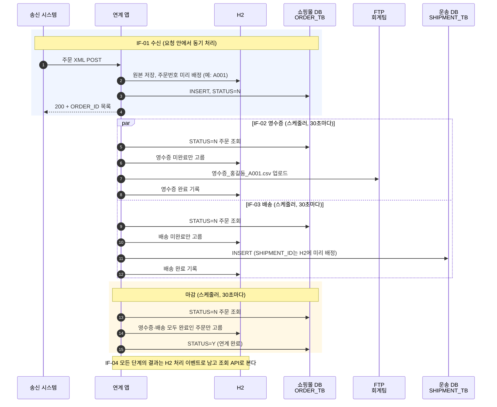

### 핵심 원칙

| | 원칙 | 왜 | 근거 |
|---|---|---|---|
| 🎯 | 사실 하나는 한 곳에만: 연계 완료는 `ORDER_TB.STATUS`(N/Y), 단계 진행은 H2 | 같은 사실을 두 곳에 두면 어긋날 때 어느 쪽이 맞는지 다시 판단해야 한다 | D-04, D-26 |
| 🔁 | 다시 해도 결과가 같게 (멱등) | 두 DB와 FTP는 한 트랜잭션으로 묶을 수 없다 | D-03 |
| 🔒 | 모든 쿼리에 `APPLICANT_KEY` 강제 | 공용 테이블이고 DELETE가 안 된다 | D-01 |
| 🚪 | 잘못된 데이터는 입구에서 거부 | 고객 DB에 들어가면 지울 수 없다 | D-07 |
| ⏳ | 연결 실패와 건별 실패를 나눠 재시도 | 상대 점검 때문에 멀쩡한 주문이 실패 처리되지 않게 | D-10 |

### 샘플 데이터 처리 결과

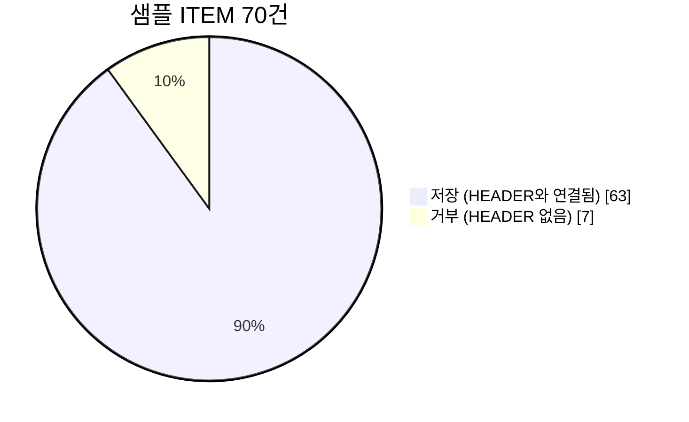

ITEM이 없는 HEADER 4건은 저장할 주문이 없어 경고로 남는다. 저장된 63건은 영수증 63개, 배송 63건이 되어 모두 `STATUS=Y`로 끝난다 (D-07, D-11).

## 1. 개요와 범위

쇼핑몰 "토토"의 주문·회계·운송 사이 수작업을 대신하는 연계 애플리케이션이다. 화면은 없고 Spring Boot 내장 웹 서버에서 API와 스케줄러가 돈다.

| # | 인터페이스 | 방식 | 소스 → 타깃 |
|---|---|---|---|
| IF-01 | 주문 수신 | REST API, 동기 저장 | 주문 XML → 쇼핑몰 DB `ORDER_TB` |
| IF-02 | 영수증 전송 | 스케줄러 | `ORDER_TB` → FTP 영수증 파일 (회계팀) |
| IF-03 | 배송 연계 | 스케줄러 | `ORDER_TB` → 운송회사 DB `SHIPMENT_TB` |
| IF-04 | 처리 추적 | H2 이력 + 조회 API | 전 구간 |

**전제.**

- **단일 인스턴스.** 임베디드 H2, 채번, 수신 중복 판단, 스케줄러가 모두 앱 하나가 도는 것을 전제한다 (D-08, D-12). 여러 대로 확장하는 것은 범위 밖이다.
- **제공 Oracle·FTP는 운영 환경으로 취급한다** (D-11).

> [!WARNING]
> 제공 환경은 DELETE·덮어쓰기가 안 된다. 시험 데이터, 잘못 들어간 행, 반쪽 파일도 지울 수 없고 그대로 평가 대상이 된다. 시행착오는 로컬에서 한다 (D-11, D-14).

| 범위 안 | 범위 밖 |
|---|---|
| IF-01 ~ IF-04 | 멀티 인스턴스 |
| 수신 중복 방지, 재시도, 운영자 재처리 API | 조회·재처리 API 인증 |
| 처리 이력과 조회 API | H2 이력 보관 기간, 장애 알림 |
| 로컬 테스트 환경 | 수신 재처리 스케줄러 (수신 재시도는 송신자 몫, D-04) |

## 2. 전체 구조

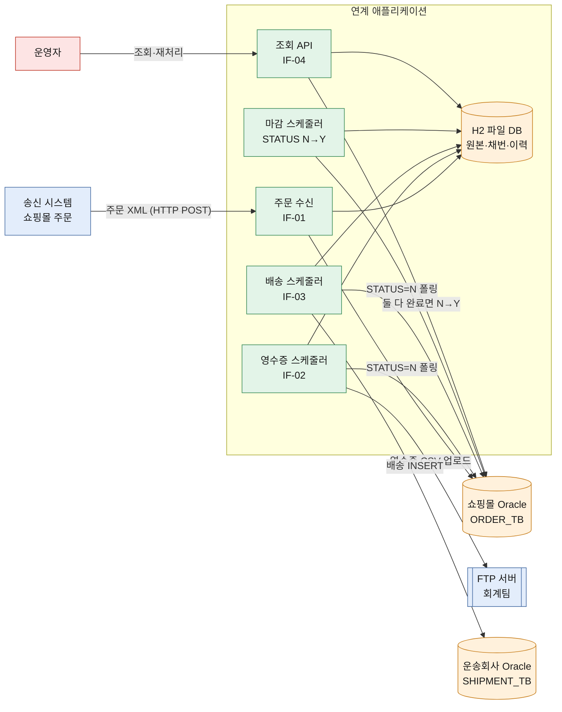

**외부 시스템.**

| 시스템 | 연결 | 우리가 하는 일 | 권한 |
|---|---|---|---|
| 송신 시스템 | 우리 API를 호출 | 주문 XML 수신 | — |
| 쇼핑몰 Oracle `ORDER_TB` | JDBC, DataSource 1 | INSERT, `STATUS`(N/Y) 조회·갱신 | SELECT·INSERT·UPDATE. 지원자 공용 테이블 |
| 운송회사 Oracle `SHIPMENT_TB` | JDBC, DataSource 2 | 배송 조회·INSERT | SELECT·INSERT·UPDATE. 지원자 공용 테이블 |
| FTP 서버 | 평문 FTP (FTPS도 지원하지만 쓰지 않음, §11.1) | 목록 조회, 영수증 업로드 | 목록·신규 업로드만 |

- 두 Oracle은 지금 같은 인스턴스·같은 계정이지만 서로 다른 시스템으로 보고 DataSource를 나눈다 (D-02). 그래서 두 DB에 걸친 작업은 한 트랜잭션으로 묶이지 않는다.
- 정합성은 분산 트랜잭션 대신 **단계별 커밋 + 멱등성 + 사전 확인 후 재처리**로 맞춘다 (D-03).

> [!IMPORTANT]
> 제공 `ORDER_TB.STATUS`는 CHECK 제약으로 `N`·`Y`만 받는다. `STATUS`는 "연계가 다 끝났나"만 담고(`N` 진행 중, `Y` 영수증·배송 모두 완료), 단계별 완료와 "사람이 확인" 표시는 H2 `ORDER_STAGE`가 담는다. 영수증과 배송은 서로 기다리지 않고 따로 처리하며, `Y`는 마감 스케줄러 한 곳만 쓴다. 작업 대상은 `STATUS=N`인 주문이다 (D-26).

## 3. 구성요소

| 구성요소 | 패키지 | 책임 | 쓰는 저장소 | 근거 |
|---|---|---|---|---|
| 주문 | `order` | 정규 모델 `Order`, 마감 스케줄러(두 단계 모두 완료면 `STATUS` N→Y 조건부 갱신). 다른 도메인은 `OrderService`로만 `ORDER_TB`에 닿는다 | 쇼핑몰 DB (+ `retry`) | D-21, D-26 |
| 주문 수신 | `inbound` | 메시지 키 결정, 중복 판단, 수신 잠금, 원본 보존, 파싱·검증, 채번 요청, 응답 | H2 (+ `order`) | D-04, D-05, D-07, D-16 |
| 주문 본문 파서 | `inbound` (포트 + XML 어댑터) | 인코딩 판단·엄격 디코딩, 맨 앞 선언 제거와 루트 감싸기, DOCTYPE 금지 DOM 파싱, 최상위 HEADER·ITEM을 `USER_ID`로 조인해 정규 모델 생성 | — | D-04, D-07, D-20 |
| 채번기 | `numbering` | `ORDER_ID`·`SHIPMENT_ID` 발급, 시작 시 Oracle 최댓값과 동기화 | H2 (+ 두 Oracle은 포트로) | D-08, D-21 |
| 영수증 | `receipt` | `STATUS=N`이고 영수증 미완료인 주문의 영수증 CSV 생성·업로드, 완전성 확인 | FTP (+ `order`, `inbound`, `retry`) | D-09, D-10, D-12, D-26 |
| 배송 | `shipment` | `STATUS=N`이고 배송 미완료인 주문의 배송 등록 | 운송 DB (+ `order`, `inbound`, `numbering`, `retry`) | D-03, D-10, D-12, D-26 |
| 재시도 관리 | `retry` | 주문·단계별 횟수, 다음 시도 시각, 단계 완료, "사람이 확인" 표시와 그 해제 | H2 | D-10, D-26 |
| 처리 이력 기록·조회 | `tracking` | 처리 이벤트 기록, 단계별 상태 계산, 운영자 창구(조회 API + 재처리 API 하나) | H2 (+ `order`, `inbound`, `retry`) | D-13, D-21, D-26 |
| 공통 | `global` | 응답 래퍼, 오류 코드 enum, 전역 예외 처리기, `traceId`, DataSource 3개 설정 | — | D-18, D-19 |
| 부트스트랩 (구현됨) | `bootstrap` | 과제 API에서 접속 정보 수신·복호화. 별도 진입점 `./gradlew bootstrap` | `config/` | — |

**패키지 구조 (D-21).** 도메인별로 나누고, 도메인마다 안쪽(`domain`, `application`)과 바깥(`adapter`)을 나눈다. 앱 안에서는 주문을 정규 모델 `Order`로만 다루고, 바깥 형식(XML, `ORDER_TB` 행, CSV, `SHIPMENT_TB` 행)은 어댑터가 변환한다.

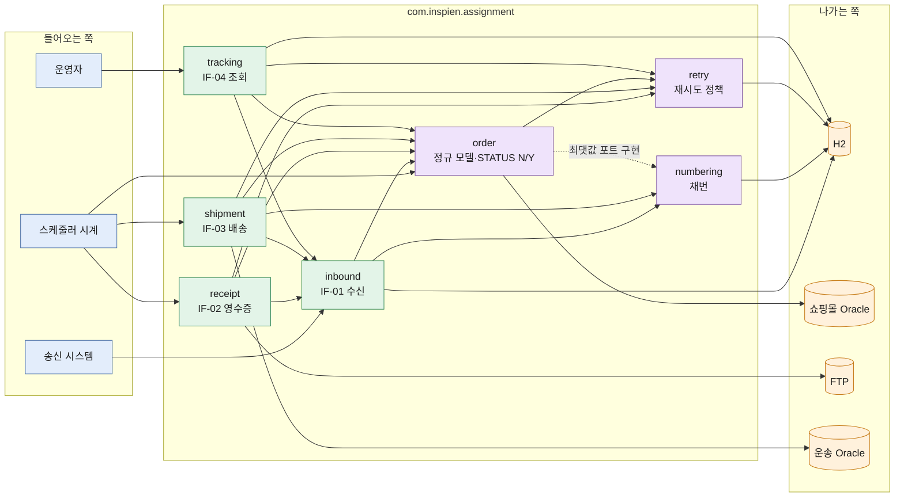

- 초록은 연계 흐름(IF-01~04), 보라는 흐름들이 함께 쓰는 핵심이다. 도메인 사이 화살표는 상대의 `application` 서비스 호출이다.
- `receipt`와 `shipment` 사이에는 화살표가 없다. 서로를 모르고 각자 H2에 자기 단계의 완료를 적는다. 두 단계가 모두 끝났는지는 `order`의 마감 스케줄러만 본다 (D-26).
- 영수증·배송은 수신일시와 수신 기록 유무를 `inbound`의 서비스로 읽는다. 조회 API(`tracking`)도 주문을 실어 온 메시지 ID·수신 시각과 메시지 상세·목록을 같은 서비스로 읽는다. `RECEIVED_MESSAGE`·`MESSAGE_ORDER`는 `inbound`가 맡고, `inbound`는 이들을 모른다. 처리 이벤트를 Spring 이벤트로 발행하는 것도 `inbound` → `tracking` 호출로 순환이 생기지 않게 하려는 것이다 (D-13, D-21).
- 채번기는 시작할 때 두 Oracle의 최댓값을 포트 `IssuedIdReader`로 읽고, `order`와 `shipment`의 Oracle 어댑터가 각각 구현한다(점선, `shipment`는 이미 화살표가 있어 생략). 채번기가 `shipment`를 부르면 서로 부르는 순환이 되기 때문이다 (D-21).
- `global`(응답·오류·설정)과 `bootstrap`은 그림에서 뺐다.

**도메인 안쪽 구조.** 영수증 예시.

```
receipt
├─ domain            Receipt: CSV 내용, 파일명 규칙 (순수 Java)
├─ application       ReceiptService (처리 흐름, 트랜잭션 경계)
│  └─ port           ReceiptUploader (바깥에 요구하는 인터페이스)
└─ adapter
   ├─ in/scheduler   ReceiptScheduler
   └─ out/ftp        FtpReceiptUploader (포트 구현)
```

| 전통 계층 | 이 구조 |
|---|---|
| Controller | `adapter/in/web`, 스케줄러는 `adapter/in/scheduler` |
| Service | `application` |
| Repository | 포트(`application/port`) + 그 구현(`adapter/out/…`). Spring Data 리포지토리와 JPA 엔티티는 구현 안쪽에 숨는다 |

- 의존 규칙: `adapter` → `application` → `domain`. 다른 도메인은 `application`으로만 부른다. ArchUnit 테스트로 강제한다 (D-21).
- 도메인 사이 화살표는 위 그림에 있는 것만 허용한다. 같은 허용 목록을 ArchUnit 테스트에 두어, 그림에 없는 의존이 생기면 테스트가 실패한다. 그림을 바꿀 때는 그 목록도 함께 바꾼다 (D-21).
- 포트는 바깥 시스템(쇼핑몰 Oracle, 운송 Oracle, FTP, H2, 수신 본문 파서)에만 둔다. 내부 서비스는 인터페이스 없이 클래스다.
- `APPLICANT_KEY`는 Oracle 어댑터가 모든 쿼리 조건과 INSERT 값에 붙인다. 서비스와 정규 모델은 이 값을 모른다 (D-01, D-21).

## 4. 데이터

### 4.1 Oracle (제공 테이블, 변경 불가)

> [!IMPORTANT]
> 모든 조회·갱신에 `APPLICANT_KEY = 내 키` 조건을 구조로 강제한다 (D-01). `ddl-auto=none`.

**값이 어디서 와서 어디로 가나.** 1행 = 주문 1건 = HEADER 1개 + ITEM 1개.

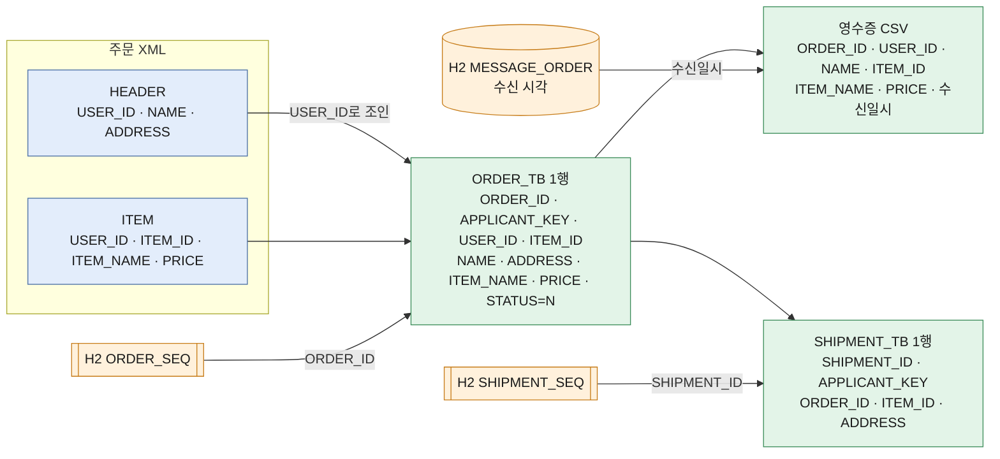

**`ORDER_TB` 값의 출처.**

| 컬럼 | 값 | 근거 |
|---|---|---|
| `ORDER_ID` (PK) | 채번 `A001`~`Z999` | D-08 |
| `APPLICANT_KEY` (PK) | 설정값 (`config/`) | D-01, D-23 |
| `USER_ID` | ITEM의 `USER_ID` (= HEADER의 `USER_ID`) | D-07 |
| `ITEM_ID`, `ITEM_NAME`, `PRICE` | ITEM | |
| `NAME`, `ADDRESS` | 같은 `USER_ID`의 HEADER | D-07 |
| `STATUS` | 저장할 때 `N`. 영수증·배송이 모두 끝나면 마감 스케줄러가 `Y`. CHECK 제약 `STATUS IN ('N', 'Y')` (§6) | D-26 |
| `CREATE_TIME` | 넣지 않는다. 엔티티에 매핑하지 않아 DB 기본값(`SYSDATE`)이 들어간다 | D-26, D-27 |

**`SHIPMENT_TB` 값의 출처.**

| 컬럼 | 값 |
|---|---|
| `SHIPMENT_ID` (PK) | 채번 `A001`~`Z999`, `ORDER_ID`와 별도 시퀀스 (D-08) |
| `APPLICANT_KEY` (PK) | 설정값 |
| `ORDER_ID`, `ITEM_ID`, `ADDRESS` | `ORDER_TB`의 해당 주문 |
| `CREATE_DATE` | 넣지 않는다. 엔티티에 매핑하지 않아 DB 기본값(`SYSDATE`)이 들어간다 (D-26, D-27) |

- `CREATE_TIME`·`CREATE_DATE`는 PPT에 없던 컬럼이다(§11.1). 면접의 "당일 날짜 기준 조회"가 이 컬럼을 쓰는 것으로 보여 DB 시각 그대로 둔다. 영수증의 수신일시는 이 값이 아니라 H2의 수신 시각이다.

**채번 형식.** 정수 시퀀스를 4자로 바꾼다. 고정 길이라 문자열 정렬이 곧 번호 순서다 (D-08).

| 시퀀스 값 | 1 | 999 | 1000 | 1998 | … | 25974 | 25975 |
|---|---|---|---|---|---|---|---|
| 번호 | `A001` | `A999` | `B001` | `B999` | … | `Z999` | 수신 거부 |

번호 변환: 앞 글자 = `'A' + (n - 1) / 999`, 숫자 = `(n - 1) % 999 + 1`. `A000`은 없다. 번호 발급과 `MESSAGE_ORDER` 기록은 같은 H2 트랜잭션에서 한다. 미리 배정한 번호는 다시 나가지 않는다 (D-08).

**매핑.**

- 복합 PK `(ORDER_ID, APPLICANT_KEY)`, `(SHIPMENT_ID, APPLICANT_KEY)`는 `@IdClass` 또는 `@EmbeddedId`로 매핑한다.
- `APPLICANT_KEY` 강제 수단: Hibernate `@TenantId`. 두 Oracle 엔티티 매니저에 고정 테넌트(내 키)를 설정한다. 복합 PK 구성 컬럼에서도 조회·저장·벌크 갱신·PK 조회에 조건이 붙는 것을 확인했다. 네이티브 SQL에는 붙지 않으므로 Oracle 어댑터는 네이티브 SQL을 쓰지 않는다 (D-01, D-25).

**쓰기 규칙.**

- `STATUS` 갱신은 마감 스케줄러의 N→Y 하나뿐이고 항상 조건부다: `UPDATE ... SET STATUS = 'Y' WHERE APPLICANT_KEY = ? AND ORDER_ID = ? AND STATUS = 'N'`. 갱신 건수가 0이면 이벤트로 남기고 넘어간다 (D-06, D-26).
  - QueryDSL 벌크 UPDATE로 하고 갱신 건수를 확인한다. 엔티티 변경 감지로 갱신하면 `AND STATUS = 'N'` 조건이 빠진다.
  - 읽은 `STATUS`가 `N`·`Y`가 아니면(내 키의 행에는 생길 수 없다) 예외로 멈춘다. 모르는 값을 조용히 대상에서 빼지 않는다.
- 수신 메시지 하나의 주문 전체를 한 트랜잭션으로 INSERT한다 (D-05).
- 재처리할 때는 INSERT 전에 미리 배정한 주문번호로 먼저 조회한다 (D-16).
- INSERT 중 PK 충돌이 나면 그 트랜잭션을 롤백하고, 새 트랜잭션에서 미리 배정한 번호로 다시 조회해 원본과 비교한다. 같으면 완료, 다르면 `500` (D-19).
- INSERT는 `persist`로 한다.

> [!WARNING]
> Spring Data `save()`는 ID를 직접 넣은 엔티티를 기존 엔티티로 보고 `merge`한다. merge는 같은 PK 행이 있으면 UPDATE하므로, PK 충돌이 나지 않고 남의 주문을 덮어쓴다. 설계는 PK 충돌을 감지해 다시 조회·비교하므로(D-16, D-19) `save()`를 쓰지 않는다. `Persistable#isNew`로 새 엔티티임을 알려도 된다.

- `SHIPMENT_TB`에는 `ORDER_ID` 유일 제약이 없으므로 INSERT 전에 같은 `ORDER_ID` 배송이 있는지 조회한다 (D-03).
- `SHIPMENT_ID`는 INSERT 전에 H2에 미리 배정하고 재시도에 재사용한다. 커밋 결과를 모르는 앞 시도가 늦게 커밋돼도 재시도와 PK로 부딪혀, 다시 조회해 "이미 있음"으로 끝난다. 조회만으로는 진행 중인 커밋이 보이지 않는다 (D-03 보완, D-19).

### 4.2 H2 (앱 소유, 파일 DB)

앱과 같은 프로세스에서 도는 파일 DB다. 업무 DB 트랜잭션과 따로 커밋되므로 업무 처리가 롤백돼도 실패 이력은 남는다 (D-04). 내부 키는 TSID (D-08).

- **경로:** 설정값. 프로필별로 `./data/local/history`, `./data/provided/history`로 나눈다. 기동 시 절대경로를 로그에 남긴다. `data/`는 Git 제외 (D-19).
- **스키마:** `schema-h2.sql`(`CREATE TABLE IF NOT EXISTS`)을 H2 전용 초기화 빈으로 기동마다 실행한다. 채번기·스케줄러보다 먼저 끝나게 한다. Oracle에는 어떤 스크립트도 실행하지 않는다 (D-19).
- **`WRITE_DELAY=0`:** 커밋 즉시 디스크에 쓴다. 기본값이면 커밋 후 최대 0.5초 동안 안 쓰여서, 그 사이 앱이 죽으면 미리 배정한 주문번호 기록이 사라지고 재전송이 중복 저장된다 (D-19).

> [!CAUTION]
> H2 파일은 단순 이력이 아니라 중복 판단 정보이자 단계 진행 기록이다. 앱 실행 중에 파일을 복사하지 않는다. 지우거나 옛 백업으로 되돌리면 완료 후 1분 안의 재전송과 실패한 메시지의 재전송을 새 메시지로 받을 수 있고, 백업 뒤의 단계 완료·"사람이 확인" 표시·미리 배정한 배송 번호가 사라진다. 복원은 앱을 멈춘 상태에서 하고, 다시 켜기 전에 `STATUS=N` 주문을 FTP 목록·`SHIPMENT_TB`와 대조한다 (D-26).

**테이블.**

```mermaid
erDiagram
    RECEIVED_MESSAGE ||--o{ MESSAGE_ORDER : "주문번호 미리 배정"
    RECEIVED_MESSAGE |o--o{ PROCESS_EVENT : "수신·거부 이벤트"
    MESSAGE_ORDER ||--o{ ORDER_STAGE : "단계별 진행"
    MESSAGE_ORDER |o--o{ PROCESS_EVENT : "주문 이벤트"

    RECEIVED_MESSAGE {
        string ID PK "TSID = 메시지 ID"
        string MESSAGE_KEY "본문 SHA-256, 유일 제약 없음"
        timestamp RECEIVED_AT "요청 도착 시각"
        string CONTENT_TYPE
        blob RAW_BODY "받은 바이트 그대로"
        string STATE "PROCESSING, COMPLETED, FAILED"
        int RESPONSE_STATUS "보낸 응답 코드"
        clob RESPONSE_BODY "재전송 시 그대로 응답"
        timestamp COMPLETED_AT "중복 판단 1분 창의 기준"
        timestamp CREATED_AT "공통"
        timestamp UPDATED_AT "공통"
    }
    MESSAGE_ORDER {
        string ORDER_ID PK "미리 배정한 주문번호"
        string MESSAGE_ID FK
        int SEQ "메시지 안의 순서"
        string USER_ID
        string ITEM_ID
        timestamp RECEIVED_AT "영수증의 수신일시"
        timestamp CREATED_AT "공통"
        timestamp UPDATED_AT "공통"
    }
    ORDER_STAGE {
        string ORDER_ID PK
        string STAGE PK "RECEIPT, SHIPMENT"
        int ATTEMPTS
        timestamp NEXT_ATTEMPT_AT
        boolean REACHED_FAILED "사람이 확인: 자동 처리 멈춤"
        string LAST_ERROR
        string ARTIFACT "파일명 또는 미리 배정한 SHIPMENT_ID"
        timestamp COMPLETED_AT "단계 완료 시각"
        timestamp CREATED_AT "공통"
        timestamp UPDATED_AT "공통"
    }
    PROCESS_EVENT {
        string ID PK "TSID"
        timestamp OCCURRED_AT
        string MESSAGE_ID FK "주기 이벤트는 없음"
        string ORDER_ID FK "거부·주기 이벤트는 없음"
        string STAGE
        string RESULT
        string DETAIL
        timestamp CREATED_AT "공통"
        timestamp UPDATED_AT "공통"
    }
```

| 테이블 | 한 줄 | 쓰는 곳 |
|---|---|---|
| `RECEIVED_MESSAGE` | 받은 메시지 1건 | 중복 판단, 재전송 시 이전 응답 반환, 거부 사유 (D-05, D-07) |
| `MESSAGE_ORDER` | 메시지 → 미리 배정한 주문번호 목록 | 재처리 시 같은 번호 재사용, 영수증의 수신일시 (D-05, D-09, D-16) |
| `ORDER_STAGE` | 주문 × 단계의 진행 상태 | 단계 완료, "사람이 확인" 표시, 백오프, 대상 고르기, 배송 번호 미리 배정 (D-03, D-10, D-12, D-26) |
| `PROCESS_EVENT` | 일어난 일 1건. 추가만 한다 | "어디서 무엇이 잘못됐나"의 시간순 기록 (D-13) |
| 시퀀스 `ORDER_SEQ`, `SHIPMENT_SEQ` | 번호 발급기 | 채번 (D-08) |

**용어: 메시지 키, 메시지 ID, 주문번호.** 모두 우리가 만드는 값이다. 쇼핑몰은 어떤 키도 보내지 않는다.

| 용어 | 예 | 값 | 가리키는 것 | 유일한가 | 쓰는 곳 |
|---|---|---|---|---|---|
| 메시지 키 | `9f2c…` (64자) | 받은 본문 바이트의 SHA-256 | 본문 내용 | 아니다 (완료 후 1분이 지나면 같은 값이 새 메시지로 다시 올 수 있다) | 수신 중복 판단, 수신 잠금 배정 |
| 메시지 ID | `0HZ8K3V2M1Q7R` | `RECEIVED_MESSAGE.ID` (TSID) | 받은 요청 한 건(묶음) | 그렇다 | 응답, 조회 API, 로그 MDC, 다른 테이블의 FK |
| 주문번호 | `A001` | `ORDER_ID` (H2 시퀀스로 채번) | 주문 한 건(상품 1개) | 그렇다 (내 `APPLICANT_KEY` 안에서) | H2 `MESSAGE_ORDER`와 Oracle `ORDER_TB`의 PK, 영수증·배송 |

- `MESSAGE_KEY`는 유일 제약을 두지 않는다 (D-05). 그래서 동시 요청은 유일 제약이 아니라 수신 잠금으로 막는다 (D-16).
- 주문번호는 Oracle에 넣기 **전에** H2에 먼저 적어 둔다("미리 배정한 주문번호"). 재처리할 때 새 번호를 따지 않고 같은 번호를 다시 써서, 지난번에 실제로 저장됐는지 확인할 수 있게 하기 위해서다 (D-05, D-16).
- `RECEIVED_MESSAGE.STATE`: `PROCESSING`(처리 중), `COMPLETED`(저장과 응답 기록까지 끝남), `FAILED`(실패, 응답 코드를 함께 기록). 같은 메시지 키의 잠금을 얻은 뒤에도 `PROCESSING`이 보이면 이전 처리가 중간에 중단된 것이다 (D-16).
- 원본은 디코딩한 문자열이 아니라 받은 바이트로 보존한다. 인코딩 해석이 틀렸을 때도 원본으로 다시 판단할 수 있다.
- `PROCESS_EVENT.STAGE` 값: `RECEIVE`(수신), `RECEIPT`(영수증), `SHIPMENT`(배송), `CLOSE`(마감, `STATUS` N→Y) (D-26).
- `PROCESS_EVENT.RESULT` 값: `SUCCESS`, `FAIL`, `SKIP`(이미 처리됨), `REJECT`, `WARN`, `OPERATOR_RESET`, `CYCLE_SKIPPED`(연결 실패 시작, 상태가 바뀔 때 한 번), `CONNECTION_RECOVERED`(복구, 건너뛴 주기 수 포함), `MISSING_RECORD`(H2에 수신 기록이 없는 주문, `ORDER_ID`는 상세에) (D-22).
  - 마감 스케줄러는 `Y`를 쓸 때 `CLOSE` + `SUCCESS`를 남긴다. 주문 상세의 이벤트에 "연계 완료" 시각이 보인다. 갱신 0건(이미 `Y`)은 남기지 않는다 (D-26).
  - `STATE_MISMATCH`(조건부 갱신 0건)는 쓰지 않는다. `STATUS`를 바꾸는 곳이 마감 스케줄러 하나이고, 그 0건은 정상이다 (D-26).
- D-13의 "이력 3종"은 `RECEIVED_MESSAGE`, `ORDER_STAGE`, `PROCESS_EVENT`다. `MESSAGE_ORDER`는 채번·중복 방지용(D-05, D-08)이라 따로 센다.

- **`ORDER_STAGE`는 이력이 아니라 진행 상태다 (D-26).** 주문마다 영수증 행과 배송 행이 따로 있다. 단계 완료(`COMPLETED_AT`)와 "사람이 확인"(`REACHED_FAILED`)은 Oracle에 담을 곳이 없어 여기에만 있다. 그래서 최선 노력으로 쓰지 않는다.
  - 쓰기에 실패하면 그 주기를 끝낸다 (D-22). 완료를 못 적었으면 다음 주기에 사전 확인(FTP 목록, `SHIPMENT_TB` 조회)으로 완료만 적는다.
  - 건별 실패 1회는 횟수, 다음 시도 시각, 한도에 닿았으면 `REACHED_FAILED`까지 **한 H2 트랜잭션**으로 쓴다.
  - Oracle `STATUS`의 사본은 두지 않는다. `Y`는 두 행의 `COMPLETED_AT`을 합친 요약이고 Oracle에만 있다.
- **공통 시각 필드 (D-27).** H2 엔티티 네 개 모두 `CREATED_AT`(INSERT 때, 이후 불변)·`UPDATED_AT`(INSERT·UPDATE 때)을 가진다. 공통 클래스(`@MappedSuperclass`)의 JPA 표준 콜백 `@PrePersist`·`@PreUpdate`가 JVM 시각으로 채운다.
  - 업무 시각(`RECEIVED_AT`, `COMPLETED_AT`, `OCCURRED_AT`)과 다르다. 업무 시각은 앱의 `Clock`으로 채우고 판단에 쓴다. 공통 필드는 "행이 언제 생기고 바뀌었나"만 알려 준다.
  - 벌크 UPDATE(재처리 API의 조건부 해제 등)는 콜백이 돌지 않으므로 `UPDATED_AT`을 직접 넣는다.
  - Oracle 엔티티에는 붙이지 않는다. 컬럼을 추가할 권한이 없다.
- `ORDER_STAGE`에는 `MESSAGE_ORDER` FK가 없다. 수신 기록이 없는 주문에도 "사람이 확인" 표시를 남길 수 있다 (D-22).
- 기존 H2 파일에는 새 컬럼(`ORDER_STAGE.COMPLETED_AT`, 네 테이블의 `CREATED_AT`·`UPDATED_AT`)이 없으므로 스키마에 `ALTER TABLE ... ADD COLUMN IF NOT EXISTS`를 둔다. NOT NULL인 공통 필드는 `DEFAULT CURRENT_TIMESTAMP`로 기존 행을 채운다 (D-26, D-27).

> [!IMPORTANT]
> 같은 사실은 한 곳에만 둔다. 단계별 완료·"사람이 확인"·재시도 상태는 H2 `ORDER_STAGE`, 그 둘을 합친 "연계 완료"는 Oracle `STATUS=Y`다. 둘이 어긋나면 정해 둔 쪽을 따른다: H2는 둘 다 완료인데 `N`이면 마감 스케줄러가 `Y`를 쓰고, `Y`인데 H2 기록이 없으면(H2 유실) `Y`를 따른다 (D-13, D-26).

### 4.3 DataSource와 트랜잭션

DataSource가 3개라 엔티티 매니저와 트랜잭션 매니저도 3개다 (D-02, D-19).

| | 쇼핑몰 Oracle | 운송 Oracle | H2 |
|---|---|---|---|
| 트랜잭션 매니저 | `orderTx` | `shipmentTx` | `historyTx` |
| 쓸 때 | `@OrderTx` | `@ShipmentTx` | `@HistoryTx` |
| 커넥션 풀 | 7 | 2 | 기본값 |
| 풀 연결 대기 | 5초 | 5초 | 기본값 |

> [!IMPORTANT]
> 기본 매니저(`@Primary`)를 두지 않는다. 이름 없이 쓴 `@Transactional`이 조용히 다른 DB로 가지 않고, 호출할 때 오류로 드러난다.

- 엔티티·리포지토리는 각 도메인의 `adapter/out/persistence`에 있고, `global`의 DB별 설정이 그 패키지들을 `@EnableJpaRepositories`로 나열해 각 매니저에 연결한다. H2는 `inbound`, `numbering`, `retry`, `tracking`이 함께 쓴다 (D-21).
- 수신 흐름은 짧은 트랜잭션 세 개(H2 원본 저장·채번 → Oracle INSERT → H2 완료 기록)로 나누고, 이를 묶는 수신 서비스에는 트랜잭션을 걸지 않는다. 수신 잠금은 그 바깥에 건다 (D-16).
- **구현 주의:** `@Primary`가 없으면 Spring Boot의 JPA 자동 설정이 빠진다. 엔티티 매니저 3개를 직접 구성하고 각각에 `ddl-auto=none` 등 Hibernate 속성을 명시한다. QueryDSL `JPAQueryFactory`도 DB별로 만든다. 같은 클래스 안의 메서드 호출은 트랜잭션 프록시를 거치지 않으므로 경계는 별도 빈으로 나눈다 (D-19).

## 5. 인터페이스 명세

### 5.1 IF-01 주문 수신 API

| 항목 | 내용 |
|---|---|
| 요청 | `POST /orders` (D-18) |
| `Content-Type` | 미디어 타입은 따지지 않고 charset만 쓴다. 헤더가 없어도 받는다 (D-20) |
| 인코딩 | BOM → `Content-Type` charset → XML 선언 → 기본 EUC-KR 순으로 정한다. 허용은 UTF-8과 EUC-KR 계열뿐이고, EUC-KR 계열은 MS949로 읽는다. 읽을 수 없는 바이트가 있으면 `400` (D-20) |
| 본문 | `<HEADER>`·`<ITEM>` 나열. XML 선언·루트가 없어도 된다 (서버가 맨 앞 선언을 지우고 루트로 감싼다). HEADER·ITEM은 최상위에 있어야 한다. DOCTYPE은 `400`. 주문 1건이든 여러 건이든 같은 경로로 처리 (D-07, D-20) |
| 중복 판단 | 받은 본문 바이트의 SHA-256으로 같은 본문을 찾고, 그 가장 최근 기록의 상태로 판단한다. 완료된 메시지는 완료 후 1분 안이면 같은 메시지, 실패(`400` 제외)·처리 중 메시지는 시간과 관계없이 같은 메시지다. 묶음 전체 단위로 판단한다 (D-15, D-24) |

**요청·응답 예시 (묶음).** 샘플과 같은 특징(루트 없음, 순서 섞임, `USER_ID`로 연결)을 가진 가상 데이터다.

```
POST /orders
Content-Type: application/xml; charset=EUC-KR

<HEADER><USER_ID>USER01</USER_ID><NAME>김민수</NAME><ADDRESS>서울시 강남구 …</ADDRESS></HEADER>
<ITEM><USER_ID>USER02</USER_ID><ITEM_ID>ITEM20</ITEM_ID><ITEM_NAME>무선 마우스</ITEM_NAME><PRICE>25000</PRICE></ITEM>
<HEADER><USER_ID>USER02</USER_ID><NAME>이서연</NAME><ADDRESS>부산시 해운대구 …</ADDRESS></HEADER>
<ITEM><USER_ID>USER01</USER_ID><ITEM_ID>ITEM10</ITEM_ID><ITEM_NAME>노트북 거치대, 블랙</ITEM_NAME><PRICE>32000</PRICE></ITEM>
<ITEM><USER_ID>USER01</USER_ID><ITEM_ID>ITEM11</ITEM_ID><ITEM_NAME>USB 허브</ITEM_NAME><PRICE>18000</PRICE></ITEM>
<ITEM><USER_ID>USER09</USER_ID><ITEM_ID>ITEM30</ITEM_ID><ITEM_NAME>키보드</ITEM_NAME><PRICE>45000</PRICE></ITEM>
<HEADER><USER_ID>USER03</USER_ID><NAME>박지훈</NAME><ADDRESS>대전시 …</ADDRESS></HEADER>
```

| 순서 (ITEM이 나온 순) | ITEM | 연결된 HEADER | 결과 |
|---|---|---|---|
| 1 | USER02 · ITEM20 | 이서연 | ✅ `A001` |
| 2 | USER01 · ITEM10 | 김민수 | ✅ `A002` |
| 3 | USER01 · ITEM11 | 김민수 | ✅ `A003` |
| 4 | USER09 · ITEM30 | 없음 | ❌ 거부 |
| — | HEADER USER03 | ITEM 없음 | ⚠️ 경고 |

```json
{
  "traceId": "7f3a9c2e5b1d4a08",
  "data": {
    "messageId": "0HZ8K3V2M1Q7R",
    "receivedAt": "2026-10-31T14:05:12+09:00",
    "replayed": false,
    "summary": { "stored": 3, "rejected": 1, "warnings": 1 },
    "stored": [
      { "seq": 1, "orderId": "A001", "userId": "USER02", "itemId": "ITEM20" },
      { "seq": 2, "orderId": "A002", "userId": "USER01", "itemId": "ITEM10" },
      { "seq": 3, "orderId": "A003", "userId": "USER01", "itemId": "ITEM11" }
    ],
    "rejected": [
      { "seq": 4, "userId": "USER09", "itemId": "ITEM30", "reason": "HEADER_NOT_FOUND" }
    ],
    "warnings": [
      { "userId": "USER03", "reason": "HEADER_WITHOUT_ITEM" }
    ]
  }
}
```

- **공통 요소는 `data` 바깥, 엔드포인트별 필드는 `data` 안이다 (D-18).** `traceId`는 로그 MDC와 같은 값이다. 본문에 `success`나 결과 코드를 넣지 않는다. 성공·실패는 HTTP 상태 코드로만 말한다.
- `seq`는 본문 안 ITEM 순서(1부터)다. 거부된 ITEM은 `ORDER_ID`가 없고 같은 사용자·상품이 두 번 나올 수 있어서 순서로 특정한다.
- `receivedAt`은 처음 받은 시각이다. 완료된 메시지와 같은 본문이 완료 후 1분 안에 다시 오면 `"replayed": true`, 같은 `ORDER_ID`, 원래 `receivedAt`과 함께 `notice`("새 주문이면 1분 뒤 다시 보내라")를 돌려준다 (D-15, D-24).
- 실패한 메시지를 이어서 처리했는데 지난번에 이미 저장돼 있었으면(결과 불명이었던 경우) 같은 형태로 `"replayed": true`를 돌려준다. 이번 요청이 저장한 것이 아니기 때문이다 (D-24).
- 거부·경고 사유 코드: `MISSING_USER_ID`, `MISSING_ITEM_ID`, `HEADER_NOT_FOUND`, `DUPLICATE_HEADER`, `PRICE_NOT_NUMBER`, `VALUE_TOO_LONG`(필드 이름을 함께 줌), `HEADER_WITHOUT_ITEM`(경고). 값 길이는 `VARCHAR2(100)` 기준이고 바이트·글자 단위는 제공 Oracle 확인 결과를 따른다 (D-07, §11).
- 필드 이름은 camelCase, 시각은 ISO-8601 `+09:00`, 값이 없는 필드는 생략한다.
- `ORDER_ID` 하나 = 상품 하나다. 김민수(USER01)는 상품 2개를 샀으므로 영수증 2장, 배송 2건이 생긴다 (D-07, D-09).

**응답 계약 (D-17).** 4xx는 보낸 쪽이 고쳐야 하는 문제, 5xx는 받는 쪽 문제다. 5xx 중 재전송으로 풀리는 것은 `503`뿐이다.

| 코드 | 경우 | 본문 | 송신자가 할 일 |
|---|---|---|---|
| 🟢 `200` | 저장 완료 (일부 거부 포함) | 메시지 ID, 저장 목록(`ORDER_ID`, `USER_ID`, `ITEM_ID`), 거부 목록(사유), 경고 목록 | 끝. 거부 건은 데이터를 고쳐서 새로 보낸다 |
| 🟢 `200` | 완료 후 1분 안에 같은 본문 (이전 메시지 완료) | 처음 응답 + **"이전 결과를 다시 보냄" 표시**와 안내 | 재전송이었다면 끝. 새 주문이었다면 1분 뒤 다시 보내면 새 주문으로 처리된다 |
| 🔴 `400` | XML 파싱 실패 (읽을 수 없는 바이트, 허용하지 않는 문자셋, DOCTYPE 포함, 빈 본문, D-20). 빈 본문은 0바이트이거나 BOM·XML 선언·공백만 있는 본문이다 | Problem Details, `retryable: false` | 본문을 고쳐서 보낸다. 그대로 다시 보내면 또 `400` |
| 🔴 `413` | 본문이 상한(기본 1MB)을 넘음. 저장·잠금 전에 거절하므로 H2에 기록이 없고 조회 API에도 나오지 않는다 (로그에만 남음) | Problem Details, 오류 코드 `PAYLOAD_TOO_LARGE`, `retryable: false` (메시지 ID 없음) | 묶음을 나눠서 보낸다 |
| 🔴 `400` | `Content-Type` 헤더가 255자를 넘음 (H2 `CONTENT_TYPE` 컬럼 길이). 잘라서 저장하면 `charset`이 떨어져 다시 파싱할 때 다르게 읽힐 수 있어 자르지 않는다 (D-16, D-20). 413처럼 저장·잠금 전에 거절해 H2에 기록이 없다 (로그에만 남음) | Problem Details, 오류 코드 `INVALID_REQUEST`, `retryable: false` (메시지 ID 없음) | 헤더를 255자 이하로 줄여 보낸다 (`application/xml; charset=EUC-KR` 정도면 충분) |
| 🔴 `500` | 예상 밖 상태: 미리 배정한 번호의 행이 일부만 있거나 원본과 다름 (재처리 전 조회, 또는 PK 충돌 뒤 다시 조회한 결과, D-16·D-19) | Problem Details, `retryable: false` | 연계 담당자에게 문의 |
| 🔴 `500` | 채번 소진 (`Z999` 초과, D-08) | Problem Details, 오류 코드 `ORDER_ID_EXHAUSTED`, `retryable: false` | 연계 담당자에게 문의 |
| 🔴 `500` | Oracle이 저장을 거절 (값 길이 초과, NOT NULL·제약 위반, 권한 없음 등 연결·자원 계열이 아닌 오류, D-17) | Problem Details, 오류 코드 `ORDER_DB_REJECTED`, `retryable: false` | 연계 담당자에게 문의. 그대로 다시 보내면 또 `500` |
| 🟡 `503` | Oracle 연결·자원 장애 (접속 실패, 타임아웃, 풀 연결 대기 초과, 연결 끊김, 커밋 중 타임아웃처럼 결과가 불명인 경우 포함, D-17·D-19) | Problem Details, `retryable: true`, `Retry-After` 헤더 | 같은 본문을 재전송한다. 시간 제한은 없다. 미리 배정한 주문번호로 조회한 뒤 이어서 처리된다 (D-24) |
| 🟡 `503` | H2 사용 불가 | 위와 같음 (메시지 ID 없음) | 같은 본문을 재전송한다. 원본도 저장되지 않았으므로 처음부터 처리된다 |
| 🟡 `503` | 수신 잠금 대기 상한 초과 (D-16) | 위와 같음 | 같은 본문을 재전송한다 |
| ⚪ 없음 | 타임아웃, 연결 끊김 | — | **곧바로(1분 안에)** 같은 본문을 재전송한다. 이전 결과를 받거나 이어서 처리된다. 이전 처리가 실패였다면 늦게 보내도 이어서 처리된다 (D-24) |

**오류 본문 (D-17, D-18).** RFC 9457 Problem Details(`application/problem+json`)에 확장 필드를 붙인다.

```json
{
  "type": "about:blank",
  "title": "Service Unavailable",
  "status": 503,
  "detail": "쇼핑몰 DB에 저장하지 못했습니다. 같은 본문을 다시 보내 주세요.",
  "instance": "/orders",
  "traceId": "7f3a9c2e5b1d4a08",
  "code": "ORDER_DB_UNAVAILABLE",
  "retryable": true,
  "messageId": "0HZ8K3V2M1Q7R"
}
```

| `code` | 상태 | `retryable` |
|---|---|---|
| `XML_PARSE_ERROR` | `400` | false |
| `PAYLOAD_TOO_LARGE` | `413` | false (`messageId` 없음) |
| `INVALID_REQUEST` (`Content-Type` 헤더 길이 초과) | `400` | false (`messageId` 없음) |
| `UNEXPECTED_STATE` | `500` | false |
| `ORDER_ID_EXHAUSTED` | `500` | false |
| `ORDER_DB_REJECTED` | `500` | false |
| `ORDER_DB_UNAVAILABLE` | `503` | true |
| `HISTORY_DB_UNAVAILABLE` | `503` | true (`messageId` 없음) |
| `BUSY` (수신 잠금 대기 초과) | `503` | true |

- 이 표는 코드에서 오류 코드 enum 하나(상태, `retryable`)로 옮겨진다. Problem Details와 `Retry-After`는 전역 예외 처리기 한 곳에서 만든다.
- Oracle 오류의 `503`·`500` 구분은 연결·자원 계열 여부로 한다. 스케줄러의 연결 실패 판정(§8)과 같은 기준이다. 연결이 끊기면 롤백 예외가 원래 예외를 덮어쓰므로 예외 타입 하나가 아니라 원인 사슬 전체를 본다(`DbFailures`). 나머지는 `ORDER_DB_REJECTED`로 둔다. PK 충돌은 이보다 먼저 "다시 조회해 비교"로 처리한다 (D-17, D-19, D-25).
- 송신자가 `500`도 재전송해도 같은 `500`이 나갈 뿐 데이터는 바뀌지 않는다. 계약은 안내이고, 안전은 서버의 멱등성(D-15, D-16)이 지킨다.

**알려진 한계 (D-15, D-24).** 중복은 본문 바이트와 이전 메시지의 상태로만 판단하므로 아래는 막지 못한다.

- 완료 후 1분 안에 같은 본문으로 들어온 정상 재주문은 중복으로 판단된다. 메시지에 주문번호도 주문 시각도 없어서 재전송과 구분할 수 없다. 대신 응답의 표시로 송신자에게 알린다.
- 저장 후 응답이 유실되고 재전송이 완료 1분 뒤에 오면 중복 저장된다.
- 결과 불명으로 실패한 메시지를 송신자가 다시 보내지 않았는데, 나중에 바이트까지 같은 정상 재주문이 오면 옛 기록을 이어서 처리해 "이미 저장됨"으로 끝난다. 응답의 표시로 알린다.
- 공백만 다른 재전송, 이전 묶음 일부와 새 주문을 섞은 묶음은 새 메시지가 되어 겹친 주문이 중복 저장된다.
- 근본 해결은 송신 시스템이 주문번호를 보내는 것이다. 고객사 개선 권고로 둔다.

재전송, 처리 중 겹침, 처리 중 중단이 서버 안에서 어떻게 처리되는지는 [§7.1](#71-if-01-주문-수신-동기)에 있다.

### 5.2 IF-02 영수증 파일

**파일명 해부.**

```
영수증_홍길동_A001.csv        ← 기본
영수증_홍길동_A001_r1.csv     ← 앞 파일이 반쪽일 때 재업로드
```

| 조각 | 예 | 왜 들어가나 |
|---|---|---|
| `영수증_` | 고정 | 앞부분이 같아 목록이 `ORDER_ID` 순으로 정렬되고, `_r1`이 원래 파일 바로 옆에 보인다 |
| `{지원자명}_` | `홍길동_` | PPT 필수. 공용 폴더에서 다른 지원자의 파일과 구분 |
| `{ORDER_ID}` | `A001` | 다시 발급되지 않는 번호라 유일성을 보장 (D-08) |
| `_r{N}` | `_r1` | 반쪽 파일을 지우거나 덮어쓸 수 없어서 새 이름으로 올린다. 있을 때만 |
| `.csv` | | 사람도 엑셀·회계 시스템도 읽는다 |
| ~~날짜·시각~~ | | 넣지 않는다. 재시도 때 이름이 바뀌면 "이미 올렸나"를 판단할 수 없다 |

**업로드 전 완전성 확인.** FTP는 지울 수도 덮어쓸 수도 없어서 업로드 전에 목록으로 판단한다 (D-09).

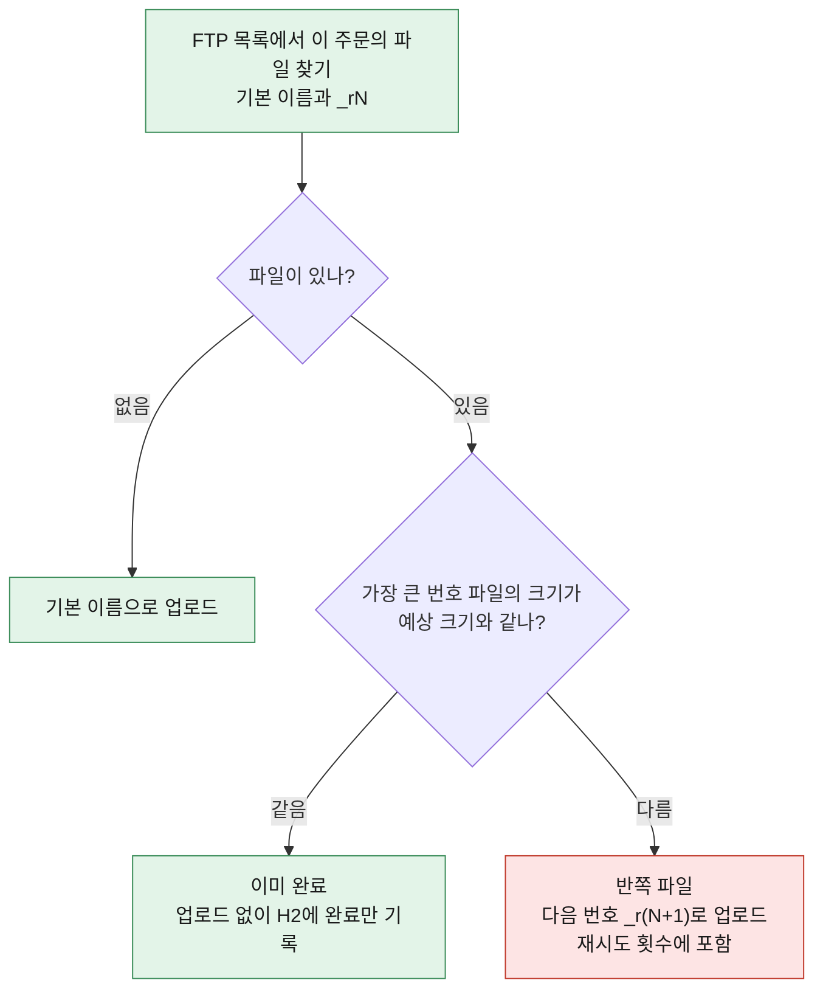

| 항목 | 내용 | 근거 |
|---|---|---|
| 위치 | 제공된 FTP 업로드 경로 (공용 폴더) | |
| 단위 | 주문 1건 = 파일 1개 | D-07, D-09 |
| 형식 | CSV, 헤더 1줄 + 데이터 1줄 | D-09 |
| 항목 | `ORDER_ID`, `USER_ID`, `NAME`, `ITEM_ID`, `ITEM_NAME`, `PRICE`, `RECEIVED_AT` (헤더는 DB 컬럼명) | D-09 |
| 수신일시 | `yyyy-MM-dd HH:mm:ss`, 한국 시간. 메시지를 처음 받은 시각이라 재시도해도 같다. 엑셀이 날짜로 읽는 형식 | D-09 |
| 내용 인코딩 | UTF-8 + BOM 기본. 인코딩과 BOM은 설정으로 바꿀 수 있다. BOM이 없으면 한국어 엑셀이 CP949로 읽어 한글이 깨진다 | D-09 |
| 줄바꿈·이스케이프 | CRLF, 마지막 줄 포함. 쉼표·따옴표·줄바꿈이 있는 값만 큰따옴표로 감싼다 (RFC 4180). `PRICE`는 숫자만 | D-09 |
| 수식 무력화 | `=` `+` `-` `@` 탭·CR로 시작하는 값은 앞에 `'`를 붙이고 큰따옴표로 감싼다 (OWASP CSV Injection). 예: `-10% 할인, 쿠폰` → `"'-10% 할인, 쿠폰"`. 쇼핑몰이 보낸 값이 엑셀에서 수식으로 실행되지 않게 한다. 거부하지 않으므로 그런 값은 `'`가 남는다 | D-09 |
| 전송 | 바이너리 모드. ASCII 모드는 줄바꿈을 바꿔 크기가 달라진다 | D-09 |
| 정본 규칙 | 같은 주문은 재시도 번호가 가장 큰 파일이 정본 | D-09 |

- 내용은 `ORDER_TB`와 H2에 저장된 값만으로 만든다. 같은 주문이면 항상 같은 바이트가 나오므로 예상 크기를 미리 계산할 수 있다.
- 파일 내용 예시. §5.1 예시의 `A002`(`영수증_홍길동_A002.csv`)다. ``은 BOM, `⏎`는 CRLF:

  ```
  ORDER_ID,USER_ID,NAME,ITEM_ID,ITEM_NAME,PRICE,RECEIVED_AT⏎
  A002,USER01,김민수,ITEM10,"노트북 거치대, 블랙",32000,2026-10-31 14:05:12⏎
  ```

- 형식은 받는 쪽(회계)이 정해 주지 않아 CSV 표준과 엑셀 기본 동작에 맞췄다. 받는 쪽 요구가 생기면 설정과 이 표를 고친다.
- 파일명은 UTF-8로 보낸다(FTP 제어 연결 인코딩). 서버가 `FEAT`에 `UTF8`을 알리고, 공용 폴더의 한글 파일명 64개가 모두 UTF-8로 읽혔다. 연결은 평문 FTP다 (D-09, §11.1).

### 5.3 IF-03 배송 등록

- `SHIPMENT_TB`에 §4.1의 값으로 1행을 INSERT한다.
- 먼저 H2 `ORDER_STAGE`(배송 단계)에 `SHIPMENT_ID`가 없으면 채번해 기록한다. 채번과 기록은 한 H2 트랜잭션이다 (D-03 보완, D-08).
- INSERT 전에 `APPLICANT_KEY` + `ORDER_ID`로 기존 배송을 조회해, 있으면 INSERT 없이 H2에 배송 완료만 적는다 (D-03, D-26).
- 없으면 미리 배정한 번호로 INSERT한 뒤 H2에 배송 완료를 적는다. 재시도해도 같은 번호다. `STATUS`는 건드리지 않는다(마감 스케줄러 몫).
- INSERT에서 PK 충돌이 나면 새 트랜잭션에서 그 번호로 다시 조회한다. `ORDER_ID`·`ITEM_ID`·`ADDRESS`가 같으면 앞 시도가 늦게 커밋된 것이라 배송 완료, 다르면 재시도 없이 배송 `FAILED` (D-03 보완, D-19).

### 5.4 IF-04 조회 API와 재처리 API

| 질문 | 요청 (D-18) | 응답 `data` |
|---|---|---|
| 🔎 이 주문 어디까지 갔나? | `GET /tracking/orders/{orderId}` | Oracle `STATUS`(N/Y), 단계별 상태 `receipt`·`shipment`(§6), 메시지 ID, 수신 시각, 단계별 횟수·다음 시도·마지막 오류·파일명·`SHIPMENT_ID`, 시간순 이벤트 |
| 🚨 막힌 주문이 있나? | `GET /tracking/orders?receipt=&shipment=&from=&to=&after=&limit=` | 진행 중(`STATUS=N`) 주문 목록과 마지막 오류. `receipt`·`shipment`는 단계별 상태 `PENDING`·`DONE`·`FAILED`(§6). 끝난(`Y`) 주문은 목록에 없고 주문번호로 본다 |
| 📨 보낸 메시지가 어떻게 됐나? | `GET /tracking/messages/{messageId}` | 상태, 응답 코드, 수신 응답과 같은 저장·거부·경고 목록, 이벤트 |
| 🕳️ 처리가 안 끝난 메시지가 있나? | `GET /tracking/messages?state=&from=&to=&after=&limit=` | 메시지 목록 (상태, 응답 코드, 수신 시각) |

- 응답 구조는 수신 API와 같다: 단건 `{ traceId, data }`, 목록 `{ traceId, data: [...], page: { nextAfter, limit } }`, 오류는 Problem Details (D-18).
- **목록 페이징:** `limit` 기본 50, 최대 200. 다음 페이지는 `after`에 마지막으로 받은 `ORDER_ID` 또는 메시지 ID를 넣는다. `ORDER_ID`는 고정 길이라 문자열 순서가 번호 순서이고, 메시지 ID(TSID)는 시간순이다. 조회 중 새 주문이 들어와도 결과가 밀리지 않는다.
- **메시지 목록이 필요한 이유:** 재전송이 오지 않아 `PROCESSING`·`FAILED`로 남은 메시지를 사람이 찾아야 한다 (D-04). 송신자가 응답을 못 받았다면 `messageId`도 모르므로 상태와 시간 범위로 찾는다.
- `from`, `to`는 수신 시각(H2) 기준이다.
- **주문 목록은 진행 중(`STATUS=N`) 주문만 보여 준다 (D-13 2026-11-04 보완).** 목록은 "막힌 주문이 있나?"에 답하려고 두었고, 막힌 주문은 모두 `N`이다. `Y` 주문은 지워지지 않고 쌓이기만 해서(최대 약 2만 6천 건, D-08), 목록에 넣으면 한 페이지를 내려고 쌓인 주문을 전부 읽어야 한다. 끝난 주문은 주문번호로 상세를 본다. H2 기록이 없는 `Y` 주문도 상세에서는 두 단계 `DONE`이다. `DONE` 조건은 `N` 주문 중 한 단계만 끝난 것(예: 영수증 `DONE`, 배송 `PENDING`)을 찾는 데 쓴다.
- **주문 목록은 단계별 상태로 먼저 거르고 나서 자른다.** 커서 `after`는 Oracle 쿼리에 넣어(`ORDER_ID > after`) 내 `N` 주문을 고르고, H2 단계 기록과 합쳐 단계별 상태와 수신 시각으로 거른 **뒤에** `limit`으로 자른다. 자른 뒤에 거르면 한 페이지가 비거나 다음 커서가 틀린다.
- H2 조회가 실패하면 오류로 응답한다. "기록 없음"으로 바꿔 보여 주지 않는다.
- 주문 상세의 이벤트는 페이징하지 않는다. 한 주문의 이벤트는 많아야 수십 건이다.

**재처리 API (운영자 쓰기 하나).** "사람이 확인" 표시를 지워 자동 처리를 다시 시작한다 (D-26).

| 요청 | 하는 일 | 응답 |
|---|---|---|
| `POST /operations/orders/{orderId}/retry` | H2 한 트랜잭션: 표시가 있는 단계의 `ATTEMPTS=0`, `REACHED_FAILED` 해제, `NEXT_ATTEMPT_AT` 비움. 이어서 `OPERATOR_RESET` 이벤트 | `200` + 다시 시작한 단계 목록. 표시가 하나도 없으면 `409` |

- **H2만 바꾼다.** Oracle `STATUS`에는 "사람이 확인"을 담을 곳이 없어(N/Y만), 표시도 해제도 H2 한 곳에서 끝난다. 그래서 이중 쓰기가 아니다. 예전에 "상태를 바꾸는 API는 없다"고 한 이유가 이 이중 쓰기였다 (D-13).
- **단계를 받지 않고, 표시가 있는 단계를 모두 다시 시작한다.** 두 단계는 따로 처리되므로 둘 다 멈춰 있을 수 있다. 운영자는 원인을 고친 뒤 주문 단위로 부른다. 한쪽 원인만 고쳤다면 다른 쪽은 다시 5회 시도한 뒤 멈춘다.
- **지우는 것은 재시도 상태뿐이다.** 영수증 완료 시각, 파일명, 미리 배정한 `SHIPMENT_ID`는 그대로 둔다. 번호를 지우면 결과 불명이던 앞 INSERT와 다른 번호로 중복 배송이 생길 수 있다 (D-03 보완).
- **잠금 없이 조건부 갱신으로 한다.** 표시를 쓰는 쪽은 스케줄러, 지우는 쪽은 이 API뿐이고, 스케줄러는 표시된 주문을 고르지 않는다. API는 `WHERE REACHED_FAILED = TRUE`로만 지우므로, 스케줄러가 처리 중인(아직 표시가 없는) 주문에는 `409`가 난다. 건별 실패를 한 트랜잭션으로 쓰는 것(§4.2)이 이 판단의 전제다.
- 이벤트는 다른 이벤트와 같이 따로 커밋한다. 이벤트 기록이 실패해도 재처리는 된다 (D-13).
- 인증은 범위 밖이다. 이 API가 바꾸는 것은 재시도 횟수뿐이라, 잘못 불러도 자동 처리가 한 번 더 도는 데 그친다.

**운영자가 막힌 주문을 푸는 과정.** 조회도 재처리도 API로 한다 (D-13, D-26).

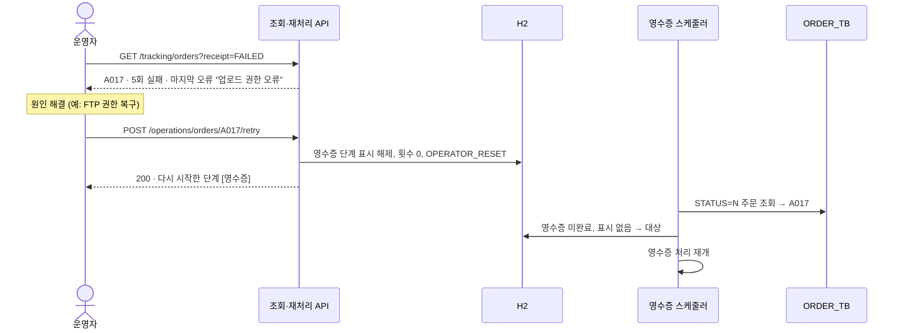

## 6. 상태 전이

**주문 하나에 상태가 셋이다 (D-26).** 영수증과 배송은 서로 기다리지 않고 따로 처리되며, 각자 단계 상태를 H2에 가진다. Oracle `STATUS`는 두 단계를 합친 요약 하나다.

| 상태 | 저장 위치 | 값 | 쓰는 쪽 |
|---|---|---|---|
| 영수증 단계 | H2 `ORDER_STAGE` 영수증 행 | `PENDING` · `DONE` · `FAILED` | 영수증 스케줄러, 재처리 API |
| 배송 단계 | H2 `ORDER_STAGE` 배송 행 | `PENDING` · `DONE` · `FAILED` | 배송 스케줄러, 재처리 API |
| 연계 완료 | Oracle `ORDER_TB.STATUS` | `N` · `Y` | 수신(`N`), 마감 스케줄러(`Y`) |

**단계 상태 (영수증·배송 같은 모양).** 저장된 필드에서 읽는다: `COMPLETED_AT`이 있으면 `DONE`, 없고 `REACHED_FAILED`이면 `FAILED`, 둘 다 아니면 `PENDING`. 행이 아직 없어도 `PENDING`이다.

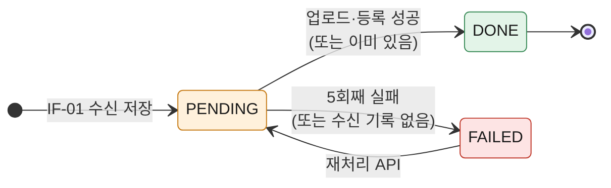

**연계 완료 (Oracle `STATUS`).**

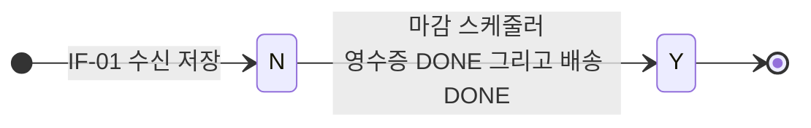

| 단계 상태 | 뜻 | 다음에 처리하는 쪽 |
|---|---|---|
| 🟠 `PENDING` | 처리 대기, 또는 백오프 중 | 그 단계의 스케줄러 |
| 🟢 `DONE` | 업로드·등록 완료 | — |
| 🔴 `FAILED` | 자동 처리 멈춤 (재시도 한도 초과, 또는 H2에 수신 기록 없음). 사람이 확인 | 운영자 (재처리 API) |

- **두 단계는 서로를 모른다.** FTP 장애로 영수증이 `FAILED`여도 배송은 `DONE`까지 간다. 순서를 정할 업무 요구가 없고, FTP 장애가 출고를 막지 않게 하기 위해서다. 예전의 "영수증 → 배송 순차"(D-06)는 `STATUS` 한 칸에 두 진행을 담아야 해서 고른 것이었다 (D-26).
- **`Y`는 마감 스케줄러만 쓴다.** 영수증·배송 스케줄러는 자기 단계만 적고 끝난다. 두 단계가 모두 `DONE`인 `N` 주문을 마감 스케줄러가 찾아 `Y`로 바꾼다. 완료를 적은 뒤 `Y`를 쓰기 전에 멈춘 주문도 같은 조건으로 다음 주기에 찾는다.
- **`Y`는 "다 끝났으니 다시 보지 마라"는 표시다.** 끝난 주문이 작업 대상에서 빠지고, H2가 빈 채로 실행해도(다른 PC 등) 끝난 주문을 다시 보거나 실패로 표시하지 않는다. 지울 수 없는 Oracle에 남으므로 H2를 잃어도 남는다.
- 한도 미만의 실패는 단계 상태를 바꾸지 않고 H2에 횟수만 기록한다. `FAILED`는 주문 취소가 아니라 "사람이 확인할 단계"다.
- H2에 수신 기록(`MESSAGE_ORDER`)이 없는 주문은 다시 해도 결과가 같아 재시도 없이 바로 그 단계가 `FAILED`가 된다. 마지막 오류에 "H2에 수신 기록 없음"이 남는다 (D-22).
- 작업 대상은 `STATUS=N` **행**에서 시작한다. H2에만 있고 Oracle에 없는 주문(메시지가 `PROCESSING`·`FAILED`라 저장되지 않음)은 단계 상태가 없고, 메시지 조회(`GET /tracking/messages?state=`)로 찾는다. Oracle에 저장됐는데 메시지가 아직 `PROCESSING`인 주문은 후속 처리를 막지 않는다.

## 7. 처리 흐름

### 7.1 IF-01 주문 수신 (동기)

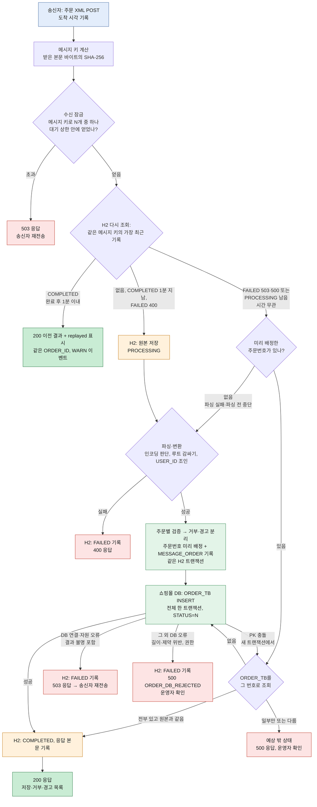

- 파싱 실패에는 인코딩 오류(읽을 수 없는 바이트, 허용하지 않는 문자셋)와 DOCTYPE 포함이 들어간다. 빈 본문(0바이트, 또는 BOM·XML 선언·공백만 있음)도 파싱 실패다. 루트로 감싸면 형식상 맞는 빈 문서가 되어 0건 `200`이 나가는데, 첨부를 빠뜨린 송신자 실수를 성공으로 숨기게 된다. HEADER·ITEM 없이 다른 요소만 있는 본문은 형식이 맞으므로 0건 `200`이다. 인코딩은 BOM → `Content-Type` charset → XML 선언 → 기본 EUC-KR 순으로 정하고, EUC-KR 계열은 MS949로 읽는다 (D-20).
- 응답은 모두 수신 잠금 안에서 결정하고, 잠금은 성공·실패와 관계없이 반드시 푼다(`finally`).
- 잠금은 트랜잭션 **바깥**에 건다. 트랜잭션 안에서 잠그면 커밋 전에 잠금이 풀려 다음 요청이 커밋 전 상태를 본다 (D-16).
- 1분 창은 이전 메시지의 완료 시각(`COMPLETED_AT`)과 이번 요청이 **도착한** 시각을 비교한다. 잠금을 얻은 시각으로 비교하면 잠금 대기 때문에 재전송이 새 주문으로 처리될 수 있다. 재전송이 완료보다 먼저 도착해 기다렸다면 창 안이다 (D-16, D-24).
- 실패(`503`·`500`)·처리 중 메시지는 시간과 관계없이 이어서 처리한다. 송신자에게는 아직 들어가지 않은 주문이라, 재전송이든 새 주문이든 "한 번 저장"이 맞다. `400`으로 실패한 메시지는 저장한 것도 번호도 없으므로 다음 요청을 새 메시지로 본다 (D-24).
- 이어서 처리한 조회 결과가 "전부 있고 원본과 같음"이면 이번 요청이 저장한 것이 아니므로 `200`에 `"replayed": true`를 붙인다 (D-24).
- 다시 처리할 때는 같은 `RECEIVED_MESSAGE` 기록을 이어 쓰고, 저장해 둔 원본을 다시 파싱해 INSERT 값과 응답을 만든다. 재전송 본문과 바이트가 같으므로 결과도 같다. 미리 배정한 주문번호는 `SEQ` 순서대로 다시 붙인다 (D-16).
- `ORDER_TB` 커밋 뒤의 실패(H2 완료 기록 실패 등)는 `200`으로 응답한다. 업무 데이터는 저장됐고 이력은 최선 노력이다 (D-04). `PROCESSING`으로 남은 기록은 재전송이 오면 조회로 완료 처리된다 (D-16).

**재전송 시나리오.** 응답을 못 받고 곧바로(완료 후 1분 안에) 같은 XML을 다시 보내거나, `503`을 받고 언제든 다시 보내도 주문은 한 번만 저장된다 (D-05, D-15, D-24).

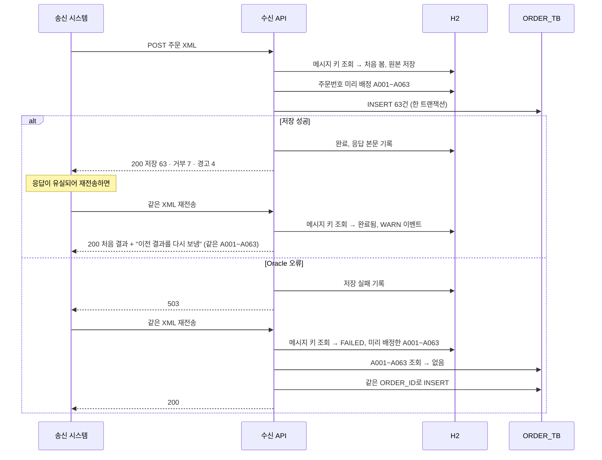

**처리 중에 재전송이 겹치면.** 같은 메시지 키는 같은 잠금을 받으므로 두 번째 요청은 첫 요청이 끝날 때까지 기다린다 (D-16).

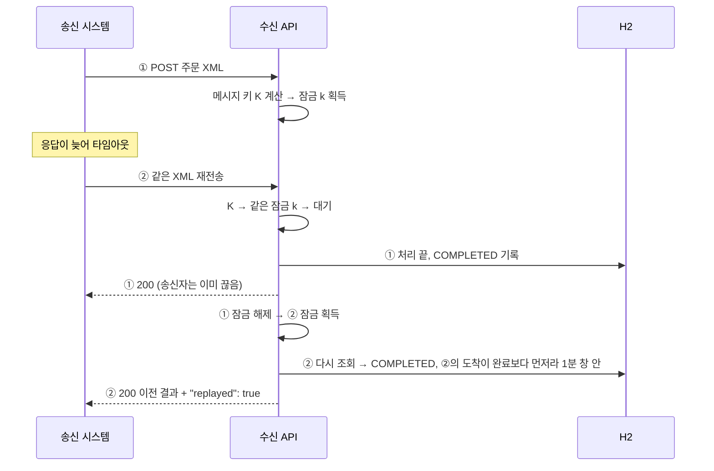

**처리 중에 앱이 중단됐다면.** Oracle 커밋 후 H2에 완료를 적기 전에 앱이 멈추면 H2에는 `PROCESSING`이 남는다. 재전송이 오면 미리 배정한 주문번호로 먼저 조회한다 (D-16).

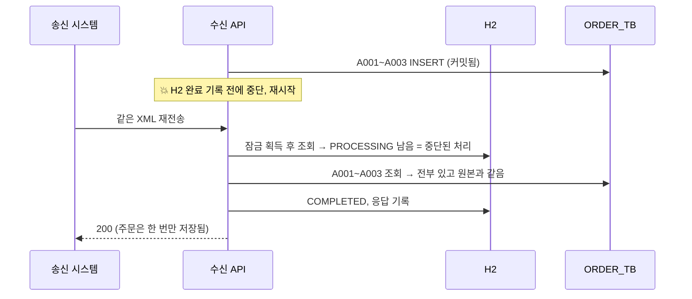

- 조회 결과가 없으면 같은 번호로 INSERT한다. 일부만 있거나 내용이 원본과 다르면 원래 생길 수 없는 상태라 `500`으로 멈추고 운영자가 확인한다.
- **INSERT에서 PK 충돌이 나도 바로 `500`이 아니다 (D-19).** 앞 요청이 `ReadTimeout`으로 포기했어도 Oracle 서버에서는 그 커밋이 늦게 끝날 수 있다. 그러면 재전송의 조회는 "없음"을 보고 INSERT하다가 앞 요청 자신의 행과 부딪힌다. 새 트랜잭션에서 다시 조회해 원본과 같으면 완료 `200`이다.
- 커밋 중 타임아웃은 저장됐는지 알 수 없는 "결과 불명"이다. 롤백됐다고 단정하지 않고 `503`으로 응답해, 재전송 때 조회로 확인한다. 그 연결은 풀에 돌려보내지 않는다.

### 7.2 IF-02 영수증 / IF-03 배송 / 마감 (스케줄러)

스케줄러는 셋이다. 모두 `fixedDelay` 30초로 돌고, 한 주기에 최대 100건을 `ORDER_ID` 오름차순으로 처리한다 (D-12).

| 스케줄러 | 대상 | 하는 일 | 쓰는 곳 |
|---|---|---|---|
| 영수증 (IF-02) | `STATUS=N`, 영수증 `PENDING` | 업로드 → H2 영수증 완료 | FTP, H2 |
| 배송 (IF-03) | `STATUS=N`, 배송 `PENDING` | INSERT → H2 배송 완료 | 운송 Oracle, H2 |
| 마감 | `STATUS=N`, 영수증·배송 모두 `DONE` | `STATUS` N→Y (조건부) | 쇼핑몰 Oracle |

- **스레드는 3개, 스케줄러마다 하나다.** 영수증이 느린 FTP에 묶여 있어도 배송과 마감은 제 주기에 돈다. `fixedDelay`라 같은 스케줄러는 자기 자신과 겹치지 않는다 (D-12, D-26).
- **동시에 돌아도 부딪히지 않는다.** 영수증과 배송은 H2에서 서로 다른 행을 쓰고, 마감은 H2를 읽기만 하며 `Y`는 `WHERE STATUS = 'N'` 조건부로 쓴다. 재처리 API는 표시가 있는 행만 조건부로 지운다(§5.4).
- 마감은 외부 연결이 없어 연결 실패가 없다. 쇼핑몰 Oracle·H2 장애면 그 주기를 끝내고 다음 주기에 다시 한다. 갱신이 0건이면(이미 `Y`) 오류로 보지 않는다.
- `Y`는 두 단계가 끝난 뒤 최대 한 주기(30초) 늦게 써진다. 그사이에도 각 스케줄러는 자기 단계가 `DONE`인 주문을 고르지 않으므로 다시 처리되지 않는다.

**영수증·배송 한 주기의 순서.**

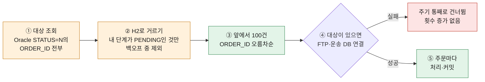

- 두 스케줄러는 같은 `STATUS=N` 집합을 읽고 H2에서 각자 자기 단계만 본다. 상대 단계의 상태는 보지 않는다 (D-26).
- ②를 ③보다 먼저 한다. 100건을 먼저 자르고 거르면, 그 100건이 모두 백오프 중이거나 `FAILED`·`DONE`일 때 뒤의 정상 주문이 계속 기다린다 (D-12).
- 재처리 API가 표시와 다음 시도 시각을 함께 지우므로, 재처리한 주문은 다음 주기에 바로 대상이 된다. 예전의 "되돌림 감지"는 필요 없다 (D-26).
- 한 주문의 실패가 다른 주문을 막지 않는다. 단, 연결이 끊기거나 쇼핑몰 Oracle·H2가 안 되면 남은 주문은 처리하지 않고 그 주기를 끝낸다. 같은 이유로 모두 실패하기 때문이다 (D-22).
- H2에 수신 기록(`MESSAGE_ORDER`)이 없는 주문은 재시도 없이 바로 그 단계에 "사람이 확인" 표시를 남긴다. 수신일시를 지어내지 않고, 복구는 운영자가 한다 (D-22).
- FTP 연결은 주기당 1회, 처리할 주문이 있을 때만 맺는다. 파일마다 접속하면 느리고 상대 서버에 부담이 된다 (D-12).
- 영수증·배송은 처리 전에 `inbound`의 서비스로 수신 기록을 조회한다. 영수증은 여기서 수신일시를 얻는다 (D-21).

**주문 하나의 처리.**

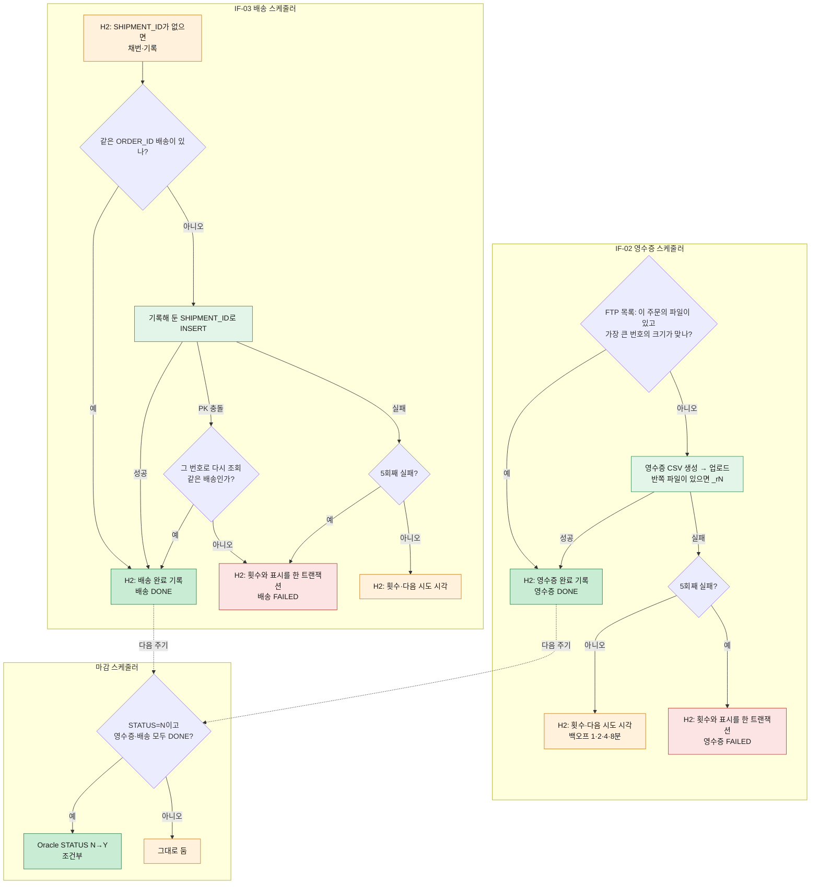

- 배송 번호를 INSERT 전에 미리 배정하는 이유: 커밋 중 타임아웃으로 결과를 모를 때, 다음 주기의 조회에는 진행 중인 커밋이 보이지 않는다. 새 번호로 INSERT하면 앞 커밋이 늦게 끝났을 때 배송이 두 건이 된다. 같은 번호를 쓰면 PK로 부딪혀 한 건으로 끝난다 (D-03 보완).
- "사람이 확인" 표시는 H2 한 곳에만 쓴다. 예전에는 Oracle `STATUS`와 H2 두 곳에 써서 쓰는 순서를 정해야 했지만(D-10 Q-20), 이제 그 문제가 없다 (D-26).
- 업로드 뒤 영수증 완료 기록 전에 멈추면, 다음 주기에 FTP 목록에서 같은 크기의 파일을 찾아 업로드 없이 완료만 적는다. 배송 INSERT 뒤 배송 완료 기록 전에 멈추면, 다음 주기에 기존 배송을 찾아 완료만 적는다 (D-03).
- 두 단계 완료 뒤 `Y`를 쓰기 전에 멈추면, 마감 스케줄러가 다음 주기에 같은 조건으로 찾아 `Y`를 쓴다. 평소 처리와 복구가 같은 경로다 (D-26).
- 모든 단계의 결과는 H2 처리 이벤트로 남는다 (D-13).

### 7.3 앱 시작

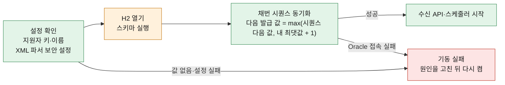

- "내 최댓값"은 `APPLICANT_KEY = 내 키`인 행의 `MAX(ORDER_ID)`다. 공용 테이블 전체의 최댓값이 아니다.
- `ORDER_SEQ`는 `ORDER_TB`, `SHIPMENT_SEQ`는 `SHIPMENT_TB`의 내 최댓값과 맞춘다. 평소에는 아무 일도 없고, H2가 비어 있을 때만 이미 쓴 번호를 다시 주지 않게 막는다 (D-08). 사고만이 아니라 새로 받은 코드나 다른 PC에서 실행할 때도 H2는 비어 있다 (`data/`는 Git 제외).
- 최댓값은 채번기의 포트 `IssuedIdReader`로 읽는다. 구현은 `order`와 `shipment`의 Oracle 어댑터에 있다 (D-21).
- **기동 실패 조건은 셋이다.** 조용히 틀린 채 도는 것보다 뜨지 않는 편이 낫다.

| 조건 | 그대로 돌면 생기는 일 | 근거 |
|---|---|---|
| `APPLICANT_KEY`나 지원자명이 없음 | 조건 없는 쿼리로 남의 행을 건드리거나, 이름 없는 영수증 파일이 올라간다. 둘 다 지울 수 없다 | D-23 |
| XML 파서 보안 설정이 하나라도 적용되지 않음 | 외부 엔티티(XXE)·엔티티 폭탄이 막히지 않는다 | D-20 |
| 채번 동기화 중 Oracle 접속 실패 | 이미 쓴 번호를 다시 발급해 PK 충돌이 난다 | D-22 |

## 8. 오류 처리와 재시도

**실패를 두 종류로 나눈다** (D-10, D-22). 기준은 "그 주문 자체의 문제인가"다. 건별 실패는 주문 취소가 아니다. 주문 행은 그대로 있고, 그 단계의 자동 처리만 멈췄다가 재개된다.

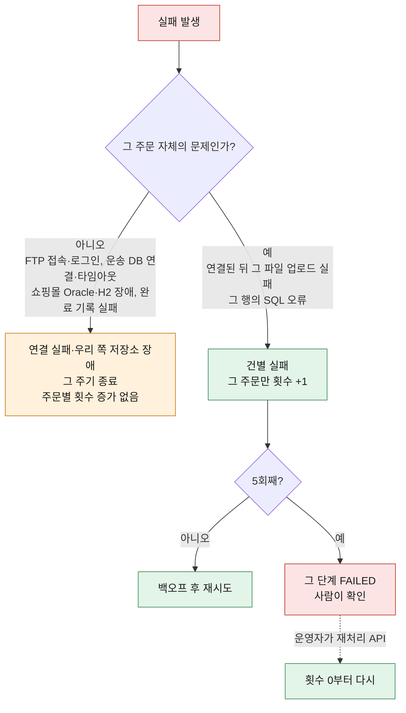

> [!TIP]
> 나누는 이유: 상대 시스템이 점검으로 30분 내려가면, 구분하지 않을 경우 대기 중인 주문 전체가 한도를 소진하고 한꺼번에 `FAILED`가 된다. 주문에는 문제가 없는데 운영자가 전부 하나씩 재처리해야 한다.

- 연결 실패는 상대 시스템(FTP, 운송 DB)에 닿지 못한 경우, 우리 쪽 저장소 장애는 쇼핑몰 Oracle·H2가 안 되거나 처리 뒤 H2 단계 완료 기록이 실패한 경우다. 정의는 다르지만 처리는 같다 (D-22).
- 운송 DB는 Spring 예외 분류의 연결·자원 계열이면 연결 실패, 나머지는 건별 실패로 본다.
- FTP 업로드 도중 연결이 끊기면(예외 또는 `426` 전송 중단 응답) 그 주문에 건별 실패 1회를 세고 주기를 끝낸다. 원인이 파일인지 네트워크인지 구분할 수 없다.
- FTP 데이터 연결 실패는 연결 실패다. 목록(LIST)은 마지막 응답이 완료(2xx)가 아니면(`425` 데이터 연결 못 엶, `426` 도중 끊김 등) 받은 목록을 믿지 않는다. 빈 목록으로 판단하면 있는 파일을 없다고 보고 다시 올리려다 멀쩡한 주문마다 실패를 센다. 업로드(STOR)의 `425`는 아무것도 보내지 않았으므로 횟수 없이 주기를 끝낸다. 그 밖의 거절(`550`, `553` 등)은 그 파일의 건별 실패다.
- FTP·운송 DB 연결 실패의 이벤트는 상태가 바뀔 때만 남긴다("시작"과 "복구"). 하루 장애에 30초마다 쌓이면 2,880건이 된다. ERROR 로그는 매 주기 남긴다 (D-22).

**건별 실패의 재시도 일정** (첫 실패 = 0분, 설정값).

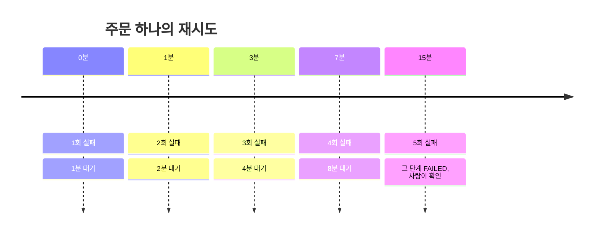

스케줄러가 30초마다 돌므로 실제 재시도는 대기 시간보다 최대 30초 늦을 수 있다.

**전체 오류 표.**

| 구간 | 오류 | 처리 | 근거 |
|---|---|---|---|
| 수신 | 본문이 상한(`max-body-size`)을 넘음 (Content-Length로 먼저 보고, 없거나 틀려도 상한 + 1바이트까지만 읽어 판단) | `413 PAYLOAD_TOO_LARGE`. 잠금도 저장도 하기 전에 거절해 H2에 기록이 없고 조회 API에 나오지 않는다. WARN 로그(받은 크기)만 남는다 | D-17, D-19 |
| 수신 | `Content-Type` 헤더가 H2 컬럼 길이(255자)를 넘음 | `400 INVALID_REQUEST`. 413과 같은 자리에서 잠금·저장 전에 거절한다. 그대로 저장하면 H2 INSERT가 실패해 `503`이 나가고 재전송해도 계속 `503`이다. 자르지 않는다 (charset이 떨어지면 다시 파싱할 때 결과가 달라짐). WARN 로그(헤더 길이)만 남는다 | D-16, D-17, D-20 |
| 수신 | XML 파싱 실패 (빈 본문 포함: 0바이트, 또는 BOM·XML 선언·공백만 있음) | `400`, H2에 원본과 실패 기록 | D-04, D-17 |
| 수신 | 인코딩 오류 (읽을 수 없는 바이트, 허용하지 않는 문자셋) 또는 DOCTYPE | `400 XML_PARSE_ERROR`, `detail`에 원인과 위치. 대체 문자로 바꿔 저장하지 않는다 | D-07, D-20 |
| 수신 | 주문 검증 실패 | 그 주문만 거부, 나머지 저장. `200`에 거부 목록 | D-07 |
| 수신 | Oracle 연결·자원 장애 (접속 실패, 타임아웃, 풀 연결 대기 초과, 연결 끊김) | `503`. 송신자가 재전송하면 미리 배정한 주문번호로 조회 후 이어서 처리 | D-04, D-05, D-16, D-17 |
| 수신 | Oracle이 저장을 거절 (값 길이 초과, NOT NULL·제약 위반, 권한 없음) | `500` + `ORDER_DB_REJECTED`, H2에 `FAILED`. 묶음 전체가 저장되지 않음. 운영자가 원인(검증 기준, 권한 등)을 고친 뒤 재전송하면 원본을 다시 파싱해 이어서 처리 | D-05, D-17 |
| 수신 | Oracle 커밋 중 타임아웃 (결과 불명) | `503`, H2에 `FAILED` + `FAIL` 이벤트(상세 "커밋 결과 불명"). 그 연결은 버림. 재전송 때 조회로 확인 | D-19 |
| 수신 | INSERT 중 PK 충돌 | 롤백 후 새 트랜잭션에서 다시 조회·비교. 원본과 같으면 완료 `200`, 다르면 `500` + 운영자 확인. "이미 처리됨"으로 단정하지 않는다 | D-05, D-16, D-19 |
| 수신 | 재처리 때 미리 배정한 번호의 행이 일부만 있거나 원본과 다름 | `500`, 예상 밖 상태로 기록. 운영자 확인 | D-16 |
| 수신 | H2 사용 불가 | `503`. 채번과 중복 판단이 H2에 있어 진행할 수 없다. 원본도 저장되지 않아 재전송은 처음부터 처리된다 | D-04, D-08 |
| 수신 | `ORDER_TB` 커밋 뒤 H2 기록 실패, 또는 그 사이 앱 중단 | `200`(중단이면 응답 없음). `PROCESSING`으로 남은 메시지는 재전송 시 조회로 완료 처리 | D-04, D-16 |
| 수신 | 같은 본문이 처리 중에 겹쳐 옴 | 같은 잠금에서 기다렸다가 이전 결과를 `200` + `"replayed": true`로 받음 | D-16 |
| 수신 | 수신 잠금 대기 상한 초과 | `503`. 송신자가 재전송 | D-16 |
| 수신 | 채번 소진 (`Z999` 초과) | `500` + `ORDER_ID_EXHAUSTED`, 수신 거부, 이력 기록 | D-08, D-17 |
| 시작 | 채번 동기화 중 Oracle 접속 실패 | 기동 실패. Oracle 복구 후 다시 켬 | D-08, D-22 |
| 시작 | `APPLICANT_KEY`·지원자명 없음 | 기동 실패. `config/`를 확인 | D-23 |
| 시작 | XML 파서 보안 설정 적용 실패 | 기동 실패 | D-20 |
| 영수증·배송 | FTP·운송 DB 연결 실패 (FTP는 접속·로그인·경로 이동, 목록의 데이터 연결 실패·중단(`425`·`426` 등 완료가 아닌 응답), 업로드의 `425` 포함) | 주기 건너뜀. 주문별 횟수 증가 없음, `FAILED`를 만들지 않음. 이벤트는 시작·복구 때만 | D-10, D-22 |
| 영수증·배송 | 쇼핑몰 Oracle·H2 장애, 처리 후 H2 단계 완료 기록 실패 | 그 주기 종료. 횟수 안 셈. 다음 주기 사전 확인으로 완료만 기록 | D-03, D-22, D-26 |
| 영수증·배송 | 주문 하나의 업로드·INSERT 실패 (건별 실패) | 지수 백오프 1·2·4·8분, 5회째 실패면 그 단계 `FAILED`. 횟수와 표시는 한 H2 트랜잭션 | D-10, D-26 |
| 영수증·배송 | H2에 수신 기록(`MESSAGE_ORDER`)이 없는 주문 | 재시도 없이 그 단계 `FAILED`, `MISSING_RECORD` 이벤트. 운영자가 데이터 복구 후 재처리 API | D-22, D-26 |
| 배송 | 운송 DB 커밋 중 타임아웃 (결과 불명) | 연결 실패로 주기 종료. 다음 주기에 미리 배정한 같은 `SHIPMENT_ID`로 다시 시도해, 앞 커밋이 늦게 끝났으면 PK 충돌로 드러난다 | D-03, D-19, D-22 |
| 배송 | INSERT PK 충돌 | 롤백 후 그 번호로 다시 조회·비교. 같으면 배송 완료, 다르면 재시도 없이 배송 `FAILED` + 이벤트 | D-03, D-19 |
| 영수증 | 반쪽 파일 발견 | 다음 번호 `_r{N+1}`로 재업로드. 재시도 횟수에 포함 | D-09, D-10 |
| 영수증·배송 | 처리 후 완료 기록 전 중단 | 다음 주기에 사전 확인(FTP 목록, `SHIPMENT_TB` 조회)으로 중복 없이 완료만 기록 | D-03, D-26 |
| 마감 | 쇼핑몰 Oracle·H2 장애 | 그 주기 종료. 다음 주기에 같은 조건으로 다시 | D-22, D-26 |
| 마감 | N→Y 조건부 갱신 0건 (이미 `Y`) | 오류로 보지 않고 넘어감 | D-26 |
| 영수증 | FTP 장애·영수증 `FAILED` | 영수증만 멈춤. 배송은 그대로 진행. `Y`는 영수증이 끝난 뒤 | D-26 |
| 영수증·배송 | 상대가 응답 없이 멈춤 | 접속·전송 타임아웃으로 실패로 바꿔 위 규칙을 따른다 | D-12, D-19 |
| 운영 | 단계 `FAILED` 원인 해결 | 재처리 API로 H2 표시와 횟수를 지움 → 다음 주기에 다시 처리 | D-26 |
| 운영 | 재처리 API: 표시가 하나도 없음 | `409`. 바꾸지 않음 | D-26 |
| 운영 | H2를 옛 백업으로 복원 | 앱을 멈춘 채 복원하고, 켜기 전에 `STATUS=N` 주문을 FTP 목록·`SHIPMENT_TB`와 대조 | D-26 |

**중단 복구 예시: 배송 INSERT 커밋 후 H2 완료 기록 직전에 앱이 죽으면** (D-03).

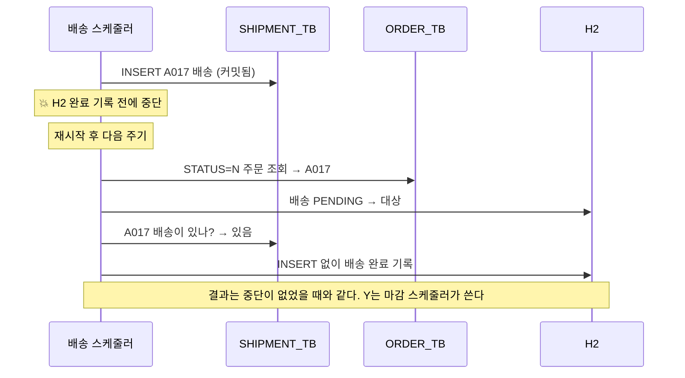

**로그.** 모든 로그에 `traceId`, `ORDER_ID`, 메시지 ID를 MDC 키로 붙인다. `traceId`는 요청마다 만들어 응답에도 돌려준다 (D-18). 로그는 개발자용이고, 운영자는 조회 API를 본다 (D-13).

## 9. 설정값

| 분류 | 설정 | 기본값 | 보관 위치 | 근거 |
|---|---|---|---|---|
| 지원자 | `APPLICANT_KEY` | — (없으면 기동 실패) | 제공 환경: `config/connection.json` · 로컬: 저장소의 가짜 값 | D-01, D-23 |
| 지원자 | 지원자명 (파일명용) | — (없으면 기동 실패) | 제공 환경: `config/bootstrap.properties`(UTF-8로 직접 읽음) · 로컬: 저장소의 가짜 값 | D-09, D-23 |
| 쇼핑몰 DB | URL, 계정 | — | 제공 환경: `config/` (Git 제외) · 로컬: 저장소 | D-02, D-14 |
| 운송 DB | URL, 계정 | — | 제공 환경: `config/` · 로컬: 저장소 | D-02, D-14 |
| H2 | 파일 경로 | 프로필별 `./data/local/history`, `./data/provided/history`. 로컬 리허설의 수신 기록·채번이 제공 환경 실행에 섞이지 않게 나눈다 | 저장소 | D-04, D-19 |
| H2 | `WRITE_DELAY` | 0 (커밋 즉시 기록) | 저장소 | D-19 |
| FTP | 호스트, 포트, 계정, 업로드 경로, 파일명 인코딩 | 평문 FTP, 파일명 UTF-8 (§11.1) | 제공 환경: `config/` · 로컬: 저장소 | D-09 |
| Oracle (두 DB) | 접속 타임아웃, 응답 읽기 타임아웃 | 3초, 10초 | 저장소 | D-12, D-19 |
| Oracle | 커넥션 풀 크기 | 쇼핑몰 7, 운송 2 (고정 크기) | 저장소 | D-19, D-26 |
| Oracle | 풀 연결 대기 상한 | 5초 | 저장소 | D-19 |
| FTP | 접속 / 명령 응답 / 데이터 타임아웃 | 5초 / 30초 / 30초 | 저장소 | D-12, D-19 |
| 수신 | 기본 인코딩 (표시가 없을 때) | EUC-KR (MS949로 디코딩) | 저장소 | D-04, D-20 |
| 수신 | 해시 중복 판단 시간 창 (완료된 메시지에만) | 완료 후 1분 | 저장소 | D-05, D-15, D-24 |
| 수신 | 수신 잠금 수 N | 16 | 저장소 | D-16, D-19 |
| 수신 | 수신 잠금 대기 상한 | 10초 | 저장소 | D-16, D-19 |
| 수신 | 본문 상한 (`max-body-size`). 넘으면 저장 전에 `413`으로 거절하고 기록하지 않는다 | 1MB (샘플 63건이 몇 KB라 수천 건 묶음도 받는다) | 저장소 | D-17, D-19 |
| 수신 | `503`의 `Retry-After` | `BUSY` 5초, DB 장애 30초 | 저장소 (오류 코드 enum) | D-17, D-19 |
| 조회 API | 목록 건수 `limit` 기본값, 최댓값 | 50, 200 | 저장소 | D-18 |
| 영수증 | 내용 인코딩 | UTF-8 + BOM | 저장소 | D-09 |
| 스케줄러 | 주기 (`fixedDelay`) | 30초 | 저장소 | D-12 |
| 스케줄러 | 주기당 처리 건수 | 100 | 저장소 | D-12 |
| 스케줄러 | 스레드 수 | 3 (영수증·배송·마감에 하나씩, 명시) | 저장소 | D-12, D-19, D-26 |
| 재시도 | 최대 시도 횟수 (첫 시도 포함) | 5 | 저장소 | D-10 |
| 재시도 | 백오프 시작 간격, 배수 | 1분, 2배 (대기는 4번: 1·2·4·8분) | 저장소 | D-10 |

> [!CAUTION]
> 제공 환경 접속 정보, `APPLICANT_KEY`, 지원자 실명은 Git에서 제외된 `config/`에만 둔다. 앱은 부트스트랩이 만든 파일에서 그대로 읽고 복사본을 만들지 않는다. 로컬 환경 값은 비밀이 아니므로 저장소에 둔다 (D-14, D-23).

**값 사이의 관계.** 스케줄러 주기(30초)는 가장 짧은 백오프(1분)보다 짧아야 백오프가 의도대로 동작한다. 주기를 바꾸면 백오프 시작 간격도 함께 본다 (D-12). 수신 잠금 대기 상한은 평소 처리 시간(1초 미만)보다 충분히 길면 된다. 최악 처리 시간까지 기다리게 하면 송신자가 먼저 타임아웃 나고, 상한을 넘으면 `503 BUSY`가 나가 재전송으로 풀린다 (D-17, D-19). 풀 연결 대기 상한(5초)은 접속 타임아웃(3초)보다 길어야 빈 풀에서 새 연결을 맺을 수 있다. 기본값(30초)이면 DB가 내려갔을 때 3초가 아니라 30초 뒤에야 `503`이 나간다 (D-19).

- 표에 없는 값(H2 잠금 대기, 커넥션 수명)은 라이브러리 기본값을 쓴다. 기본값이 무한 대기이거나, 기본값이 다른 값의 의도를 무너뜨리는 곳에만 정했다 (D-19).
- 커넥션 풀 크기는 공용 계정에 맞춘 값이다. 두 풀이 같은 계정에 붙어, 기본값(10)이면 앱 하나가 늘 20개를 붙잡는다 (D-19).
  - 쇼핑몰 7 = 동시 수신 2~3 + 스케줄러 3(셋 다 쇼핑몰 Oracle을 읽음) + 조회 1. 운송 2 = 배송 스케줄러 1 + 시작 동기화 (D-26).

## 10. 실행 환경

```mermaid
flowchart LR
    L["① 로컬 개발·테스트<br/>컨테이너 Oracle·FTP<br/>운영과 같은 권한"]:::local --> R["② 제공 환경 확인<br/>읽기 전용<br/>길이 단위·인코딩·FTPS"]:::prod
    R --> F["③ 최종 실행 1회<br/>제출 전<br/>63건 모두 STATUS=Y"]:::prod
    F --> I["④ 면접 당일 시연<br/>새 ORDER_ID 추가"]:::prod

    classDef local fill:#e3f4e8,stroke:#3c8d5a,color:#1a1a1a
    classDef prod fill:#fde4e4,stroke:#c0392b,color:#1a1a1a
```

초록은 마음대로 지우고 다시 해도 되는 곳, 빨강은 남긴 것이 그대로 평가 대상이 되는 곳이다 (D-11).

| 환경 | Oracle | FTP | 용도 | 근거 |
|---|---|---|---|---|
| 로컬 (`local` 프로필) | Oracle Database Free 컨테이너 | FTP 서버 컨테이너 | 개발, 시행착오, 리허설 | D-14 |
| 자동 테스트 | Testcontainers (같은 이미지) | Testcontainers (같은 이미지) | 통합 테스트. 장애 시나리오는 가짜 구현으로 단위 테스트 | D-14 |
| 제공 환경 | 과제 Oracle | 과제 FTP | 읽기 전용 확인 → 제출 전 최종 실행 1회 → 면접 당일 시연 | D-11 |

- 로컬은 운영 조건을 재현한다: 앱 계정 권한은 SELECT·INSERT·UPDATE만, 다른 `APPLICANT_KEY` 행을 미리 넣은 공용 테이블, FTP는 목록·업로드만 (D-14).
  - 제공 환경에서 확인한 제약도 로컬 초기화 스크립트에 넣는다: `STATUS IN ('N', 'Y')` CHECK, `ORDER_ID`·`SHIPMENT_ID` 형식 CHECK, `CREATE_TIME`·`CREATE_DATE` 컬럼(기본값 `SYSDATE`) (§11.1, D-26).
- 제공 환경 최종 실행의 기대 결과 (샘플 기준): 저장 63건, 거부 7건, 경고 4건, 영수증 63개, 배송 63건, 모두 `STATUS=Y` (D-11).
- 다른 PC(시연용 노트북 등)에서 실행할 때는 `config/`를 복사한다. 과제 API는 다시 부르지 않는다. 다시 불러도 같은 응답이 오는 것은 확인했다(2026-10-31). `data/`는 옮기지 않아도 채번이 Oracle에 맞춰진다 (D-22, D-23).
- 제공 환경에서 쓰기 전에 확인할 것은 §11에 모았다 (D-11).

## 11. 제공 환경 확인 후 정할 것

설계 쟁점(Q-01~Q-26)은 모두 결정했고, 이력은 [decisions.md](decisions.md)의 "쟁점 이력"에 있다. 아래는 제공 환경을 **쓰기 없이** 확인해야 정할 수 있는 값이다 (D-11). 그 전까지는 "지금 가정"대로 로컬에서 개발한다.

| 확인할 것 | 지금 가정 | 확인 방법 | 결과로 정하는 것 | 근거 |
|---|---|---|---|---|
| 컬럼 길이 단위(바이트·글자), NOT NULL | 바이트 기준 100 | 딕셔너리 뷰(`ALL_TAB_COLUMNS`) | 값 길이 검증(`VALUE_TOO_LONG`), 필수 값 | D-07, D-11 |
| Oracle DB 문자셋 | MS949 확장 한글을 저장할 수 있다 | `NLS_DATABASE_PARAMETERS` | 순수 EUC-KR이면 확장 한글을 입구에서 거부할지 | D-20 |
| Oracle 버전 | Oracle Database Free 컨테이너와 같은 동작 | 버전 조회 | 로컬 컨테이너 버전, Hibernate 방언 | D-11, D-14 |
| FTP / FTPS | FTP | 접속, `FEAT` 응답 | FTP 클라이언트 구성 | D-09, D-11 |
| 한글 파일명 인코딩 | UTF-8 | 공용 폴더의 다른 한글 파일명, `FEAT`의 UTF8 지원 | `OPTS UTF8 ON` 사용 여부, 제어 연결 인코딩 | D-09 |
| 응답 시간 | 평소 1초 미만 | 접속 확인 때 측정 | 타임아웃 값 조정 | D-19 |
| 공용 계정 세션 한도 | 내 연결 9개(쇼핑몰 7 + 운송 2)를 받을 여유가 있다 | `USER_RESOURCE_LIMITS`의 `SESSIONS_PER_USER` (조회할 수 있을 때) | 커넥션 풀 크기 조정 | D-11, D-19 |

- ~~구현하며 로컬에서 확인할 것: `@TenantId`와 복합 PK, Oracle 예외 분류~~ → 확인함 (2026-11-01, D-25). `@TenantId`는 동작하고, `ORA-12899`는 무결성 위반이 아니라 `JpaSystemException`으로 나온다. 연결이 끊기면 롤백 예외가 원래 예외를 덮어써 원인 사슬 전체로 판정한다.

### 11.1 확인 결과 (2026-11-01, 읽기 전용)

`./gradlew checkProvided`로 확인했다. Oracle은 읽기 전용 트랜잭션에서 SELECT만, FTP는 로그인·FEAT·목록 조회만 했다. 제공 환경에 쓴 것은 없다.

> [!IMPORTANT]
> **`ORDER_TB.STATUS`에 CHECK 제약 `STATUS IN ('N', 'Y')`가 있다.** 처음 설계한 상태 5개(`RECEIVED` 등)는 저장할 수 없었다. → D-26으로 결정: `STATUS`는 연계 완료 플래그(N/Y)로 쓰고, 영수증·배송은 따로 처리하며 단계별 상태를 H2 `ORDER_STAGE`에 둔다. 두 단계가 모두 끝나면 마감 스케줄러가 `Y`를 쓴다 (§6).

| 확인할 것 | 지금 가정 | 확인 결과 | 영향 |
|---|---|---|---|
| 컬럼 길이 단위, NOT NULL | 바이트 기준 100 | `VARCHAR2(100 BYTE)`, `NLS_LENGTH_SEMANTICS=BYTE`. NOT NULL은 PK 두 컬럼뿐 | 가정대로. `VALUE_TOO_LONG` 검증 그대로 |
| Oracle DB 문자셋 | MS949 확장 한글 저장 가능 | `AL32UTF8` | 가정대로. 길이는 UTF-8 바이트로 센다(`db-charset: UTF-8`) |
| Oracle 버전 | Free 컨테이너와 같은 동작 | 19c Enterprise 19.9 | 로컬은 23 Free. 쓰는 기능(JPQL, 시퀀스 없음, 벌크 UPDATE)은 같다 |
| FTP / FTPS | FTP | 평문 FTP 로그인 가능, `AUTH TLS`도 지원 | 평문 FTP로 간다. FTPS는 쓰지 않는다 |
| 한글 파일명 인코딩 | UTF-8 | FEAT에 `UTF8`. 공용 폴더의 한글 파일명 64개가 모두 UTF-8로 읽힘(MS949로는 0개) | 가정대로 |
| 응답 시간 | 평소 1초 미만 | Oracle 접속 0.5초·쿼리 2ms, FTP 접속 13ms·목록 0.1초 | 타임아웃 값 그대로 |
| 공용 계정 세션 한도 | 9개 여유 | `SESSIONS_PER_USER = UNLIMITED` | 풀 크기 그대로 (쇼핑몰 7 + 운송 2, D-26) |

**PPT에 없던 것.**

| 항목 | 내용 | 영향 |
|---|---|---|
| CHECK 제약 | `STATUS IN ('N', 'Y')` | 상태 설계 변경 (위, D-26) |
| CHECK 제약 | `ORDER_ID`, `SHIPMENT_ID`: `REGEXP_LIKE(..., '^[A-Z][0-9]{3}$')` | 채번 형식과 같다 |
| 추가 컬럼 | `ORDER_TB.CREATE_TIME`, `SHIPMENT_TB.CREATE_DATE` (`TIMESTAMP(6)`, 기본값 `SYSDATE`) | INSERT에 넣지 않아 DB 시각이 들어가게 한다(§4.1). 면접의 "당일 날짜 기준 조회"가 이 컬럼을 쓰는 것으로 보인다 |
| 테이블 소유 | `RECRUIT` 스키마. 접속 시 현재 스키마가 `RECRUIT`로 설정됨(동의어 없음) | 스키마 접두어 없이 접근하는 지금 방식 그대로 |
| 권한 | 두 테이블 모두 SELECT·INSERT·UPDATE | 가정대로 |
| 트리거, 추가 인덱스 | 없음 (PK 인덱스만) | — |
| 기존 데이터 | `ORDER_TB` 1건(지원자 1명, STATUS `N`), `SHIPMENT_TB` 0건. 내 키의 행 없음 | 채번은 A001부터 |
| FTP 공용 폴더 | 파일 65개. 다른 지원자 파일은 `{이름}_{ORDER_ID}.xml` 모양 | 우리 파일명(`영수증_…csv`)과 겹치지 않는다 |
